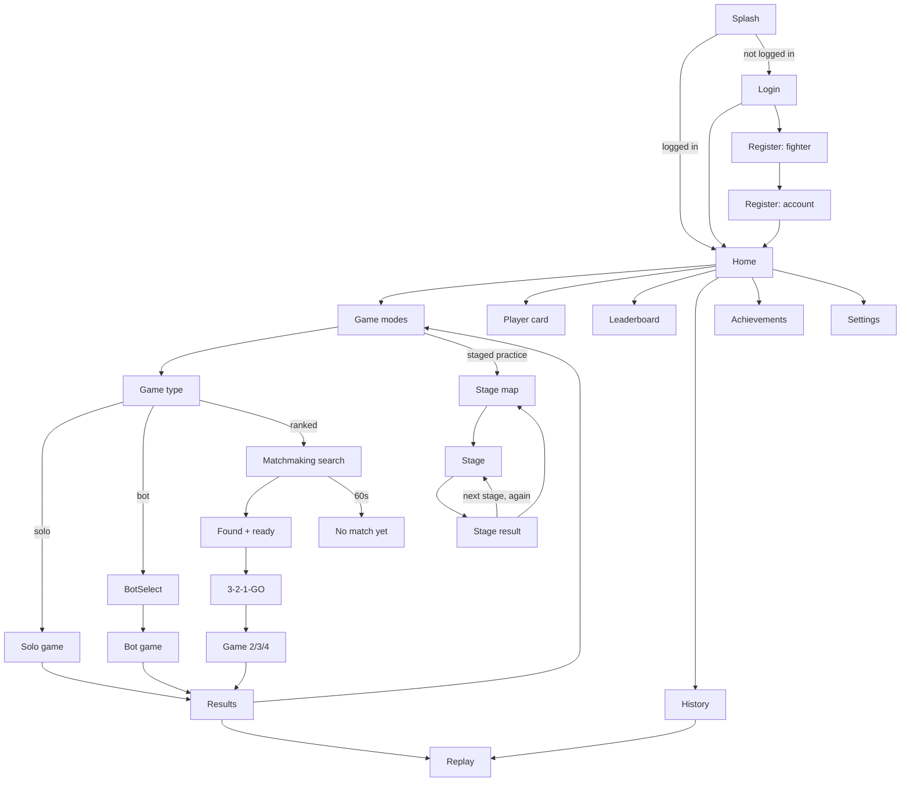

<div dir="rtl">

# סודוקו פייט — אפיון מפורט לגרסה הראשונה (V1)

> **מה המסמך הזה:** אפיון מלא לבנייה, שמבוסס על האפיון המקורי של משה ([00-original-spec-v1.md](00-original-spec-v1.md)).
>
> - **כל דרישה מהאפיון המקורי נשארה**, חוץ משני מקרים:
>   - הצעות שמסומנות **"ממתינה לאישור"**. כל עוד הצעה כזו לא אושרה, בונים לפי המקור.
>   - **דרישות שמשה החליף במפורש, בעצמו.** בטבלה בסעיף 24 הן מסומנות **"✓ החלטת משה"**, ובמקום שלהן במסמך כתובות הדרישה המקורית וההחלטה שמחליפה אותה. בהן בונים לפי ההחלטה, ולא לפי המקור. המקור עצמו (`00-original-spec-v1.md`) לא משתנה:
>     - **D14:** הקנס על טעות (§13, סעיף 6.5).
>     - **D44:** אין הפרעות מול בוט (§10, §20, סעיף 7.2).
>     - **D45:** שיגור הפרעה בשתי הקשות, בלי הגרירה של §16 (סעיף 7.3). **אין לבנות גרירה מחדש.**
>     - **D48:** שש אפשרויות במסך "משחק חדש", במקום "חמש אפשרויות בלבד" של §5. השישית היא "אימון בשלבים" (סעיפים 5.1 ו־5.3).
>     - **D62:** אין כפתור תגובות לשחקן באימון בשלבים, למרות "אפשר יהיה להגיב במהלך המשחק" של §18 (סעיף 8). הבוט עדיין מגיב.
>     - גם האווטרים שלנו במקום חבילה חיצונית (§33) הם החלטה כזו. היא רשומה בסעיף 3.4, ולא בטבלה.
> - במקומות שהאפיון המקורי השאיר פתוחים נקבעה **ברירת מחדל**, כדי שאפשר יהיה להתחיל לבנות. היא מסומנת כך: **[D3]**.
>   כל ההחלטות מרוכזות בטבלה בסעיף 24, ושם גם מאשרים אותן.
>
> **איך לקרוא הפניות:** הסימן §11 מפנה לסעיף 11 ב[אפיון המקורי](00-original-spec-v1.md). "סעיף 6.2", או רק 6.2, מפנה לסעיף במסמך הזה.
>
> - **עיצוב:** https://claude.ai/artifact/Gi5UdFahu2WP7ECR5Z5pon (פרטים ב־[03-DESIGN.md](03-DESIGN.md))
> - **תוכנית עבודה:** [02-WORK-PLAN.md](02-WORK-PLAN.md)
>
> גרסת המסמך: 1.3 (18.10.2026: אימון בשלבים, סעיף 5.3 ו־D48–D65). בהמשך המסמך, **V1.1** פירושו העדכון של המשחק שיגיע אחרי ההשקה.

---

## תוכן עניינים

1. חזון ועקרונות
2. מילון מונחים
3. משתמשים, הרשמה וחשבון
4. מסכים וניווט
5. מצבי משחק וסוגי משחק
6. חוקי המשחק (הליבה)
7. הפרעות
8. תגובות (אימוג'י)
9. בוטים
10. Matchmaking
11. דירוג וליגות
12. סיום משחק ומסך תוצאות
13. צפייה חוזרת (Replay) והסברים לוגיים
14. היסטוריה, טבלת מובילים וכרטיס שחקן
15. Gamification (התקדמות)
16. אופליין, ניתוק וחיבור מחדש
17. ארכיטקטורה טכנית
18. פרוטוקול תקשורת בזמן אמת
19. מודל נתונים
20. מאגר הלוחות
21. אבטחה ומניעת רמאות
22. דרישות לא־פונקציונליות (ביצועים, נגישות, שפות, אנליטיקס)
23. דרישות חנויות (App Store / Google Play)
24. החלטות פתוחות: כאן מאשרים
25. מחוץ להיקף V1
26. רעיונות (§39), לאישור
27. נתוני שימוש ואתר ניהול

---

## 1. חזון ועקרונות

**סודוקו פייט** הוא משחק סודוקו תחרותי. 1–4 שחקנים פותרים **את אותו לוח בדיוק, בזמן אמת**. כל מהלך נכון מזכה בנקודות לפי
הקושי שלו, כל טעות עולה בנקודות, ואפשר להפריע ליריבים. יש דירוג כמו בשחמט, Matchmaking, וצפייה חוזרת שמסבירה כל מהלך.

עקרונות שלא משתנים (מהאפיון המקורי: §2, §36, §40):

- **משחק, לא אפליקציה.** אין Dashboard, אין טבלאות עסקיות, אין מראה של אפליקציית סודוקו בסיסית.
- **Competitive + Fun + Premium + Clear.** החוויה מהירה, תחרותית, ברורה, מצחיקה וממכרת.
- **הלוח תמיד קריא.** אנימציות ואפקטים לא פוגעים בריכוז. החריג: הפרעות, שזה התפקיד שלהן (§15).
- **עיצוב (§2):** שפה גרפית ייחודית, עומק ויזואלי, ומעברים מונפשים בין מסכים. כל שינוי משמעותי במצב המשחק מורגש:
  החלפת מוביל, הפרעה או ניתוק. ניקוד מונפש. מהלך נכון נותן משוב חיובי, וטעות מורגשת. ניצחון מרגיש כמו ניצחון.
  הפרעות מצחיקות, מפתיעות ובולטות. יש תחושת מתח, התקדמות ותגמול.
- **UX (§36):** המשחקיות קודמת למידע משני. פעולות חשובות בולטות. אין עומס. אנימציות קצרות ומדויקות.
  יש Feedback לכל פעולה. מצב המשחק ברור בכל רגע, והמשתמש מבין תוך שניות מה הוא יכול לעשות עכשיו.
- **השרת הוא מקור האמת** בכל משחק מדורג (§26).
- **פתרון סודוקו איכותי והוגן** הוא הליבה.

## 2. מילון מונחים

| מונח | הגדרה |
|---|---|
| לוח | 9×9 משבצות. שורות A–I מלמעלה למטה, עמודות 1–9 משמאל לימין. שם משבצת: אות שורה ואחריה מספר עמודה, למשל **D5**. הלוח מוצג תמיד משמאל לימין, גם בעברית. |
| ריבוע | אחד מתשעת ריבועי ה־3×3, ממוספרים 1–9 משמאל לימין ומלמעלה למטה. |
| רמז (Given) | ספרה שמופיעה בלוח מההתחלה. |
| נעילה (Lock) | בחירת משבצת ריקה. המשבצת שייכת לשחקן שבחר אותה לזמן החשיבה, ואף אחד אחר לא יכול לגעת בה. |
| זמן חשיבה | משך הנעילה לפני שחרור אוטומטי (סעיף 6.2). |
| מהלך | הזנת ספרה במשבצת נעולה. המהלך **נכון** או **שגוי**. |
| בעלות | משבצת שנפתרה נשארת צבועה בצבע של מי שפתר אותה עד סוף המשחק. |
| הפרעה | אפקט של 5 שניות שנשלח על יריב ועולה נקודות (סעיף 7). |
| תגובה | אימוג'י קצר שנשלח במהלך המשחק (סעיף 8). |
| מצב משחק | אחד מששת המצבים במסך "משחק חדש" **[D48]**: מדורג 2, מדורג 3, מדורג 4, מול בוט, לבד, ואימון בשלבים. במנוע אין מצב שביעי: שלב רץ במצב "לבד" או "מול בוט" (סעיף 5.3). |
| סוג משחק | מהיר, רגיל או קשה. |
| אימון בשלבים | מצב האימון של 300 השלבים הקצרים, על מפה (סעיף 5.3). באנגלית Staged practice, ושלב הוא Stage: המילה Level כבר אומרת רמת בוט ורמת XP. |
| שלב | אתגר אחד של אימון בשלבים: משימה אחת של עד 30 שניות, ו־0–3 כוכבים. המזהים L001 עד L300. **לא** "שלב" של Replay (סעיף 13.1, פעולה אחת ביומן), ולא שלב בתוכנית העבודה. |
| פרק | 10 שלבים רצופים על המפה: פרק k הוא השלבים 10k−9 עד 10k. יש 30 פרקים, והשלב העשירי בכל אחד הוא בוס. |
| שער | התנאי לפתיחת פרק: הבוס של הפרק הקודם שוחק, ובפרק הקודם נאספו לפחות 20 מתוך 30 כוכבים. שער שנפתח נשאר פתוח (סעיף 5.3.5). |
| כוכבים | ‏0–3 בכל שלב, לפי ספי הסוג שלו (סעיף 5.3.2). נשמר הטוב ביותר, והוא לא יורד אף פעם. |
| בוס | השלב העשירי בכל פרק: אתגר אחד של עד 30 שניות מסוג קיים (ריבוע, מרוץ או דו־קרב), עם הלוח הקשה של הפרק ובוט מהיר ב־10% (סעיף 5.3.3). |
| מפתח דירוג | המזהה של דירוג מסוים, למשל `normal` (אפשרות B) או `normal-2p` (אפשרות A). |
| מושב (Seat) | מקום השחקן במשחק, 0–3. לכל מושב יש צבע וצורה. |
| "אני" | בכל מכשיר השחקן המקומי מוצג בצבע P1 ובצורת ●. היריבים מקבלים את P2–P4 לפי סדר המושבים. |

## 3. משתמשים, הרשמה וחשבון

### 3.1 פרטי משתמש (§3)
| שדה | חובה | כללים |
|---|---|---|
| שם לתצוגה | כן | 3–16 תווים: אותיות עברית ואנגלית, ספרות, קו תחתון ונקודה. ייחודי, בלי תלות ברישיות. בדיקת זמינות בזמן ההקלדה. סינון מילים פוגעניות. אפשר לשנות פעם ב־30 יום **[D20]**. |
| מדינה | כן | ברירת המחדל מזוהה לפי הגדרות המכשיר, ואפשר לשנות אותה בכל עת **[D21]**. מוצגת כדגל. בבחירה ובתוויות מופיע השם המלא בשפת האפליקציה, מטבלה שלנו (עברית ואנגלית לכל קוד ב־`COUNTRY_CODES`), ולא מהטלפון: למנוע Hermes אין `Intl.DisplayNames`, ובבדיקה הראשונה במכשיר הופיעו רק שתי אותיות. |
| אווטאר | כן | מתוך הקטלוג (סעיף 3.4). |
| מייל | כן | ייחודי. נשלח מייל אימות **[D22]**. בכניסה עם Google (סעיף 3.3): המייל של חשבון Google, שכבר מאומת, ולכן בלי מייל אימות. |
| סיסמה | כן, למי שנרשם עם מייל | **לפחות 8 תווים, ותו לא** (החלטה של משה, 14.10.2026: "זה לא חשבון בנק"): בלי חובה של אות, ספרה, אות גדולה או סימן. מד החוזק עם 4 הדרגות נשאר, ורק ממליץ. ב־Firebase צריך להשאיר את מדיניות הסיסמאות כבויה (Authentication ← Settings ← Password policy), או על מינימום 8 בלבד. |

### 3.2 זרימת הרשמה: "צור את הלוחם שלך"
לפי הרעיון באפיון המקורי, בחירת האווטאר והמדינה היא חוויה ולא טופס.
1. **שלב 1, הלוחם:** שלושה שדות באותו גובה: אווטאר, שם לתצוגה עם בדיקת זמינות, ומדינה.
   - **אווטאר:** ריבוע עם האווטאר שנבחר ושמו, ו"שינוי". הקשה פותחת חלון גבוה עם כל האווטרים ברשת, תחת כותרת לכל סוג (אנשים, חיות, חפצים...). הנבחר מסומן, הקשה על אחר בוחרת וסוגרת, והאווטאר בשדה מחייך ומקפץ.
   - **מדינה:** אותו שדה, עם הדגל והשם המלא. הקשה פותחת רשימה נגללת של כל המדינות, עם דגל ושם מלא, ממוינת לפי השם בשפת האפליקציה, ועם חיפוש (בעברית או באנגלית). החיפוש מוצא שם כפי שמקלדת הטלפון מקלידה אותו: עם ' או " במקום גרש וגרשיים (צ'כיה, ארה"ב) או בלעדיהם, בלי סימנים על אותיות לטיניות (curacao), ובכמה שמות מקובלים נוספים (USA, ‏UK, ‏Turkey, אמריקה, אנגליה).
   - **תצוגה חיה של הכרטיס שלי בלבד**, כמו בשלב 2: בלי VS ובלי יריב, ועם מקום לכל השם. האווטאר שבו "חי" (סעיף 3.4).
   - **החלטה של משה (14.10.2026), אחרי הבדיקה במכשיר:** הבמה הגדולה והרצועה תפסו יותר מדי מקום. הבחירה נשארת חוויה דרך החלון והכרטיס החי.
   - עריכת פרופיל משתמשת באותם שדות.
2. **שלב 2, החשבון:** מייל, סיסמה, אימות סיסמה, ואישור תנאי השימוש ומדיניות הפרטיות.
   - **או "המשך עם Google"** (סעיף 3.3), מעל הטופס: קודם אישור התנאים (התיבה, או חלון קטן כשהיא לא מסומנת), ואז חשבון Google והלוחם משלב 1.
3. בסיום עוברים למסך הבית. הדירוג ההתחלתי הוא 1200 בכל מפתח דירוג **[D23]**.

### 3.3 כניסה וחשבון
- כניסה עם מייל וסיסמה (§3). "שכחתי סיסמה" שולח מייל לאיפוס **[D22]**.
- **כניסה והרשמה עם Google: "המשך עם Google"** (בקשה של משה, 14.10.2026, "וגם פייסבוק ועוד אפשרויות מקובלות").
  - **איפה:** בכניסה ובשלב 2 של ההרשמה, מעל הטופס, ורק בבנייה עם Firebase. ‏ב־Android בלבד בינתיים. במצב פיתוח (בלי Firebase) אין כפתור.
  - **הכפתור:** לפי הנחיות המותג של Google ל־Android: הגרסה הכהה, ה־G הצבעוני בתחילת הכפתור (בעברית מימין), והנוסח "המשך עם Google" / "Continue with Google". באותו גובה של הכפתורים שלנו.
  - **בכניסה:** חשבון Google עם לוחם נכנס לבית. חשבון Google חדש במשחק עובר לשלב 1, כשהוא כבר מחובר, ושם יוצר את הלוחם. לפני שהלוחם נוצר הוא מאשר את התנאים, אלא אם **החשבון הזה** כבר אישר אותם (בשלב 2, רגע לפני בורר החשבונות). האישור שייך לחשבון ולא לטלפון: מי שאישר בטלפון הזה עם חשבון אחר, או בלי שנוצר חשבון, לא אישר בשבילו.
    - בשלב 1 הזה, השלב האחרון של ההרשמה, אין "שלב 1 מתוך 2".
    - **"התנתקות" בשלב 1 מוחקת את הכניסה עם Google**, כשאין לה לוחם ואין לה סיסמה: Firebase שומר את המייל, השם וקישור התמונה מ־Google מרגע הכניסה, עוד לפני אישור התנאים, וכך לא נשאר כלום. Firebase מאפשר את זה רק זמן קצר אחרי הכניסה. אחר כך (האפליקציה נפתחה מחדש על שלב 1) זו התנתקות רגילה, ונשאר דף בקשת המחיקה באתר.
  - **בהרשמה:** אחרי אישור התנאים, חשבון Google והלוחם משלב 1. אם לחשבון הזה כבר יש לוחם, זו כניסה: הולכים לבית, והודעה קצרה אומרת את זה ומציגה את שם הלוחם.
  - **ניסיון אחד בכל פעם:** הקשה שנייה (גם על חלון התנאים בזמן שהוא נסגר) לא פותחת בורר שני ולא יוצרת לוחם פעמיים.
  - **אימות מייל:** חשבון Google מגיע מאומת. אין מסך אימות, ומשחק מדורג מותר (השרת בודק את `email_verified`, ולא את שיטת הכניסה).
  - **חשבון אחד לכל מייל** (ברירת המחדל של Firebase): כניסה עם Google לא יוצרת חשבון שני למייל שכבר יש לו חשבון. או ש־Firebase מכניס לאותו חשבון (אותו uid, אז אותו לוחם ואותם משחקים; למייל של Gmail שלא אומת, Firebase יכול להסיר את הסיסמה, ואז נכנסים מעכשיו עם Google או מאפסים סיסמה), או שהוא מסרב, והאפליקציה אומרת "למייל הזה כבר יש חשבון עם סיסמה". שום מידע לא מתמזג.
    - **מקרה אחד לדעת (השתלטות מוקדמת):** מי שרושם כתובת Gmail שאינה שלו, עם סיסמה, יכול ליצור עליה לוחם ולשחק בלי לאמת אותה **[D22]**. כשבעל הכתובת נכנס אחר כך עם Google, ‏Firebase מסיר את הסיסמה (מי שרשם אותה כבר לא נכנס איתה), אבל הלוחם שעל ה־uid נשאר: בעל הכתובת מגיע ללוחם שלא הוא יצר, עם השם, ההיסטוריה ושעון 30 הימים של שינוי השם. ההודעה בשלב 2 מציגה את שם הלוחם, כדי שזה ייראה. הפתרון היום: הגדרות ← מחיקת חשבון, והרשמה מחדש. **פתוח:** השרת יכול לשמור אם הלוחם נוצר עם מייל לא מאומת, ולהציע לבעל הכתובת "להתחיל מחדש".
  - **הגדרות:** מוצגת שיטת הכניסה (מייל וסיסמה, Google, או שתיהן). מחיקת חשבון של Google מאושרת בבחירה מחדש של חשבון Google, במקום סיסמה, והאפליקציה מבטלת את הגישה שקיבלה מ־Google. לחשבון עם שתיהן יש גם "אישור עם הסיסמה במקום", כי Google יכול להיכשל בטלפון (בלי Play Services, או בגרסה שהמפתח שלה לא ב־Firebase), והמחיקה חייבת לעבוד. התנתקות מנתקת גם מ־Google, כדי שבפעם הבאה יופיע שוב בורר החשבונות.
  - **שגיאת DEVELOPER_ERROR:** הבנייה חתומה במפתח שטביעת האצבע שלו (SHA-1) לא נמצאת ב־Firebase. כל מפתח חתימה חדש (כולל Play App Signing) צריך להיכנס ל־Firebase (`docs/FIREBASE-SETUP.md`). השחקן רואה הודעה פשוטה ("הכניסה עם Google לא זמינה כרגע בגרסה הזו", עם הקוד), ו־Crashlytics מקבל דיווח עם הקוד של Google. כך גם כשל לא ידוע של Google.
  - **מפתח ה־debug הציבורי:** ‏APK של `npm run apk` חתום במפתח ה־debug של התבנית של React Native, שזהה בכל פרויקט. כל עוד ה־SHA-1 שלו רשום ב־Firebase, כל אחד יכול לחתום בו APK עם שם החבילה שלנו ולקבל את הכניסות עם Google שנעשות בו. לכן בנייה לחנות (פרופיל `production` ב־EAS) נכשלת כל עוד `google-services.json` מכיל אותו, ו־APK מהמחשב מציג את הכפתור רק כל עוד הוא רשום.
  - **Facebook:** אחר כך, ממתין למשה ([החלטות פתוחות](DECISIONS-PENDING.md) 3.21). **Sign in with Apple:** חובה ברגע ש־Google מגיע ל־iOS (סעיף 23).
- **מחיקת חשבון מתוך האפליקציה** (חובה ב־App Store, סעיף 23). גם הכניסה ליציאה מהחשבון ולמחיקה נמצאת במסך ההגדרות.
- **הצעה (ממתינה לאישור) [D24]: משחק כאורח.** האפיון המקורי (§3): "שחקן חדש יוצר משתמש".
  ההצעה: אפשר להתאמן לבד ומול בוט בלי חשבון, גם אופליין. משחק מדורג דורש חשבון.
  למה: השחקן מתחיל לשחק מיד, ויותר אנשים יגיעו למשחק הראשון.
  כאורח: בכרטיס הבית כתוב "אורח" ואין דירוג, כרטיסי המשחקים המדורגים עמומים עם הכיתוב "דורש חשבון", וההיסטוריה וה־XP נשמרים במכשיר ועוברים לחשבון בהרשמה.
  **עד שתאושר: הרשמה היא חובה**, ואחריה האימון זמין גם אופליין.

### 3.4 אווטרים (§33)
- **החלטה של משה (12.10.2026):** האווטרים הם שלנו, ולא חבילה חיצונית. זה מחליף את מה שכתוב במקור (§33: "אני אספק תמונות של אווטרים"). משה שינה את זה בעצמו.
- קטלוג V1: ‏101 דמויות מוכנות ומונפשות, שלנו (`packages/avatars`, מדריך הסגנון `docs/avatars/STYLE.md`, דף תצוגה `docs/avatars/preview.html`). אין "בונה אווטאר": בוחרים דמות מוכנה.
  - **ערבוב של אנשים, חיות וחפצים עם פנים:** אנשים, חיות, חפצים מהבית ומהמשרד, אוכל, טבע, יצורים, וכל הספרות וסימני הסודוקו.
  - **לכל דמות:** ‏10 הבעות (רגילה, חיוך, צחוק, קריצה, הפתעה, עצב, בלבול, סחרחורת, כעס, ישנוניות), ‏9 תנועות (מצמוץ, קפיצה, הנהון, הטיה, ניעור, סיבוב, היפוך, מעיכה, נדנוד), ולרובן גם חלק זז משלהן (הטוסט קופץ מהטוסטר, הענן מוריד גשם).
  - **כל התנועות מכבדות הפחתת תנועה.** במצב הזה הפנים משתנות, והדמות לא זזה.
  - הסדר בבורר: לפי סוג, ובתוך הסוג לפי הקטלוג. המזהים הם מילים באנגלית (`noam`, `coffee-cup`), נשמרים עם המשתמש, ולכן לא משנים אותם לעולם. הרשימה בחוזה: `AVATAR_IDS` ב־`packages/protocol`.
- av00 נשאר המזהה של "אין אווטאר" (חשבון שנמחק או חסר): לא נבחר ולא נשמר, והאפליקציה מציירת במקומו צללית אפורה בלי פנים (המראה: ברירת מחדל, ממתינה לאישור של משה, [החלטות פתוחות](DECISIONS-PENDING.md) 3.20).
- **המזהים הישנים** (av01 עד av51, בלי av36) לא נבחרים יותר. לכל אחד יש מחליף קבוע ושונה (`LEGACY_AVATAR_MAP`): מיגרציה 0004 בשרת ממירה את `users.avatar_id`, וכל קריאה של מזהה ממסד הנתונים עוברת דרך `normalizeAvatarId`. הקבצים הישנים (`assets/avatars`) נמחקו מהמאגר ב־13.10.2026, לבקשת משה, ולכן **שאלת הרישיון שלהם ירדה**.
- האווטאר מופיע, כמו קודם, במסך הראשי, בכרטיס השחקן, במשחק (וגם קטן, ‏22 פיקסלים, במשבצת נעולה), ב־Replay, בהיסטוריה, ב־Leaderboard ובמסך הסיום.
- **האווטרים מגיבים למשחק** (ברירת מחדל, ממתינה לאישור של משה: [החלטות פתוחות](DECISIONS-PENDING.md) 3.18). הטבלה היא הגדרה: `AVATAR_REACTIONS` ב־`apps/mobile/src/avatars/reactions.ts`, ושינוי בה לא דורש שינוי בקוד.
  - **תגובה** מתנגנת פעם אחת, על האווטר של מי שזה קרה לו:

    | מה קרה | על מי | הבעה | תנועה | כמה זמן ההבעה נשארת |
    |---|---|---|---|---|
    | מהלך נכון | מי ששיבץ | חיוך | הנהון | ‏1.2 שניות |
    | מהלך נכון שממלא שורה, עמודה או ריבוע, או מניח את התשיעי של ספרה, וכל מהלך נכון חמישי ברצף בלי טעות | מי ששיבץ | צחוק | קפיצה | התנועה |
    | מהלך שגוי | מי שטעה | עצב | ניעור | ‏1.6 שניות |
    | הפרעה | היעד | סחרחורת | נדנוד, שוב ושוב עד שההפרעה נגמרת | התנועה |
    | הפרעה | השולח | קריצה | בלי | ‏1.5 שניות |
    | תגובה 😂 · 😱 · 😎 · 🤦 · 🔥 · 👀 | השולח | צחוק · הפתעה · קריצה · בלבול · צחוק · הפתעה | קפיצה · מעיכה · הטיה · הנהון · סיבוב · הטיה | התנועה |
    | כניעה, נטישה | מי שיצא | עצב | בלי | ‏1.5 שניות |
    | ניתוק | | אין תגובה: הכרטיס כבר אפור | | |
    | חזרה מניתוק | מי שחזר | חיוך | בלי | ‏1.5 שניות |
    | סוף המשחק: מקום 1 לבד | המנצח | צחוק | סיבוב | התנועה |
    | סוף המשחק: מקום 1 עם עוד שחקן | כל מי שבמקום 1 | חיוך | בלי | ‏1.5 שניות |
    | סוף המשחק: מאחור, או יצא | כל השאר | עצב | בלי | ‏1.5 שניות |
    | לפני משחק (VS, טעינת החדר): שחקן נהיה "מוכן" | השחקן | חיוך | הנהון | התנועה |

  - **מצב רוח:** ההבעה שנשארת בין התגובות, כל עוד הסיבה קיימת. תחת הפרעה: סחרחורת. נכנע או נטש: עצב. בסוף המשחק: מנצח ותיקו חיוך, מפסיד עצב. לפני משחק (VS, ‏3-2-1, החדר): חיוך. **‏20 שניות בלי פעולה שלי במשחק שרץ: ישנוניות**, רק אצלי, עד הפעולה הבאה שלי (גם פעולה שנדחתה, כמו לחיצה על משבצת תפוסה). בכל זמן אחר: הבעה רגילה. באנר ההפרעה מראה את השולח קורץ, ובארסנל היעד מופתע.
  - **כשתגובות נפגשות על אותו אווטר:** סוף המשחק, ואחריו כניעה ונטישה, הפרעה (יעד), שליחת הפרעה, טעות, מהלך נכון, חזרה מניתוק ותגובת אימוג'י. תגובה חזקה יותר קוטעת מיד. חלשה יותר לא קוטעת תגובה חזקה שעוד מתנגנת. ותגובה באותה עוצמה מתחילה רק ‏0.6 שניות אחרי הקודמת. מה שלא נכנס נזרק, ואין תור.
  - **Replay:** כל שלב מנגן את התגובה של מי שפעל בו (החזקה מביניהן), כשהצפייה עומדת על השלב ‏0.2 שניות. גרירה על ציר הזמן מנגנת רק את השלב שבו היא נעצרת, ולא את מה שעברה בדרך. מעבר לשלב אחר עוצר מיד את התגובה של השלב הקודם, וחזרה לשלב מנגנת אותו שוב.
  - **מסך התוצאות:** כשהשורה של השחקנים נוחתת, המנצח צוחק ומסתובב, וממשיך לזוז במקום. מי שמאחור עצוב, ותיקו מחייך.
  - **"חי" כשלא קורה כלום** (מצמוץ, ובגודל 48 ומעלה גם החלק הזז של הדמות, בלולאה): רק במנצח במסך התוצאות ובכרטיס שלי בשלב 1 של ההרשמה (מאז 14.10.2026; הרשת בחלון הבחירה עומדת), ורק כשהמסך מוצג. בשאר המקומות האווטר עומד בין התגובות (ברירת מחדל, ממתינה לאישור של משה: [החלטות פתוחות](DECISIONS-PENDING.md) 3.19; ההגדרה: `AVATAR_STAGES`).
  - **הפחתת תנועה:** רק ההבעה משתנה, לאותו זמן. שום אווטר לא זז.
- פתיחת אווטרים נוספים לפי רמה: התשתית נבנית ב־V1 (שדה `unlockLevel`, בלי שינוי), והתוכן מגיע ב־V1.1.

### 3.5 דיווח על שחקן וחסימה (הנחיה 1.2 של Apple, ומדיניות ה־UGC של Google Play)
**החלטה של משה (12.10.2026, אפשרות א ב־[UGC-PROPOSAL](store/UGC-PROPOSAL.md), [החלטות פתוחות](DECISIONS-PENDING.md) 1.2).** זו תוספת: שום דרישה מהאפיון המקורי לא הוסרה. היא משנה רק את "לצפייה בלבד" של אתר הניהול (סעיף 27.3), באישורו.
השם לתצוגה הוא תוכן שמשתמשים יוצרים, ולכן צריך סינון (יש: סעיף 3.1), דיווח, חסימה ומענה. החוזה: `packages/protocol/src/moderation.ts`. השרת: `apps/server/src/moderation`.
- **"דווח על שחקן":** בכרטיס השחקן (`/player/[id]`) ובתפריט של כרטיס היריב במשחק (אותו תפריט של "השתק", [D19]).
  - **3 סיבות, בלי טקסט חופשי:** "שם פוגעני", ‏"רמאות", ‏"אחר" (`offensiveName`, ‏`cheating`, ‏`other`). כך דיווח לא יוצר תוכן חדש.
  - **אחרי השליחה:** "תודה. נבדוק את הדיווח תוך 48 שעות". ההתחייבות ל־48 שעות כתובה גם בתנאי השימוש.
  - **בשרת:** ‏`POST /v1/reports` ‏`{ playerId, reason, gameId? }`. רק על חשבון אחר וקיים. דיווח אחד פתוח לכל מדווח, שחקן וסיבה: אותו דיווח שוב, כשהוא עוד פתוח, מקבל `duplicate` (והאפליקציה מציגה את אותה תודה). גם אותו דיווח שמנהל **דחה** ב־7 הימים האחרונים מקבל `duplicate` (`DISMISSED_REPORT_COOLDOWN_DAYS`), כדי שלא יחזירו שחקן לתור מיד אחרי שנבדק. עד 10 דיווחים בשעה לחשבון (`rateLimited`). `gameId` נשמר רק כשהוא משחק מדורג ששניהם שיחקו בו.
  - **`gameId` נשלח** מתפריט הכרטיס במשחק, ומכרטיס שנפתח ממסך התוצאות או מכרטיס ההיסטוריה של משחק מדורג (`/player/[id]?gameId=`).
  - השחקן שדווח לא יודע מי דיווח עליו. אנליטיקס: `report_sent{reason}` בלבד, בלי מזהים.
- **"חסום שחקן":** באותם מקומות, ליד "דווח". ביטול: הגדרות ← "שחקנים חסומים". עד 100 חסימות לחשבון.
  - **Matchmaking לא מצמיד אותם לאותו משחק,** בשני הכיוונים, ב־2, 3 ו־4 שחקנים (סעיף 10). שחקן חסום לא נספר כ"יריב זמין" באיפוס 80% של היריבים החוזרים, ולכן חסימה לא תוקעת חיפוש.
  - **אם בכל זאת נפגשים** (משחק שהתחיל לפני החסימה, או חסימה מתוך המשחק): התגובות של החסום מגיעות לחוסם מושתקות. השרת שולח אותן בלי האימוג׳י (`MUTED_REACTION_EMOJI`), כך שרצף האירועים נשאר שלם.
  - **לא מסתירים אף אחד מטבלת המובילים.** היא ציבורית, ושם פוגעני מטופל בדיווח.
  - אף אחד לא מקבל הודעה שנחסם.
- **טיפול בדיווחים (אתר הניהול, סעיף 27.3):** דף "דיווחים" לפי סטטוס (פתוח, טופל, נדחה), מקובץ לפי השחקן שדווח, עם מספר הדיווחים לכל סיבה, המדווחים ותאריכים. **הסדר: קודם מי שדיווחו עליו הכי הרבה חשבונות שונים** (חשבון אחד עם 3 סיבות נספר פעם אחת), ואחר כך מספר הדיווחים. תג "מחכה יותר מ־48 שעות" לפי הדיווח הפתוח הכי ישן, גם כשהוא לא בין 50 הדיווחים שמוצגים. פעולות, כל אחת עם אישור באתר, ונרשמת ביומן (`admin_audit`) עם הכתובת של המנהל:
  - **רק בכניסה עם Google:** כששרת מציע כניסה עם Google, כניסה בסיסמה רואה את הדפים אבל לא מבצעת פעולות (`googleRequired`): הסיסמה משותפת, והיומן לא היה יודע מי פעל. בשרת עם סיסמה בלבד (פיתוח) הסיסמה פועלת, ונרשמת כ־`password`.
  - **"טופל" / "נדחה"** לדיווח פתוח.
  - **"איפוס שם":** השם מוחלף בשם זמני וייחודי (למשל `שחקן48213`, שעובר את סינון המילים), והשחקן מתבקש לבחור שם חדש (`Me.nameResetRequired`). כלל "פעם ב־30 יום" לא חל על הבחירה הזו. השם הישן יוצא גם מהיומנים של המשחקים שלו (ה־Replay של היריבים), גם של משחק שהתחיל רגע לפני האיפוס ונשמר אחריו.
    - **השם הישן "פורש" (`retired_names`):** אף אחד לא יכול לבחור אותו שוב, גם לא אותו שחקן. בדיקת השם, ההרשמה והשינוי מחזירים `blocked`, כמו מילה אסורה. כך הבחירה החופשית לא מחזירה אותו מיד.
    - **בינתיים** (עד שנבחר שם): אפשר להתאמן (גם בלי חיבור, סעיף 16.1) ולהיכנס להגדרות (שם גם מוחקים את החשבון). כל השאר מוביל חזרה ל־"בחר שם חדש".
  - **"השעיית חשבון"** ו**"ביטול השעיה":** חשבון מושעה לא נכנס למשחק מדורג (התור וחדרי המשחק מחזירים `suspended`) ולא משנה את החשבון (`PATCH /v1/me` מחזיר `suspended`; בכרטיס השחקן אין "עריכה", ו־`/edit-profile` מציג את מסך ההשעיה). ‏`GET /v1/me` ומחיקת החשבון עובדים. אפשר לחסום ולבטל חסימה גם בהשעיה. ביטול ההשעיה מחזיר הכל.
    - **מחיקה לא מבטלת השעיה:** כשחשבון מושעה נמחק, נשמרות טביעות חד־כיווניות (SHA-256) של ה־uid ושל המייל המאומת שלו (`suspended_sign_ins`), בלי ה־uid והמייל עצמם. חשבון חדש עם אותה כניסה (Firebase נותן uid חדש, אז המייל הוא מה שמזהה) מתחיל מושעה, וביומן נרשמת השעיה של `system` עם `previousUserId`, הקישור לחשבון שנמחק. מדיניות הפרטיות אומרת את זה (אינטרס לגיטימי של משחק הוגן).
- **מחיקת חשבון:** החסימות שלו נמחקות (לשני הכיוונים), דיווחים פתוחים עליו נסגרים כ"נדחה" על ידי `system`, הדיווחים ששלח נשארים (מהשורה האנונימית), ומהיומן נמחקים השמות שלו.

## 4. מסכים וניווט

### 4.1 רשימת המסכים (§37) ושמם בקנבס העיצוב
**שם הקובץ** הוא השם שמשתמשים בו במסמכים ומול Claude. **הכותרת בקנבס** היא הכותרת באנגלית שמופיעה מעל כל מסך.

| # | מסך | שם הקובץ | הכותרת בקנבס |
|---|---|---|---|
| — | מערכת עיצוב | DS-Foundations, DS-Components, DS-Motion | Design System · Foundations / Components / Motion & Feedback |
| 1 | פתיחה | Splash | Splash |
| 2 | התחברות | Login | Login |
| 3 | הרשמה: לוחם | Register-Fighter | Register · Create your fighter |
| 4 | הרשמה: חשבון | Register-Account | Register · Account |
| 5 | בית | Home, Home-EN | Home, Home · English (LTR) |
| 6 | כרטיס שחקן | Profile | Player card |
| 7 | מצבי משחק (6 אפשרויות, D48) | Modes-Levels (היום), Modes (5 אפשרויות, לפני D48) | Game modes · 6 options, with staged practice (D48) / Game modes (5 options, before D48: see Modes-Levels) |
| 8 | סוג משחק | GameType | Game type |
| 9 | בחירת בוט | BotSelect | Bot selection |
| 10 | Matchmaking | Match-Search, Match-Found, Match-Countdown, Match-Timeout | Matchmaking · Searching / Found & Ready / 3-2-1-GO / No match yet |
| 11 | משחק 2 שחקנים | Game-2P, Game-2P-EN, Game-2P-Correct, Game-2P-Wrong | Game · 2 players (playable) / English / Correct move / Wrong move |
| 12 | משחק 3 שחקנים | Game-3P | Game · 3 players |
| 13 | משחק 4 שחקנים | Game-4P | Game · 4 players |
| 14 | אימון לבד | Game-Solo | Solo practice |
| 15 | אימון מול בוט | Game-Bot | Practice vs bot |
| 16 | הפרעות | Arsenal, Interference-Target, Hit-Fireworks, Hit-Cats, Hit-Warp, Interferences | Interference · … / Hit · … / Interferences collection |
| 17 | תגובות | Reactions | Reactions |
| 18 | אישור כניעה | Surrender | Surrender confirmation |
| 19 | תוצאות | Results-Victory, Results-Defeat, Results-4P | Results · Victory / Defeat / 4-player ranking |
| 20 | צפייה חוזרת | Replay | Replay with explanations |
| 21 | היסטוריה | History, History-Empty | Game history / Game history · Empty |
| 22 | טבלת מובילים | Leaderboard | Leaderboard |
| 23 | הישגים והתקדמות | Progress | Achievements & progress |
| 24 | אין אינטרנט | Offline | Offline · before a game |
| 25 | ניתוק | Opponent-Reconnecting, Self-Reconnecting, Opponent-Left | Opponent reconnecting · 15 / My connection lost / Opponent abandoned |
| 26 | שגיאת חיבור | Connection-Error | Connection error |
| 27 | טעינה | Loading | Loading states |
| 28 | אימון בשלבים: המפה, מצבי הצומת והפאנל בתחתית (סעיף 5.3.5) | Levels-Map | Staged practice · Stage map |
| 29 | אימון בשלבים: שער פרק (גיליון) | Levels-Gate | Staged practice · Chapter gate (20 stars) |
| 30 | אימון בשלבים: תוצאת שלב (סעיף 12) | Level-Result | Staged practice · Stage result |
| 31 | שלב: "איפה ה־7?" (סוג 1) | Lv-Find | Stage · Find the digit (kind 1) |
| 32 | שלב: מרוץ מול הבוט (סוג 2) | Lv-Race | Stage · Race the bot (kind 2) |
| 33 | שלב: מלא את הריבוע (סוג 3) | Lv-Box | Stage · Fill the box (kind 3) |
| 34 | שלב: דו־קרב ל־30 (סוג 4) | Lv-Sprint | Stage · Duel to 30 (kind 4) |
| 35 | שלב: מצא את הטעות | Lv-SpotError | Stage · Spot the mistake |
| 36 | שלב: צייד הנקודות | Lv-PointHunter | Stage · Point hunter |
| 37 | שלב: שרשרת | Lv-Chain | Stage · Chain |
| — | חלופה לבחינה: משחק בתורות | Game-2P-Turns | Game · Turn-based variant |

**מסכים שחסרים בעיצוב ויתווספו ב־V1:**
- **הגדרות:** צליל, רטט, שפה, הפחתת תנועה, יציאה, מחיקת חשבון.
- **שכחתי סיסמה, עריכת פרופיל, וניצחון בנטישה** (וריאנט של מסך התוצאות).
- **מצבים ריקים (§38):** טבלת מובילים בלשונית חברים, הישגים לפני שהושג משהו.
- **מצבי שגיאה (§38):** התחברות (סיסמה שגויה, מייל לא מאומת), הרשמה, ו־Matchmaking.
- **דיווח וחסימה (סעיף 3.5):** גיליון "דווח על שחקן" (3 סיבות, ותודה עם 48 שעות) ואישור "חסום שחקן", בכרטיס השחקן ובתפריט של כרטיס היריב במשחק מדורג; "שחקנים חסומים" בהגדרות (`/blocked-players`); "בחר שם חדש" אחרי איפוס שם, שהאפליקציה לא יוצאת ממנו עד שנבחר שם (`/choose-name`); ו"החשבון מושעה" (`/account-suspended`, עם באנר בבית, והמדורג חסום עם הסיבה).
- **גרסה:** בתחתית ההגדרות ומסך הכניסה, "גרסה 1.0.0" ומתחתיה "build ‎a1b2c3d · staging" (`docs/BUILD-APK.md`, "גרסה").
- **הפרעות, אחרי ההחלטות של משה מ־17.10.2026 (סעיף 7, D44–D47):**
  - Arsenal ו־Interference-Target עדיין מציירים את הגרירה הישנה. מאז D45 אין גרירה, והמימוש לפי `docs/design/components.md` (סעיפים 8.1 ו־13). המסך Interference-Drag נמחק.
  - גם בלוחות אחרים יש שאריות של הגרירה, והן ישנות: ב־Interferences האריח "גרירה · בלבד, אל כרטיס היריב" והרמז בתחתית ("הקש על הברק בכרטיס היריב וגרור"); ב־Splash הטיפ "הפרעה שולחים בגרירה"; ב־DS-Components וב־DS-Motion הדגימות של הגרירה; וב־DS-Foundations "יעד גרירה" בהסבר על הזוהר. באפליקציה הנוסח הוא שתי הקשות. בקנבס הכותרות של כל הלוחות האלה מסומנות "old".
  - אין לוח לכפתור "הפרעה", לחלון ההפרעות החדש, להחשכת הלוח (D46) ולשלושת הסוגים החדשים (D47): מספרים מתערבלים, דיו ומקלדת מתערבלת.
  - ב־Game-Bot יש הפרעה בכרטיס הבוט. מאז D44 אין.
- **אימון בשלבים (סעיף 5.3, D48–D65):** הלוחות של השלבים הם השורות 28–37 בטבלה, ו־Modes-Levels בשורה 7. הם הועתקו מהקנבס של השלבים (`docs/handoff/2026-10-15/staged-practice/project/`) לשמות חדשים, כי Main ו־Modes כבר תפוסים (פירוט ב־[03-DESIGN.md](03-DESIGN.md)).
  - **אין לוח ל:** פתיחת שלב (התוכן שלה נמצא בפאנל הקבוע של Levels-Map), "מוכן?" של הכניסה המהירה, רשימת הפרקים, הבוס בתוך שלב (האווטר עם כתר וצ'יפ "בוס"), "פרק חדש נפתח", "איך משחקים" (3 תמונות לכל סוג), דיאלוג היציאה ("לצאת מהשלב?"), תוצאה עם 0 כוכבים, הספירה 3, 2, 1 מעל לוח מכוסה בחזרה מהרקע (D65), השורה בכרטיס השחקן, וכל הגרסאות באנגלית.
  - **החלטת משה (18.10.2026):** בונים אותם מה־tokens של כיוון C ומהבריף (`docs/handoff/2026-10-15/staged-practice/brief.md`), ומשה בודק אותם במכשיר. הרכיבים: `docs/design/components.md` סעיף 19.

### 4.2 מפת ניווט

> כדי לראות את התרשים ב־VS Code צריך את התוסף **Markdown Preview Mermaid Support** (‏`bierner.markdown-mermaid`). ב־GitHub הוא מוצג אוטומטית.

<div dir="ltr">



</div>

- בניווט התחתון של מסכי הבית יש ארבעה פריטים: **בית · טבלת מובילים · היסטוריה · הישגים**. לכרטיס השחקן נכנסים בלחיצה על הכרטיס במסך הבית.
- **אימון בשלבים (סעיף 5.3):** משחק חדש ← המפה ← שלב ← תוצאה ← המפה. "לשלב הבא" ו"שוב" עוברים מהתוצאה לשלב, דרך "מוכן?" (או "איך משחקים", לפני השלב הראשון של סוג חדש). התוצאה היא מצב בתוך מסך השלב, ולא מסך או חלון חדשים (סעיף 12), וחזרה למפה רק אחרי שכל חלון נסגר.
- אם D24 תאושר, יתווסף מסלול נוסף: מ־Login, "המשך כאורח", למסך הבית במצב אורח.

### 4.3 מסך הבית (§4)
- הוא מרגיש כמו מסך הבית של משחק, לא כמו Dashboard.
- **בראש המסך: כרטיס השחקן.** אווטאר, שם, דגל ומדינה, ליגה, דירוג, ונתונים מרכזיים (משחקים, אחוז ניצחונות, רצף).
  בדירוג מוצגים כל הדירוגים של השחקן: 3 באפשרות B, או בקיצור באפשרות A.
  דירוג זמני: התג "זמני" קטן, **מתחת למספר** ולא לידו, כדי שלא ידחוק את המספרים (הבדיקה במכשיר, 14.10.2026).
- **אחרי משחק מדורג, הכרטיס מתעדכן בלי להפעיל מחדש** (בקשת משה אחרי הבדיקה של 1.0.0, 15.10.2026):
  - הדירוג החדש מופיע **מיד בסוף המשחק**. המספר הוא התוצאה שהשרת חישב, אותו מספר שמסך התוצאות מציג.
  - ברקע האפליקציה קוראת את הפרופיל מהשרת, עד שהמשחק נספר בו (בדרך כלל תוך שניות). אז מתעדכנים גם הרמה, ה־XP, הליגה והנתונים (משחקים, אחוז ניצחונות, רצף).
  - זה קורה בכל דרך יציאה מהתוצאות: "לבית", "משחק חדש", Back של Android, החלקה ב־iOS, ויציאה מהאפליקציה לרקע.
  - יציאה ממשחק רץ של 2 שחקנים: ההפסד בנטישה נשמר אחרי זמן החסד, והאפליקציה קוראת אותו אז. ב־3–4 שחקנים המשחק נשמר רק כשהוא נגמר לכולם, והבית קורא אותו בכניסה הבאה.
  - השרת הוא הסמכות: אם לא שמר את המשחק תוך 2 דקות, מוצג הערך של השרת.
  - הבית, וגם חזרה לאפליקציה מהרקע, קוראים את הפרופיל מהשרת לכל היותר פעם ב־30 שניות, ומיד אם הוא נטען מהטלפון.
  - הזמנים הם הגדרות ב־`accountConfig.refresh` (`apps/mobile/src/config/account.ts`).
- **מתחת לכרטיס: אפשרויות המשחק.** כפתור "שחק" גדול, שמוביל למסך משחק חדש, ושורת "עוד סיבוב" עם ההגדרה האחרונה.
- משחקים אחרונים בקצרה, וניווט תחתון.

## 5. מצבי משחק וסוגי משחק

### 5.1 ששת מצבי המשחק (§5): במסך "משחק חדש" מוצגות שש אפשרויות [D48]
| מצב | שחקנים | דירוג | אינטרנט | שמירה ו־Replay |
|---|---|---|---|---|
| אימון לבד · לוח מלא | 1 | לא | לא נדרש | נשמר במכשיר **[D25]** |
| אימון מול בוט | 1 + בוט | לא | לא נדרש | נשמר במכשיר **[D25]** |
| מדורג · 2 שחקנים | 2 | כן | נדרש | בשרת |
| מדורג · 3 שחקנים | 3, כולם נגד כולם | כן | נדרש | בשרת |
| מדורג · 4 שחקנים | 4, כולם נגד כולם | כן | נדרש | בשרת |
| אימון בשלבים (סעיף 5.3) | 1, או 1 + בוט | לא | לא נדרש | רק הכוכבים: במכשיר, ומסונכרנים לחשבון **[D57]**. בלי שמירת משחק ובלי Replay **[D58]** |

- **ההחלטה של משה: שש אפשרויות [D48]**
  - **הדרישה המקורית (§5):** "במסך "משחק חדש" יוצגו חמש אפשרויות בלבד."
  - **ההחלטה:** שש אפשרויות. השישית היא "אימון בשלבים" (סעיף 5.3), אחרי "אימון לבד · לוח מלא".
    - ב"אימון לבד" משתנה רק השם בשורה. החוקים שלו לא משתנים, ובהיסטוריה ובתוצאות הוא נשאר "אימון לבד".
  - **למה:** משה ביקש במפורש ("תוספת 1", 15.10.2026), ואישר את התוכנית ב־18.10.2026. המקור (`00-original-spec-v1.md`) לא משתנה.
- **הסדר במסך (בדיקת המכשיר של משה, 15.10.2026):** מדורג 2, ‏3 ו־4 שחקנים, ואחריהם אימון מול בוט, אימון לבד · לוח מלא, ואימון בשלבים. **כל אפשרות בשורה משלה**, גם מדורג 3 ו־4.
  - **השורות קומפקטיות:** כותרת 18 במקום 22, וריווח קטן יותר. בטלפון של 360×780dp עם כפתורי ניווט נכנסות **שש שורות** והשורה התחתונה, בלי גלילה, בעברית ובאנגלית (הבדיקה: `ModesAndGameType.test.tsx`). בגופן גדול המסך נגלל. הגיבוי, אם לא נכנס: להסיר את השורה התחתונה ([החלטות פתוחות](DECISIONS-PENDING.md) 3.23, אפשרות ד).
  - **השורה "אימון בשלבים":** אריח קטן של סודוקו עם מספר השלב, "שלבים של חצי דקה · עד 3 כוכבים", צ'יפ "שלב 14 · ★ 29" ו"עובד גם בלי אינטרנט". אצל שחקן חדש: "300 שלבים קצרים · 0–3 כוכבים". אין לה תגית "דורש חיבור". באנגלית: "30-second stages · up to 3 stars".
  - **אימון מול בוט:** רובוט בצבע P2 (היריב היחיד), במסגרת P2 בגודל האווטר שלי בשורת האימון לבד.

### 5.2 סוגי משחק (§6)
| | מהיר | רגיל | קשה |
|---|---|---|---|
| קושי הלוח | קל: נפתר רק עם "בודד גלוי" | בינוני: דורש "בודד נסתר" | קשה: דורש זוגות או צמצומים |
| ספרות גלויות בפתיחה [D43] | 45–50 | 35–40 | כמו שהיה: 22–29 (לא משתנה) |
| זמן חשיבה לנעילה | 8 שניות | 12 שניות | 18 שניות |
| משך משוער (2 שחקנים) | 4–6 דקות | 6–9 דקות | 9–14 דקות |

- ברירת המחדל היא ש"סוג משחק" משלב **גם** את קושי הלוח (כמה ספרות גלויות בפתיחה, וגם איזו טכניקה הלוח דורש) **וגם** את קצב הזמן **[D5, D43]**.
- **מספר הגלויים בפתיחה (החלטת משה, 2026-10-15) [D43]:** לוח "מהיר" נפתח עם 45–50 ספרות גלויות, ולוח "רגיל" עם 35–40.
  - **לוחות "קשה" נשארים בדיוק כמו שהיו** (22–29 גלויים), לבקשת משה.
  - ללוח מהיר או רגיל שחסרות בו ספרות גלויות מוסיפים ספרות **מהפתרון שלו**. הבחירה אקראית, עם seed קבוע לכל לוח, ולכן כל הרצה נותנת את אותו מאגר.
  - **איזון בין הספרות:** כל ספרה גלויה חדשה הולכת לספרה שיש לה הכי מעט גלויים, ובתוכה לריבוע הריק ביותר. כך כל תשע הספרות מופיעות, ואף אחת לא בולטת: הפער בין הספרה הנפוצה לנדירה הוא לכל היותר 2 ב"מהיר" ו־3 ב"רגיל".
  - **הטכניקה לא משתנה:** לא מוסיפים ספרה שהייתה הופכת את הלוח לקל מהסוג שלו. לוח "רגיל" עדיין דורש "בודד נסתר".
  - ספרה גלויה שתואמת לפתרון לא יוצרת פתרון שני, ולכן ללוח נשאר פתרון יחיד.
  - הטווחים הם הגדרה במנוע (`DEFAULT_GIVENS`). אפשר לשנות אותם, או לתת טווח גם ל"קשה".
- סוגי המשחק חלים גם על אימון לבד ועל אימון מול בוט.
- **באימון בשלבים** (סעיף 5.3) הפרק בוחר את סוג הלוח, ומספר המשבצות המלאות נשאר **בטווח של D43** לסוג: מהיר 45–50, רגיל 35–40, קשה 22–29.
  - זה חל בדו־קרב, בסוגים 1–2, בצייד הנקודות ובשרשרת. לכן במערכה 3, שבתוכנית כתוב בה "רגיל ‏38→33", נבנה ‏38→35, ובמערכה 4, "קשה ‏30→27", נבנה ‏29→27. בדו־קרב סוג הלוח קובע גם את זמן החשיבה לנעילה, כמו בטבלה למעלה.
  - בריבוע ובמצא את הטעות הלוח לא קובע זמן נעילה, ושם נשארים המספרים של התוכנית (למשל 72 ספרות מסביב לריבוע בפרק 1).

### 5.3 אימון בשלבים [D48–D65]
**מה זה:** מצב אימון של **300 שלבים קצרים על מפה**, עם 0–3 כוכבים בכל שלב. זו "תוספת 1" של משה (15.10.2026), עם ההחלטות שלו מ־17.10.2026 (עד 30 שניות, ואין הפרעות) ומ־18.10.2026 (אישור התוכנית, D62, D64 ו־D65). זה המצב השישי במסך "משחק חדש" [D48], והוא לא משנה אף מצב קיים.
- **המקורות:** התוכנית (`docs/handoff/2026-10-15/staged-practice/plan.md`) ותוכנית הפיתוח (`dev-plan.md` באותה תיקייה). כאן הכללים שבונים. **המספרים עצמם** (ספים, לוחות, בוט וקצב לכל פרק) נמצאים ב־`packages/engine/src/levels/levels.config.ts`, ובדיקה (`levels.config.test.ts`) מקבעת אותם מול התוכנית.
- **כל החלטה שעדיין ☐** (D50–D61, D63) בנויה לפי ברירת המחדל, כהגדרה שהקוד באמת קורא, עם בדיקה שמחליפה את הערך שלה.

#### 5.3.1 עקרונות
1. **קצר וממוקד:** כל שלב הוא משימה אחת של **עד 30 שניות** (`LEVEL_RULES.levelMaxMs`) **[D49]**. הקושי עולה מהמהירות ומההיגיון: הסף ל־★★★ מתקצר, היעד דורש טכניקה קשה יותר, ויש פחות ספרות בלוח. לא מוסיפים משימות.
2. **אין הפרעות בכלל [D49]:** לא בשלבים בלי בוט, לא מול הבוט, ולא בבוס. אין כפתור "הפרעה" ואין באנר הפרעה (סעיף 7.2).
3. **אותו מנוע ואותם חוקים:** ניקוד (סעיף 6.4), קנס על טעות (סעיף 6.5), נעילות (סעיף 6.2) ובוטים (סעיף 9).
   - **במנוע אין מצב משחק חדש:** שלב רץ במצב `solo` (בלי בוט) או `bot`, עם השדה `level`. בשני המצבים האלה כבר אין הפרעות [D44].
   - **כל הגדרה חדשה ב־`rules` אופציונלית, ולא קיימת ב־`defaultRules`.** משחק מדורג, אימון לבד ואימון מול בוט לא משתנים, ובדיקה מקבעת אותם בבייט (סעיף 17.2).
4. **הוגן:** כל יעד נפתר בהיגיון בלבד, בטכניקות של הפרק. אין שלב שדורש ניחוש. אחרי כל שלב מוצג "למה?", מאותו מנוע הסברים של ה־Replay (סעיף 13.2).
5. **קבוע מראש:** כל שלב נבנה פעם אחת, עם seed, ונשמר בקובץ נתונים קפוא (סעיף 5.3.9). הניסיון הראשון בכל שלב הוא תמיד הלוח השמור, ו"שוב" משחק לוח שקול (D63, סעיף 20).
6. **אף לוח לא בא מהמאגר המדורג** (סעיף 20). הפתרון של השלבים נמצא באפליקציה, וזה בסדר: זה אימון.
7. **אין לוגיקת משחק בממשק:** מה נחשב טעות, מתי השלב נגמר, כמה כוכבים, איזה מדד טוב יותר ומה נחשב "שוחק": הכל במנוע. המסכים מקבלים `GameView` ומציגים (סעיף 17.2).
8. **כללי התצוגה של כל האפליקציה:**
   - הלוח והמקלדת תמיד משמאל לימין, ומשבצת נקראת כמו D5.
   - אני ב־P1 עם ●, והבוט ב־P2 עם ▲.
   - כל טקסט דרך `t()`, בעברית ובאנגלית (מרחב התרגום `levels`; באנגלית Stage, ולא Level).
   - מספר עם סימן (‎+5 ש׳, ‏‎−6) עטוף בתווי בידוד.
   - כל אנימציה מכבדת הפחתת תנועה (`docs/design/motion.md` סעיף 4.11).
9. **תגובות [D62]:** אין כפתור תגובות לשחקן בשלבים. הבוט עדיין מגיב (סעיף 9), והבעות הפנים של האווטרים נשארות (סעיף 3.4). הרישום מול §18: סעיף 8.

#### 5.3.2 הסוגים והספים
שבעה סוגים (`LevelKind`), כל אחד עם מסך משלו (סעיף 4.1, שורות 31–37). סוג 1, סוג 2 ומצא את הטעות הם **סוגי הקשה**, בלי מקלדת. הספים הם ברירת המחדל **[D52]**.

| סוג | המשימה | סוף השלב | כוכבים | טעות | בוט |
|---|---|---|---|---|---|
| **1 · "איפה ה־7?"** (`find`) | ספרה ואזור (ריבוע, שורה, עמודה או כל הלוח). מקישים על המשבצת שבה הספרה חייבת להיות. מציאה אחת | המציאה, הקשה שגויה שנייה, או 20 ש׳. בשני האחרונים התשובה מוצגת, ו־0 כוכבים | ★★★ עד 5 ש׳ (מפרק 11 עד 4, ומפרק 26 עד 3) · ★★ עד 10 · ★ עד 20 | הקשה שגויה: ‎+5 ש׳. השנייה מסיימת (הסיבה `failed`) | אין |
| **2 · "מרוץ מול הבוט"** (`findDuel`) | ‏5 מקומות ברצף **[D53]**, כל אחד כמו בסוג 1. מי שמקיש ראשון על המקום הנכון לוקח אותו | כל 5 המקומות נלקחו, או 30 ש׳. מקום שלא נלקח עד אז לא שלי | לפי המקומות שלי: ★★★ ‏4–5 · ★★ ‏3 · ★ ‏2 · 0 עם 0–1 | הקשה שגויה: הקפאה של 3 ש׳, והבוט ממשיך. טעות שנייה באותו מקום: בחוץ עד המקום הבא | כן, "מחפש" |
| **3 · "מלא את הריבוע"** (`fillBox`) | ריבוע אחד מודגש, עם 4–9 משבצות חסרות (מפרק 16 כל הריבוע). רק משבצות הריבוע ניתנות לבחירה | הריבוע מלא, או הזמן של השלב | לפי זמן: בפרקים 1–2 ‏10 / 15 / 20 ש׳, ועד 15 / 22 / 30 בפרקים 26–30 (הטבלה המלאה בהגדרות). הזמן נגמר: 0 | ספרה שגויה: ‎+5 ש׳, והספרה מושבתת במשבצת הזו [D12] | אין |
| **4 · "דו־קרב ל־30"** (`duel`) | משחק רגיל מול בוט: נעילה, ספרה, ניקוד וקנס | מישהו מגיע ל־30 נקודות, או 30 ש׳ | לפי הפער בסוף: ★★★ ‏15 ומעלה · ★★ ‏8 ומעלה · ★ אני מוביל · 0 בתיקו, כשהבוט מוביל, או כשהבוט הגיע ראשון ל־30 | הקנס של המשחק, בנקודות (סעיף 6.5) | כן, הבוט של המשחק |
| **מצא את הטעות** (`spotError`) | בין הספרות "שלי" (P1, עם ●) מסתתרות 1–3 ספרות שגויות. הספרות המקוריות תמיד נכונות. מקישים על השגויות | כולן נמצאו, או הזמן: 20 ש׳ לטעות אחת, 30 לשתיים ולשלוש. טעות שלא נמצאה מוצגת, ו־0 כוכבים | טעות אחת: ‏6 / 12 / 20 ש׳ · שתיים: ‏12 / 20 / 30 · שלוש: ‏15 / 22 / 30 | הקשה על ספרה נכונה "שלי": ‎+5 ש׳ | אין |
| **צייד הנקודות** (`pointHunter`) | כמה שיותר נקודות ב־3 מהלכים, בנוסחת הניקוד (סעיף 6.4) | אחרי 3 מהלכים, או בתקרת הזמן: 30 ש׳, מפרק 12 ‏25, ומפרק 21 ‏20 | אחוז מהמקסימום ב־3 מהלכים, מעוגל למעלה לחצי נקודה: ★★★ ‏95% (מפרק 27 ‏98%) · ★★ ‏85% · ★ ‏70% | ספרה שגויה: הקנס של המשחק, והיא שורפת מהלך | אין |
| **שרשרת** (`chain`) | בכל רגע רק משבצת אחת בלוח פתירה. מוצאים אותה וממלאים, והיא פותחת את הבאה. ‏3–5 צעדים | הצעד האחרון, או הזמן: 24 ש׳ ל־3 צעדים, 30 ל־4–5 | ‏3 צעדים: ‏10 / 16 / 24 ש׳ · 4: ‏13 / 20 / 30 · 5: ‏16 / 23 / 30. מפרק 29 ‏★★★ עד 12 ש׳ | ספרה שגויה: ‎+5 ש׳. ספרה נכונה במשבצת שעוד אי אפשר לדעת: נכנסת עם הניקוד שלה, כמו במקור **[D64]** | אין |

- **הזמן כולל את הקנסות,** בכל סוג (סעיף 5.3.10).
- **סוג 1:** באזור "כל הלוח" יש לספרה לפחות משבצת אחת שאפשר לדעת, וכל משבצת ריקה שבה הספרה נכונה מתקבלת. במציאה הספרה "נופלת" למשבצת בצבע שלי, והשלב נגמר.
- **סוג 2:** הבוט **מחפש, ולא פותר** (סעיף 9). בכרטיס שלו "מחפש…", ובמציאה האווטר שלו "קופץ" למשבצת. מקום שלקחתי נצבע ב־P1 עם ●, ומקום של הבוט ב־P2 עם ▲. כשהבוט טועה, הוא מוקפא 3 ש׳, והמקום נשאר פתוח. כל מקום נשאר יעד, לא משנה מי לקח את המקומות שלפניו.
- **סוג 3:** אין טיימר נעילה (`lockTimeout: false`), כי אין יריב. אחרי טעות הנעילה נשארת, ואין המתנה לפני נעילה חוזרת. משבצות ריקות מחוץ לריבוע עמומות. לריבוע יש תשובה אחת: כל צעד של הפותר הלוגי הכרחי.
- **סוג 4:** זמן החשיבה לנעילה לפי סוג הלוח, כמו במשחק (סעיף 5.2). על המסך "מרוץ ל־30": שני פסים (● אני, ▲ הבוט) עד 30, ומד פער עם סימנים ב־8 וב־15.
- **מצא את הטעות:** טעות **גלויה** מתנגשת בספרה מקורית. טעות **שקטה** (מפרק 13) סותרת רק את ההיגיון: הספרה הנכונה דורשת את הטכניקה של הפרק. לספרות המקוריות לבד יש פתרון יחיד. טעות שנמצאה מוצגת מחוקה, עם הספרה הנכונה בקטן. כרטיס טיפ בשלושת השלבים הראשונים של הסוג.
- **צייד הנקודות:** המקסימום מחושב בבנייה, בחיפוש מלא, על משבצות שאפשר לדעת ברגע הזה בטכניקות של הפרק. אין טיימר נעילה, והנעילה נשארת אחרי טעות. בשני השלבים הראשונים של הסוג מופיעה מעל המשבצת הנבחרת תווית "שווה 6", מהמנוע (`selectedWorth`), ולא מחישוב במסך.
- **שרשרת:**
  - "אפשר לדעת" נבדק **בכל הטכניקות שהפותר מכיר**, ולא רק בשל הפרק. כל צעד ידוע בטכניקות של הפרק, ולפחות צעד אחד דורש את הטכניקה החדשה. ללוח השרשרת לא חייב להיות פתרון יחיד: הספרות של השרשרת נקבעות בהיגיון, ולכן הן זהות בכל פתרון.
  - התצוגה לא חושפת את הצעד הבא. אין טיימר נעילה.
  - **ספרה שגויה,** בכל משבצת: טעות ו־‎+5 ש׳. הנעילה נשארת, ואפשר לנסות שוב מיד באותה משבצת.
  - **ספרה נכונה במשבצת שעוד אי אפשר לדעת מה נכנס בה [D64] (ממתינה לאישור: בונים לפי המקור (משה מנסה קודם, 2026-10-18)):** נכנסת עם הניקוד שלה, כמו בכל משחק (§14). רק משבצות השרשרת מקדמות את השלב, והוא נגמר כשכולן מלאות. ההגדרה: `LEVEL_RULES.chainNotYet = 'accept'`. הרישום מול §14: סעיף 6.4.
  - **ההצעה (המתג `'penalty'`):** ‎+5 ש׳, והספרה **לא** נכנסת, גם כשהיא נכונה. לא נרשמת טעות, הספרה לא מושבתת, והנעילה נשארת. הודעה: "עוד אי אפשר לדעת מה נכנס ב־A9". **בגרסת הבדיקה (staging)** יש בהגדרות מתג, "שרשרת: ניחוש עולה 5 ש׳", שמפעיל אותה משלב השרשרת הבא, כדי שמשה ישחק בשני המצבים ויחליט. בגרסה לחנות המתג לא מופיע.
  - **טיפ** בשלושת שלבי השרשרת הראשונים (`LEVEL_UI.tipLevels`), כמו במצא את הטעות: "בכל צעד יש בדיוק משבצת אחת שאפשר להוכיח. אם אתה בטוח בספרה, זו המשבצת."
- **הקשה על משבצת מלאה** (ספרה מקורית) בסוגי ההקשה: לא קורה כלום, בלי קנס (`LEVEL_RULES.tapOnFilled = 'ignore'`; החלופה: הקשה שגויה) [D52].
- **רעיונות 4–7** (בלי טעויות, דו־קרב נעילות, כל האפשרויות, הבזק זיכרון) לא נכנסים ל־1.0.2 [D54]. ההגדרה `maxMistakes` שמורה לרעיון 4, ולא ממומשת.

#### 5.3.3 בוס
- **השלב העשירי בכל פרק** [D50]. **אותו אורך: עד 30 ש׳.** אתגר אחד, בלי חלקים ובלי מסכי ביניים.
- **האתגר:** בפרק 1 (עוד אין בוט) ריבוע עם 5 משבצות חסרות במקום 4: ‏★★★ עד 10 ש׳ · ★★ עד 15 · ★ עד 20. מפרק 2: מרוץ בפרקים הזוגיים, ודו־קרב בפרקים האי־זוגיים (מפרק 3).
- **מה קשה יותר:** הבוט של הפרק מהיר ב־10% (‎×0.9 על הקצב של הפרק), והלוח הוא הלוח הקשה של הפרק, כמו בשלבים 7–9. הקצב נשמר בשלב כקצב הסופי של הבוט. ‏Overlord בדיוק בשלבים 280, 290 ו־300.
- **כוכבים:** אותם ספים כמו בסוג של האתגר. "בוס" הוא סימון על שלב, ולא סוג.
- **במפה:** צומת של 68dp עם כתר, ומהפרק השני גם האווטר של הבוט. **במסך:** כמו הסוג שלו, והאווטר של הבוס עם כתר וצ'יפ "בוס".

#### 5.3.4 פרקים
- **‏300 שלבים ב־30 פרקים של 10** [D50]. המזהים L001 עד L300 קבועים. שלב שנבנה מחדש מקבל `rev` חדש, והכוכבים שלו נשמרים.
- **"שן מסור":** בכל פרק, שלבים 1–3 קלים בדרגה אחת מהערכים של הפרק, שלבים 4–6 בדיוק בהם, ושלבים 7–9 קשים בדרגה אחת. כך כל פרק נפתח בנוח ונגמר במאמץ. פרק לוקח כ־3–5 דקות.
- **החלוקה לסוגים:**
  - פרקים 1–4 לפי הטבלה של התוכנית (סעיף 4.1 בה). בפרק 4 שלב אחד של מצא את הטעות.
  - פרקים 5–9: שני שלבים מכל אחד מסוגים 1–4, שלב אחד מהרעיונות, ובוס.
  - מפרק 10: שלב אחד מסוג 1, שניים מכל אחד מסוגים 2–4, שני שלבים מהרעיונות, ובוס.
  - סוג חדש מקבל 2 שלבים בפרק שבו הוא מופיע: צייד הנקודות בפרק 7, במקום שלב של סוג 2, ושרשרת בפרק 9, במקום שלב של סוג 4. לפני השלב הראשון של סוג חדש מוצג "איך משחקים".
  - **בסך הכל:** ‏43 מסוג 1, ‏58 מסוג 2, ‏63 מסוג 3, ‏56 מסוג 4, ‏50 מהרעיונות, ו־30 בוסים.
- **שש מערכות של 5 פרקים** (התוכנית, סעיף 4.3): יסודות (לוח מהיר, בודד בריבוע ובודד גלוי), שורות (רגיל, בודד נסתר בשורה ובעמודה), כל הלוח (רגיל), צמצומים (קשה), זוגות (קשה), ואליפות (קשה). כל לוח בטווח של D43 לסוג שלו (סעיף 5.2).
- **הבוט והקצב של כל פרק [D61]:** Pip בפרקים 2–4, ‏Biscuit בפרקים 5–9, ‏Mr. Hoot בפרקים 10–17, ‏Maestro מפרק 18, ו־Overlord בבוס של פרקים 28–30. מכפיל קצב לכל פרק, מ־‎×1.1 עד ‎×0.8 (סעיף 9).
- **כמה כוכבים אנחנו רוצים** שכל פרופיל שחקן יקבל בניסיון הראשון (מזדמן, טוב, מעולה): היעדים בתוכנית (סעיף 4.4 בה). בפרקים 26–30 ‏★★★ רק לשחקנים מעולים. הסימולציה של הבנייה מזהירה כשהתוצאה רחוקה מהיעד (סעיף 5.3.9).
- **שינוי של מספר** הוא שינוי מכוון: בקובץ ההגדרות, עם בדיקה, ובנייה מחדש עם `rev` חדש.

#### 5.3.5 נעילות ושערים
- **שלב 1** פתוח תמיד. **שלב n** נפתח כששלב n−1 **שוחק** לפחות פעם אחת, בכל תוצאה [D51].
  - **"שוחק"** פירושו שהשלב הגיע לסוף: הצלחה, הזמן נגמר, הבוט ניצח, הקשה שגויה שנייה בסוג 1, או יציאה באישור (X או "חזרה", 0 כוכבים). ההגדרה: `LEVEL_RULES.quitCountsAsPlayed`.
  - **האפליקציה נסגרה באמצע שלב:** הניסיון לא נחשב. (יציאה לרקע בלי סגירה: השלב קופא, סעיף 5.3.8.)
- **שער:** השלב הראשון של פרק k+1 (שלב 10k+1) נפתח רק אם הבוס של פרק k שוחק, **וגם** סכום הכוכבים הטובים ביותר בפרק k הוא **לפחות 20 מתוך 30** (`LEVEL_RULES.gateStars`). כל השלבים אחרי שער נעול נעולים.
  - **שער שנפתח נשאר פתוח,** גם אם בעדכון הסף עולה, או נוסף לפרק שלב שלא שוחק.
  - **שער עם מספיק כוכבים, והבוס לא שוחק:** נשאר סגור. הלוחית והגיליון אומרים "שחק את שלב הבוס כדי לפתוח", והבוס הוא הכפתור הראשי.
- **כוכבים לא יורדים:** משחק חוזר שומר את הטוב ביותר, גם כשהשלב קיבל `rev` חדש.
- **ההגדרות:** ‏`LEVEL_RULES = { chapterSize: 10, chapterCount: 30, gateStars: 20, levelMaxMs: 30000, quitCountsAsPlayed: true, replayTransform: true, chainNotYet: 'accept', tapOnFilled: 'ignore' }` ב־`packages/engine/src/levels/progress.ts`. (‏`chainNotYet`: לפי המקור, כי D64 ממתינה לאישור.) מספר השלבים הוא `chapterCount × chapterSize` (היום 300), בטלפון ובשרת, ולא מספר קבוע בקוד.
- **מה רואים** (Levels-Map, ‏Levels-Gate):
  - **לוחית שער** מתחת לכותרת של פרק נעול: מנעול, "נפתח ב־20 כוכבים", פס התקדמות ו־"17/20". אחרי שנפתח: מנעול פתוח ו"פרק 5 פתוח".
  - **הקשה על שער נעול** פותחת גיליון: "צריך 20 כוכבים בפרק 4. יש לך 17, חסרים 3.", עד 3 שלבים שכדאי לשחק שוב, וכפתור ראשי "שחק את שלב 34". ראשון ברשימה: שלב בפרק שעוד לא שוחק (למשל הבוס). אחריו אלה עם הכי מעט כוכבים, ובתיקו אלה ששוחקו אחרונים.
  - **בתוצאה של כל שלב:** "בפרק הזה: ★ 18/30 · לשער צריך 20".
  - **כשהשער נפתח:** אנימציה של מנעול שנפתח, "פרק 5 נפתח!" ו־‎+50 XP, פעם אחת. אחר כך "פרק חדש נפתח": הבוט החדש מציג את עצמו בשורה אחת, ומה חדש בפרק.
- **המפה [D60]:**
  - שביל זיגזג **מלמעלה למטה** (`LEVEL_UI.mapDirection = 'down'`), ושלב 1 למעלה. קו מלא עד השלב הנוכחי, ועמום אחריו. בפתיחה השלב הנוכחי בערך ב־40% מהגובה.
  - **צומת:** אריח קטן בצורת ריבוע 3×3 של סודוקו, ‏56dp (בוס 68dp), עם מספר גדול ושלושה כוכבים קטנים. **אין סמל של סוג על הצומת** (`LEVEL_UI.nodeKindIcon = false`).
    - **שוחק:** הכוכבים שהושגו בזהב. **נוכחי:** טבעת זהב שפועמת, וסיכה קטנה שלי ב־P1 עם ●. **נעול:** אריח כהה עם מספר אפור ותג מנעול. הקשה עליו: רעד קצר והודעה "קודם משחקים את שלב 37".
    - **נגישות:** כל צומת הוא כפתור עם תווית, למשל "שלב 7, איפה ה־7, שני כוכבים מתוך שלושה" או "שלב 12, נעול".
  - **כותרת לכל פרק:** "פרק 4 · בלש" ו־"★ 18/30". בכותרת המסך צ'יפ "★ 84/900", שפותח רשימת פרקים לקפיצה מהירה.
  - **פאנל קבוע בתחתית**, כמו בלוח: הצומת שנבחר, הסוג, המטרה במשפט אחד, סרגל הכוכבים, הבוט (בסוגים עם בוט), השיא שלי, ו"המשך · שלב 37" או "שחק". אין גיליון שנפתח מעל המפה: חלונות כאלה גרמו למסך השחור (סעיף 12).
- **כניסה מהירה [D56]:** "לשלב הבא" בתוצאה מתחיל את השלב הבא ישר, עם מסך "מוכן?" של 2 ש׳ (`LEVEL_UI.readyMs`) שמראה את הסוג, המטרה והסרגל, בלי הלוח. אחריו השעון מתחיל.
- **"איך משחקים":** לפני השלב הראשון של כל סוג, 3 תמונות מהלוח האמיתי, עם "הבנתי" ו"דלג". פעם אחת לכל סוג.

#### 5.3.6 תגמולים
- **‏10 XP לכל כוכב חדש,** ו־**50 XP לכל שער שנפתח** בפעם הראשונה [D55] (`DEFAULT_PROGRESS_RULES.xp.levelStar`, ‏`levelGate`). משחק חוזר שמשפר מ־★ ל־★★★ נותן 20 XP, ומשחק חוזר בלי שיפור לא נותן כלום, כך שאי אפשר "לחרוש". המקסימום: ‏10,450 XP (‏900 כוכבים, ו־29 שערים בפרקים 2–30).
- **השרת מחשב את ה־XP** (סעיף 15), והוא נספר ברמות כמו כל XP. מסך התוצאה מציג הערכה.
  - ההשלכה: רמה 4 מגיעה אחרי כ־4 פרקים, ואיתה כל סוגי ההפרעות במדורג (D17). משה לא שינה את ברירת המחדל (18.10.2026).
- **אין השפעה על הדירוג,** כמו בכל אימון. **אין טבלת מובילים** של שלבים, ו**אין הישגים** של שלבים ב־V1 (סעיפים 21, 25).
- **כרטיס השחקן:** "שלבים: 87 · ★ 214", בכרטיס שלי בלבד [D58] (סעיף 14.3).
- **אין רמזים ואין "חיים"** [D59]. משחקים שוב בלי הגבלה, וההסבר מגיע אחרי השלב.

#### 5.3.7 אופליין, שמירה וסנכרון
- **הכל עובד בלי אינטרנט** (סעיף 16.1). אין בשלבים שום דבר שדורש שרת.
- **השלבים בתוך האפליקציה,** כקובץ נתונים קפוא (`levels.json`, כ־171KB, וכ־36KB בדחיסת gzip; הגבול שסוכם הוא 180KB, ובדיקה שומרת עליו). הוא נטען רק בכניסה לשלבים: לא בפתיחת האפליקציה, ולא בשרת.
- **ההתקדמות בטלפון** נשמרת במסד נפרד, `levels.db`, לפי חשבון: הכוכבים הטובים ביותר, מספר המשחקים והמדד הטוב ביותר לכל שלב, ניסיון בכל שורה (כוכבים, זמן, טעויות, סיבת סיום), והשערים שנפתחו.
  - **למה מסד נפרד:** מסד האימונים "ננעל" כשמתקינים גרסה ישנה מעל חדשה, ואז שמירת האימונים נעצרת. ובלי עמודת בעלים, בטלפון משותף חשבון אחד היה מקבל את הכוכבים של השני.
  - **שלבים לא נוגעים באימונים:** לא ב־`practice.db`, לא ב"משחקים אחרונים", לא בהיסטוריה, ולא ב־XP של האימון [D58].
  - **אין יומן אירועים מלא ואין Replay** לשלב: רק תוצאת הניסיון.
- **סנכרון לחשבון, כבר ב־1.0.2 [D57]:**
  - האפליקציה שולחת את הכוכבים הטובים ביותר לכל שלב (`PUT /v1/me/levels`, בערך 3KB לכל היותר), והשרת שומר את המקסימום לכל שלב (`user_levels`, סעיף 19).
  - **בטלפון חדש, או אחרי התקנה מחדש,** ההתקדמות חוזרת (`GET /v1/me/levels`). איחוד בין שני טלפונים: המקסימום לכל שלב.
  - ההגדרה: `LEVELS_DATA.sync`. כשהיא כבויה, לא נשלח כלום.
- **תאימות:**
  - **אפליקציה חדשה מול שרת ישן** (‏404 על `/v1/me/levels`): "לא נתמך". הכוכבים נשמרים בטלפון ומחכים, וה־XP מגיע כשהשרת מתעדכן. ניסיון חוזר בהפעלה הבאה, או אחרי 6 שעות.
  - **שלב שהשרת עוד לא מכיר** (למשל L301 מגרסה עתידית עם יותר פרקים): השרת מדלג עליו ומחזיר אותו ברשימה `unknown`, וכל השאר נשמר.
  - **אפליקציה ישנה מול שרת חדש:** רק הוספות. שום דבר לא משתנה בשבילה.
  - **השרת עולה לפני האפליקציה** (סדר השחרור: [02-WORK-PLAN](02-WORK-PLAN.md), שלב 14א).

#### 5.3.8 יציאה לרקע באמצע שלב [D65] (החלטת משה, 18.10.2026)
- **השלב קופא** כשהאפליקציה יוצאת מהחזית: שיחת טלפון, מעבר לאפליקציה אחרת, או כיבוי מסך. נעצרים שעון השלב, תקרת הזמן, טיימרי הנעילה, ההקפאה של 3 ש׳ במרוץ, והבוט.
- **בחזרה לאפליקציה:** ספירה לאחור 3, 2, 1 **מעל הלוח המכוסה**, כדי שההקפאה לא תיתן זמן חשיבה. אחריה השלב ממשיך **בדיוק מאותה נקודה, עם אותו זמן שנשאר**. גם במרוץ ובדו־קרב: הבוט לא התקדם בזמן ההקפאה.
  - **הפחתת תנועה:** רק המספר מתחלף.
- **האפליקציה נסגרה ברקע:** הניסיון לא נחשב, כמו קודם (סעיף 5.3.5).
- **ההגדרות:** `LEVEL_UI.backgroundPause = true`, ‏`LEVEL_UI.resumeCountdownMs = 3000`.
- **איך:** `GameHost.pause()` ו־`resume()` במארחים המקומיים (`LocalGameHost`, ‏`LocalFindHost`, סעיף 17.2). ב־`RemoteGameHost` הן לא עושות כלום: משחק מקוון לא נעצר כך, ומעבר לרקע בו הוא ניתוק (סעיף 16.2).
- **גם באימון לבד ובאימון מול בוט** (הרחבה של משה, 18.10.2026): אותה הקפאה ואותה ספירה 3, 2, 1 מעל לוח מכוסה. נעצרים השעון, טיימר הנעילה והבוט, שממשיך עם זמן החשיבה שנשאר לו. **לא במדורג ולא במשחק מקוון:** שם נשאר הכלל של הניתוק [D42].
  - **המשחק השמור** (D25): ההקפאה נרשמת ביומן כמו שהמנוע פולט אותה (`gamePaused` ו־`gameResumed`), ושעון המשחק לא סופר אותה: לא במשך המשחק, לא בשעון שעל המסך, ולא בזמנים של ה־Replay. משחק שנשמר לפני 1.0.2 נטען כמו קודם.
  - **ההגדרות:** `PRACTICE_UI.backgroundPause = true`, ‏`PRACTICE_UI.resumeCountdownMs = 3000` (`apps/mobile/src/config/practice.ts`).
- זה לא סותר את המקור: §25 עוסק בניתוק במשחק מדורג, ושלב הוא אימון במכשיר.

#### 5.3.9 בנייה ובדיקה
- **קובץ נתונים קפוא:** `npm run levels:build` בונה את 300 השלבים פעם אחת, מהמחולל של המנוע ומ־seed של כל שלב, ושומר את `packages/engine/data/levels.json`. הקובץ נכנס ל־git, ולא נבנה מחדש בזמן ריצה. ‏`npm run levels -w @sudoku-fight/mobile` מעתיק לאפליקציה רק את השדות שהיא צריכה.
  - **ה־seed** נגזר מהמזהה ומה־`rev` (למשל `L037:r1`), ואף פעם לא מה־seed של המאגר המדורג.
  - **הקוד של הבנייה** ב־`packages/engine/src/levels/builder/`, ב־Node בלבד. הוא לא נכנס לאפליקציה או לשרת. (לא `build/`: ה־`.gitignore` מסתיר כל תיקייה בשם הזה.)
  - **"טביעת אצבע" של הגדרות הבוט** שמורה בקובץ. שינוי ב־`BOT_CONFIG` מכשיל את הבדיקה בכוונה: שינוי בבוט הוא בנייה מחדש עם `rev` חדש, ולא שינוי שקט בשלבים קיימים.
- **‏`npm run levels:validate`** (בדיקת Jest, שרצה גם ב־`npm test`) בודק כל שלב, וגם את הלוח השקול של "שוב" בניסיונות 2 ו־3:
  - הלוח תקין, והספרות המקוריות מתאימות לפתרון. בדו־קרב, בסוגים 1–2, בצייד הנקודות ובשרשרת הלוח בטווח של D43.
  - כל יעד נפתר **בטכניקות של הפרק בלבד**. בפרק שמוסיף טכניקה, היעד גם דורש אותה: לכל פרק וסוג יש בהגדרות רשימת טכניקות, ורשימה של "מה חייב להידרש".
  - הכללים של כל סוג (סעיף 5.3.2): בסוג 2 כל מקום נשאר יעד; בסוג 3 כל המשבצות החסרות בריבוע נקבעות; במצא את הטעות כל טעות היא באמת טעות; בצייד הנקודות המקסימום מחושב מחדש; בשרשרת יש בכל צעד בדיוק משבצת אחת שאפשר לדעת.
  - אף שלב לא ארוך מ־30 ש׳, כל הספים בתוך הזמן שלו, ★★★ קשה מ־★★, ו־★★ קשה מ־★.
  - **אין בשום מקום שדה של הפרעות,** ולבוט אין הפרעות.
  - **אף לוח ואף פתרון לא זהים ללוח מדורג,** ואין שני שלבים עם אותו לוח או פתרון (סעיף 20).
- **סימולציה של שלושה פרופילים** (מזדמן, טוב ומעולה), עם מודל זמן לכל סוג: זמן למשבצת בריבוע, לחיפוש, לצעד בשרשרת, למהלך בצייד ולמהלך בדו־קרב.
  - היא מזהירה ולא מכשילה, ומסמנת כל מספר שעדיין הנחה.
  - מכיילים אותה פעם אחת מול משחק אמיתי, ודוח הבנייה מגיע למשה לפני שמקבעים את הספים.
- **אחרי ההשקה** מכווננים לפי דף "שלבים" באתר הניהול (סעיף 27.3).

#### 5.3.10 כללי גבול
- **"עד 5 ש׳" כולל את 5.000 ש׳ בדיוק.** ‏5.01 ש׳ כבר ★★. כך בכל סף זמן.
- **הזמן כולל את הקנסות.** טעות של ‎+5 ש׳ מקרבת גם את סוף השלב, וקנס שעובר את הסוף מסיים מיד, בסיבה `timeUp`.
- **פעולה ברגע סוף השלב עצמו מאוחרת מדי:** השלב נגמר לפניה.
- **במרוץ,** הקשה שלי והקשה של הבוט באותה מילישנייה: המקום שלי.
- **סיבות הסיום** (`LEVEL_END_REASONS`; הפונקציה `levelOutcome` במנוע ממפה כל סוף, בשני המארחים): ‏`completed`, ‏`timeUp`, ‏`botWon`, ‏`failed` ו־`quit`.
  - **‏`failed`:** הקשה שגויה שנייה בסוג 1. השלב שוחק, עם 0 כוכבים.
  - **‏`botWon`:** רק כשהבוט מגיע ראשון ל־30 בדו־קרב. כשהזמן נגמר: `timeUp`, לא משנה מי מוביל.
  - **במרוץ:** `completed` כשכל 5 המקומות נלקחו, ו־`timeUp` אחרת.
- **‏"שוב" [D63]:** הניסיון הראשון תמיד בלוח השמור, ומהניסיון השני בלוח שקול (סעיף 20). נתוני "ניסיון ראשון" בדף הניהול תמיד על הלוח השמור.
- **סתירות קטנות בתוך התוכנית, ומה נבנה:** בשרשרת ‏★★★ עד 12 ש׳ **מפרק 29**, ובצייד הנקודות ‏98% **מפרק 27**. בפרק 24 אין כלל "דו־קרב רק על לוחות קשים" (במערכות 4–5 הלוחות כבר קשים). מכפיל החיפוש של הבוט: ‎×1.3 לכל יעד שאינו "בודד", בלי מספרים נוספים.

## 6. חוקי המשחק (הליבה)

- כל החוקים רצים במנוע המשחק (`packages/engine`), שהוא קוד TypeScript טהור.
- אותו קוד רץ בשרת (משחק מדורג) ובמכשיר (אימון ובוטים).
- **השעון מוזרק למנוע:** במשחק מדורג זה השעון של השרת, ובאימון זה השעון של המכשיר (`LocalGameHost`). גם **האקראיות מוזרקת** (RNG עם seed), כדי שאפשר יהיה לשחזר כל משחק.

### 6.1 מודל המשחק [D1]
- **הצעה (ממתינה לאישור): כולם משחקים במקביל.** האפיון המקורי אומר "בזמן אמת" (§1), אבל גם מזכיר "תור" ב־§9, ‏§10, ‏§25, ‏§26 ו־§29.
  ההצעה: כל השחקנים פועלים בו־זמנית על אותו לוח, ו"תור" מתפרש כ"מי פעיל עכשיו". כרטיס של שחקן שמחזיק נעילה מציג "בוחר · D5" עם טיימר.
  - יתרונות: קצב מהיר, מתח, והמשחק מרגיש באמת כמו "Fight".
  - חסרונות: ב־4 שחקנים יש עומס על הלוח, ושחקנים עם תגובה מהירה מקבלים יתרון.
- **החלופה: משחק בתורות.** בכל רגע רק שחקן אחד יכול לנעול (מסך Game-2P-Turns).
- המנוע תומך בשני המצבים, דרך ההגדרה `rules.turnModel`, שהערכים שלה `simultaneous` או `turns`.

### 6.2 נעילת משבצת (§11)
1. שחקן בוחר משבצת **ריקה** שלא נעולה. השרת נועל אותה לשחקן הזה ושולח `cellLocked` עם `expiresAt`.
2. לכל שחקן יש **נעילה אחת לכל היותר**. בחירה במשבצת אחרת משחררת את הקודמת.
3. אי אפשר לבחור משבצת שנעולה על ידי שחקן אחר. בלחיצה עליה מוצג משוב "תפוסה": רטט קצר, בלי קנס.
4. **בסיום זמן החשיבה** (סעיף 5.2) המשבצת משתחררת אוטומטית. **אין קנס על שחרור בגלל זמן [D2]**.
5. כפתור "ביטול בחירה" משחרר את הנעילה. זה ה"ביטול" שמופיע באפיון (§12).
6. **אחרי שחרור מכל סיבה** (זמן, ביטול, בחירה במשבצת אחרת או טעות), אותו שחקן יכול לנעול שוב את אותה משבצת רק אחרי שנייה אחת **[D2]**. כך אי אפשר להחזיק משבצת ללא הגבלה.
7. **עצירת טיימרים [D11]:**
   - בזמן שהשחקן תחת הפרעה, טיימר הנעילה שלו נעצר. נעילה שהוא יוצר בזמן ההפרעה מתחילה עצורה עד שההפרעה נגמרת.
   - בהקפאת משחק (סעיף 16.2) נעצרים כל טיימרי הנעילה וגם טיימר ההפרעה.
   - פתיחת חלון הכניעה לא עוצרת את טיימר הנעילה ולא משחררת אותה.
8. **הצגה בלוח:** לנעילה שלי יש טבעת בצבע שלי, ספירה לאחור ופס שמתרוקן. לנעילה של יריב יש טבעת בצבע שלו ואווטאר קטן.
   כך ברור מאוד למי שייכת כל משבצת, גם כשמשחקים 3–4 שחקנים.
9. **בלי חיבור (השלב השקט, סעיף 16.2) [D42]:** בחירת משבצת נועלת אותה **בטלפון בלבד**, עם אותה ספירה לאחור. השרת לא יודע עליה, ושחקן אחר יכול לתפוס אותה. נעילה של יריב שהזמן שלה נגמר נעלמת אצלי, כי בלי חיבור אי אפשר לדעת אם היא פקעה או נפתרה.
   - כשהחיבור חוזר, ספרה שהוזנה נשלחת כ־`offlineMove`. השרת נועל את המשבצת אם היא עדיין פנויה, ומיד מכריע את הספרה. ההמתנה של שנייה (פריט 6) לא חלה עליו, כי בטלפון השחקן לא שחרר את המשבצת.
   - בחירה בלי ספרה נשלחת כבחירה רגילה, אם המשבצת עדיין פנויה, עם זמן חשיבה מלא.
10. **באימון בשלבים** (סעיף 5.3.2): בסוגים בלי יריב (ריבוע, צייד הנקודות ושרשרת) אין טיימר נעילה (`rules.lockTimeout: false`), הנעילה נשארת אחרי טעות, ואין המתנה לפני נעילה חוזרת. בריבוע אפשר לבחור רק את משבצות הריבוע (`rules.editableCells`). בדו־קרב הנעילה כמו במשחק.

### 6.3 הזנת ספרה (§12)
- המקלדת ייעודית: הספרות 1–9 וכפתור "ביטול בחירה". לא משתמשים במקלדת של המכשיר.
- **"מחיקה" (§12)** לא נדרשת ב־V1. ספרה נבדקת מיד, ולא מוחקים ספרה נכונה או סימון טעות. אם יתווספו בעתיד סימוני עיפרון (Notes), "מחיקה" תמחק אותם.
- הזנה אפשרית רק כשיש לשחקן נעילה פעילה.
- ספרה שכבר הוזנה בטעות **במשבצת הזו** מושבתת במקלדת לכל השחקנים, כדי שאף אחד לא יקבל קנס כפול על מידע שכבר גלוי **[D12]**.
- ספרה שכל 9 המופעים שלה כבר בלוח מוצגת עמומה ולא ניתנת ללחיצה. מתחת לכל ספרה מופיע כמה מופעים שלה נשארו.
- השרת בודק את הספרה מול הפתרון ומחזיר תוצאה. **במשחק מדורג הלקוח לא מקבל את הפתרון** (סעיף 21).

### 6.4 מהלך נכון: ניקוד (§14)
עבור משבצת c וספרה d מחשבים ארבעה פרמטרים, **על הלוח שלפני ההזנה**:

| פרמטר | הגדרה | טווח |
|---|---|---|
| `row` | מספר המשבצות המלאות בשורה של c, לא כולל c | 0–8 |
| `col` | מספר המשבצות המלאות בעמודה של c, לא כולל c | 0–8 |
| `box` | מספר המשבצות המלאות בריבוע של c, לא כולל c | 0–8 |
| `num` | כמה פעמים הספרה d כבר מופיעה בלוח | 0–8 |

"מלאה" פירושה רמז או משבצת שנפתרה. סימוני טעות לא נספרים.

- X הוא הערך הגבוה מבין ארבעת הפרמטרים. Y הוא הערך השני בגובהו אחרי מיון בסדר יורד. בתיקו בערך הגבוה, Y שווה ל־X.
- **הניקוד:** `points = 9 − X + (9 − Y) / 2`.
- **טווח:** תאורטית 1.5 עד 13.5, בקפיצות של חצי נקודה. **בפועל**, במאגר הנוכחי (נמדד ב־2026-10-15, אחרי שינוי מספר הגלויים [D43]), המהלך השווה ביותר בפתיחת לוח הוא: ב"מהיר" 5–6.5 (כמעט תמיד 6), ב"רגיל" 7.5–9.5 (לרוב 8), וב"קשה" 9–12 (לרוב 10.5–11). הלוח רק מתמלא, והניקוד של משבצת רק יורד, ולכן אלה גם המהלכים השווים ביותר במשחק כולו. המשבצת האחרונה בלוח תמיד שווה 1.5.
- **דוגמה** (באפיון המקורי מופיעה רק התוצאה, 3.5): `X = 7, Y = 6 → 2 + 1.5 = 3.5`.
- **פרשנות [D13]:** באפיון המקורי מופיעים חמישה סעיפים: שורה, עמודה, ריבוע, מספר, "כמה מספרים נוספים קיימים".
  הם פורשו כארבעה פרמטרים: "מספר" ו"כמה מספרים נוספים קיימים" הם פרמטר אחד (`num`). אם הכוונה הייתה לחמישה פרמטרים, צריך להגדיר את החמישי.
  החלופה ל־Y: הערך השני **השונה** מ־X.
- **Feedback:** הניקוד עולה מהמשבצת, עף אל הכרטיס של השחקן, ושם המספר סופר כלפי מעלה (650ms). המשבצת נצבעת בצבע השחקן.
- **שרשרת באימון בשלבים [D64] (ממתינה לאישור: בונים לפי המקור (משה מנסה קודם, 2026-10-18)):**
  - **הדרישה המקורית (§14):** "כאשר שחקן בוחר מספר נכון הוא מקבל ניקוד בהתאם לקושי של המהלך."
  - **מה נבנה:** לפי המקור. בשלב מסוג "שרשרת" (סעיף 5.3.2), ספרה נכונה נכנסת בכל משבצת, עם הניקוד שלה, ורק משבצות השרשרת מקדמות את השלב. ספרה שגויה: טעות ו־‎+5 ש׳.
  - **ההצעה:** ספרה במשבצת שעוד אי אפשר לדעת מה נכנס בה עולה ‎+5 ש׳ ולא נכנסת ללוח, **גם כשהיא נכונה**. לא נרשמת טעות, והספרה לא מושבתת. במשבצת הבאה של השרשרת, ובכל שאר המשחקים והשלבים, מהלך נכון מקבל ניקוד כמו תמיד.
  - **למה:** כך ניחוש אף פעם לא משתלם, והשרשרת מלמדת למצוא את המהלך הבא ולא לנחש. משה אישר את ההצעה ב־18.10.2026, ובהודעה מאוחרת יותר באותו יום פתח אותה מחדש: קשה להבין את הקנס, והוא רוצה לנסות קודם. לכן, עד שיחליט, בונים לפי המקור (CLAUDE.md). המקור (`00-original-spec-v1.md`) לא משתנה.
  - **מתג:** `LEVEL_RULES.chainNotYet` (היום `'accept'`, המקור). הערך `'penalty'` הוא ההצעה. בגרסת staging אפשר להפעיל אותה בהגדרות ("שרשרת: ניחוש עולה 5 ש׳"), והיא חלה משלב השרשרת הבא.

### 6.5 מהלך שגוי (§13)
- **הקנס = הנקודות שהשחקן היה מקבל אילו הזין את הספרה הנכונה באותה משבצת, באותו רגע** **[D14]**.
  - **החלטה של משה (15.10.2026), שמחליפה במפורש את הסולם 1, 2, 4, 8 של המקור (§13).** המקור עצמו (`00-original-spec-v1.md`) לא משתנה; ההחלטה רשומה כאן ובטבלה של סעיף 24.
  - החישוב: אותה נוסחה של סעיף 6.4, `9 − X + (9 − Y) / 2`, **על הלוח שלפני ההזנה**, עם הספרה מהפתרון. Y לפי **[D13]**.
  - טווח: 1.5 עד 13.5, בקפיצות של חצי נקודה. **לא תלוי במספר הטעות**, ולא בספרה השגויה שהוזנה.
  - הקנס הולך אחרי הלוח: אותה משבצת עולה פחות ככל שהשורה, העמודה, הריבוע והספרה מתמלאים. טעות בתחילת המשחק יקרה (בערך ‎−6 עד ‎−9), וטעות בסוף זולה (בערך ‎−1.5 עד ‎−3).
  - דוגמה: במשבצת שבה הספרה הנכונה הייתה מקבלת X = 7, Y = 6 (הדוגמה של סעיף 6.4, ‎+3.5), ספרה שגויה עולה ‎−3.5.
  - מונה הטעויות נשאר כמו שהוא: שובר השוויון **[D16]**, הפרס "הכי מעט טעויות", הסטטיסטיקות וההיסטוריה.
  - האירוע `placedWrong` נושא את הקנס בלבד, בלי הפירוק (`row`, `col`, `box`, `num`): פירוק היה מגלה לכל השחקנים כמה פעמים הספרה הנכונה כבר בלוח.
  - החוק חל בכל המצבים: אימון לבד, מול בוט ומדורג.
  - **אין הגדרה ואין חלופה.** משה ביקש במפורש (15.10.2026) לא להשאיר את השיטה הישנה כאפשרות בהגדרות. הסולם 1, 2, 4, 8 נמחק מהקוד, וגם התקרה של **[D14]** (הצעה של 8) נמחקה. בקוד: `missedPoints` ב־`packages/engine/src/sudoku/scoring.ts`.
  - משחקים ישנים, ששוחקו לפני ההחלטה, נשארים בהיסטוריה וב־Replay עם הקנסות שנרשמו בהם (‎−1, ‏‎−2, ‏‎−4…).
- הספרה השגויה נשארת במשבצת, **קטנה ואדומה**, וגלויה לכל השחקנים. היא נשארת גם אחרי שהמשבצת נפתרת.
- **Feedback:** הבהוב אדום, רעד של 300ms, הקנס באדום ותגית על הכרטיס, בלי לחסום את הלוח.
- **אחרי טעות המשבצת משתחררת**, וכל אחד יכול לנעול אותה **[D3]**.
- הניקוד **יכול לרדת מתחת לאפס** **[D15]**.
- **באימון בשלבים** (סעיף 5.3.2) הקנס הוא **זמן** בסוגים שנמדדים בזמן:
  - **ריבוע ושרשרת:** ספרה שגויה עולה ‎+5 ש׳ (`rules.mistakeTimeMs`). האירוע `timePenalty` מקרב את סוף השלב, וקנס שעובר את הסוף מסיים מיד (`timeUp`). המשבצת **לא** משתחררת (בניגוד ל־D3): אין יריב, והנעילה נשארת.
  - **סוגי ההקשה:** הקשה שגויה עולה ‎+5 ש׳, ובמרוץ הקפאה של 3 ש׳.
  - **דו־קרב וצייד הנקודות:** הקנס של הסעיף הזה, בנקודות. בצייד הנקודות הוא גם שורף מהלך.
  - ספרה שגויה מוצגת ומושבתת במשבצת, כמו במשחק [D12]. (ספרה נכונה במשבצת שעוד אי אפשר לדעת, בשרשרת, היא לא טעות: D64, סעיף 6.4.)

### 6.6 כניעה (§19)
- הכפתור נמצא בכרטיס שלי. לחיצה פותחת אישור: **"אתה בטוח שאתה רוצה להיכנע?"** עם הכפתורים **"כן, להיכנע"** ו**"ביטול"**.
  "ביטול" הוא הכפתור הבולט והנוח יותר.
- **2 שחקנים:** כניעה היא הפסד מיידי (הדירוג: סעיף 11.2).
- **3–4 שחקנים [D36]:** מי שנכנע יוצא מהמשחק. המיקום שלו נקבע לפי סעיף 6.7. המשבצות שפתר נשארות בצבע שלו, והנעילה שלו משתחררת.
- **באימון:** הכפתור נקרא "סיום אימון". לחיצה פותחת אישור ("לסיים את האימון?", עם הכפתורים "כן, לסיים" ו"ביטול"). אין השפעה על דירוג.
  - **יציאה לרקע באמצע אימון לבד או אימון מול בוט [D65]** (הרחבה של משה, 18.10.2026) היא לא סיום: האימון קופא, ובחזרה 3, 2, 1 מעל לוח מכוסה, וממשיכים מאותה נקודה (סעיף 5.3.8). במשחק מדורג אין הקפאה כזו [D42].
- **באימון בשלבים** (סעיף 5.3): אין כפתור כניעה. **כפתור X** למעלה, וגם "חזרה" באנדרואיד, פותחים אישור: "לצאת מהשלב? תקבל 0 כוכבים, והשלב הבא ייפתח." יציאה באישור היא סוף השלב, עם 0 כוכבים והסיבה `quit`, והשלב נחשב "שוחק" [D51].
  - **יציאה לרקע באמצע שלב [D65]** (שיחת טלפון, מעבר לאפליקציה אחרת, כיבוי מסך) היא לא יציאה מהשלב: השלב קופא, ובחזרה ספירה לאחור 3, 2, 1 מעל לוח מכוסה, וממשיכים מאותה נקודה (סעיף 5.3.8).
  - **האפליקציה נסגרה באמצע שלב:** הניסיון לא נחשב.

### 6.7 סיום משחק ומיקום במשחק
- המשחק מסתיים כש**כל המשבצות מלאות**, או כשנשאר רק שחקן פעיל אחד (כל השאר נכנעו או נטשו).
- **מיקום:** לפי הניקוד, מהגבוה לנמוך. **[D16]** בתיקו בניקוד, מי שעשה פחות טעויות מדורג גבוה יותר. אם גם זה שווה, זה תיקו אמיתי (מקום משותף).
- **מי שיצא מהמשחק** (נכנע או נטש) מדורג אחרי כל השחקנים הפעילים, לפי סדר היציאה: מי שיצא ראשון מדורג אחרון. בנטישה, רגע היציאה הוא סוף זמן ההמתנה (Grace).

### 6.8 כרטיסי השחקנים במסך המשחק (§9, §10)
- **2 שחקנים:** שני כרטיסים זה לצד זה, **אני | היריב**. "אני" בצד ההתחלה של השורה: מימין בעברית, משמאל באנגלית.
- **כל כרטיס כולל:** שם, דגל ומדינה, אווטאר, ניקוד במשחק הנוכחי (מונפש), דירוג (לפי מפתח הדירוג של המשחק),
  **מצב Online** (מחובר, מתנתק או נטש), ו**אינדיקטור פעילות**: "בוחר · D5" עם טיימר. אם D1 ייקבע "בתורות", זה יהיה "התור שלו".
- **בכרטיס שלי:** כפתור כניעה וכפתור תגובות.
- **בכרטיס של כל יריב: כפתור "הפרעה"** (§10 של המקור: "אצל היריב: לחצן הפרעה"; החלטת משה, 17.10.2026, D45):
  - כפתור אייקון באותו גודל ובאותה צורה של כפתור התגובות. כתוב עליו רק "הפרעה" ("Interfere"), **בלי מחיר**. המחיר מוצג בחלון ההפרעות (סעיף 7.3), ובתווית לקורא המסך.
  - גם בכרטיסים הקומפקטיים של 3–4 שחקנים, ברצועה התחתונה של כל יריב.
  - הוא מופיע רק במשחק שיש בו הפרעות (סעיף 7.2), ולכן לא בכרטיס של בוט.
  - כשאי אפשר להפריע עכשיו (חסרות נקודות, היריב כבר תחת הפרעה, המשחק לא רץ), הכפתור עמום. הקשה עליו מציגה הודעה קצרה עם הסיבה, עם רטט קל, ולא פותחת את החלון.
- **מי מוביל (§9):** סימון ברור של המוביל, וכשהמוביל מתחלף זה קורה באנימציה. ב־3–4 שחקנים מוצג גם המקום הנוכחי (1–4) על כל כרטיס.
- **3–4 שחקנים:** כרטיסים קומפקטיים בשורה אחת, שלא פוגעים באזור הלוח. הסדר שלהם קבוע לפי המושבים, כדי שיעדי ההפרעה לא יזוזו.

## 7. הפרעות (§15–§17)

### 7.1 קטלוג
| הפרעה | מזהה | נפתחת ברמה [D17] | מה רואה מי שנפגע, 5 שניות |
|---|---|---|---|
| זיקוקים | `fireworks` | מההתחלה | זיקוקים מתפוצצים על המסך. |
| חתולים | `cats` | מההתחלה | חתולים מצוירים רצים על המסך. |
| עיוות | `warp` | מההתחלה | המסך מתעוות: פרספקטיבה, גלים, היסט צבעים. |
| מספרים מתערבלים [D47] | `scramble` | 2 | הספרות בלוח מתגלגלות כל הזמן, כמו במכונת מזל, בספרות מזויפות בצבע של מי ששלח. בכל רגע רק כ־30% מהן מראות את הספרה האמיתית. |
| דיו [D47] | `ink` | 3 | כתמי דיו גדולים מכסים חלק מהלוח, ונמחקים בהדרגה. |
| מקלדת מתערבלת [D47] | `keypad` | 4 | מקשי הספרות מחליפים מקומות כל שנייה וחצי. על כל מקש תמיד כתובה הספרה שהוא מזין. |
| ערפל, פנס, רעידת אדמה, בועות | | בעתיד | |

- **פתיחה בהדרגה (§15: "ייפתחו בהדרגה") [D17]:** שלוש הראשונות פתוחות מההתחלה, מספרים מתערבלים ברמה 2, דיו ברמה 3, ומקלדת מתערבלת ברמה 4.
  - ההגדרה: `INTERFERENCE_UNLOCK_LEVELS` ב־`apps/mobile/src/screens/game/arsenal/config.ts`. הסדר (בחלון ובפתיחה): `INTERFERENCE_KINDS` ב־`packages/engine/src/game/rules.ts`.
  - הפתיחה נבדקת באפליקציה. השרת בודק רק שהסוג מותר במשחק הזה (סעיף 7.2, "סוגים במשחק").
- **שלושת הסוגים החדשים (בקשה של משה, 17.10.2026) [D47]** עומדים באותם כללים כמו הקיימים:
  - 5 שניות בדיוק, ואותה עלות (D10).
  - הם מסתירים או מבלבלים, אבל **לא משנים את מה שהשחקן מזין**: הקשה בוחרת את המשבצת שמתחת לאצבע, ומקש מזין את הספרה שכתובה עליו. הספרות המתערבלות הן תצוגה בלבד, וההקשות עוברות דרכן ללוח.
  - **מספרים מתערבלים:** לכל היותר 2.5 החלפות בשנייה, מתחת לגבול של 3 הבזקים בשנייה (רגישות לאור, `docs/design/motion.md` סעיף 4.4). הספרות המזויפות בצבע של השולח, כדי שיהיה ברור שהן מזויפות: ספרה מזויפת שנראית אמיתית הייתה גורמת לטעות ולקנס. סימני הטעות, טבעות הנעילה והמקלדת לא משתנים.
  - **מקלדת מתערבלת:** המקשים מחליקים למקום החדש בכ־200ms, ו"ביטול בחירה" לא זז. מקש לא זז מתחת לאצבע: ערבוב שמגיע בזמן נגיעה מחכה לשחרור, והקשה בזמן התזוזה (ומעט אחריה) לא נשלחת. בסוף ההפרעה המקשים חוזרים ל־1–9. מחוץ ל־5 השניות האלה המקלדת תמיד 1–9 משמאל לימין.
  - **דיו:** כ־5 כתמים שמכסים כ־40% מהלוח, ונמחקים בהדרגה בשנייה וחצי האחרונה.
  - **להפחתת תנועה יש גרסה סטטית שמסתירה לפחות אותו מידע** (סעיף 22): במספרים מתערבלים "?" קבוע בכל משבצת מלאה; במקלדת ערבוב אחד בלבד, שנכנס בדעיכה; בדיו אותם כתמים, בלי תנועה.
  - **האקראיות קבועה מראש:** היא נגזרת מהמשחק ומהמספר הסידורי של אירוע ההפרעה (`seq`), ולכן כל הפרעה נראית אותו דבר בכל הרצה, ונבדקת ב־Jest. אין שדה חדש בפרוטוקול.
  - הגדרות התזמון: `apps/mobile/src/components/interference/config.ts`.

### 7.2 חוקים
- **משך:** 5 שניות בדיוק.
- **עלות [D10]:** ההפרעה ה־n של שחקן במשחק עולה `cost = 2^n` נקודות: הראשונה 2, השנייה 4, השלישית 8, וכן הלאה.
  - העלות **יורדת מהניקוד במשחק** ברגע השיגור.
  - הסולם מתאפס בכל משחק חדש.
  - אפשר לשגר רק אם הניקוד גדול מהעלות או שווה לה. אחרת כפתור "הפרעה" עמום, והקשה עליו מציגה הודעה קצרה, למשל "אין מספיק נקודות להפרעה הבאה (8 נק׳)". בחלון ההפרעות כתוב "חסרות 3 נק׳".
  - **עלות אחידה:** כל הסוגים עולים אותו דבר. העלות תלויה רק בכמה הפרעות השחקן כבר שלח במשחק, לא בסוג.
- **אין הפרעה כפולה [D11]:** אי אפשר לשלוח הפרעה לשחקן שכבר תחת הפרעה, וגם לא בשנייה שאחרי שהיא נגמרת. אי אפשר לשלוח הפרעה לשחקן מנותק.
- **היקף ההפרעה [D35]:** **לפי האפיון המקורי, ההפרעה פועלת על המסך** (§15: "חתולים שרצים על המסך", "עיוות של המסך").
  **הצעה (ממתינה לאישור):** ההפרעה תפעל רק על אזור הלוח, והמקלדת והכרטיסים יישארו זמינים. למה: ההפרעה מפריעה לראות, אבל לא חוסמת לגמרי את היכולת לשחק.
  **עד שתאושר, ההפרעה פועלת על כל המסך.**
  ההחשכה של D46 (למטה) תמיד על הלוח בלבד, בלי קשר להיקף.
  ההיקף של D35 נוגע לזיקוקים, לחתולים ולעיוות. לשלושת הסוגים החדשים (D47) יש אזור קבוע, בלי קשר להיקף: מספרים מתערבלים ודיו פועלים על הלוח, ומקלדת מתערבלת על המקלדת (סעיף 7.1).
- המשחק ממשיך כרגיל בזמן ההפרעה. טיימר הנעילה של מי שנפגע נעצר (סעיף 6.2, סעיף קטן 7).
- **איפה יש הפרעות [D44]:**
  - **רק במשחק מדורג.** לא באימון לבד, **ולא במשחק שבו השחקן יודע שהיריב בוט** (החלטת משה, 17.10.2026: אין טעם להפריע לבוט, ואין טעם שהבוט יפריע בחזרה). לא ממני ולא מהבוט.
  - ההחלטה מחליפה במפורש, במשחק מול בוט, את "להשתמש בהפרעות" של §20 במקור ואת "לחצן הפרעה" של §10. המקור לא משתנה.
  - היום כל משחק עם בוט הוא אימון מול בוט, כולל "שחק מול בוט בינתיים" (סעיף 10), ובמשחק מדורג אין בוטים. לכן אין משחק שבו בוט "מוסתר" מפריע.
  - ההגדרה: `INTERFERENCES_BY_MODE` ב־`packages/engine/src/game/rules.ts` (‏`solo: false`, ‏`bot: false`, ‏`ranked: true`). Replay של משחק ישן מול בוט עדיין מראה את ההפרעות שהיו בו.
  - **אימון בשלבים [D49] (החלטת משה, 17.10.2026): אין הפרעות בכלל.** לא בשלבים בלי בוט, לא מול הבוט, ולא בבוס. אין כפתור "הפרעה", ולבוט אין הפרעות (סעיף 5.3). שלב רץ במצבים `solo` ו־`bot` של המנוע, ששניהם כבויים ב־`INTERFERENCES_BY_MODE`, ובדיקת השלבים מוודאת שאין שדה של הפרעות באף שלב.
- **החשכת הלוח [D46] (בקשה של משה, 17.10.2026):**
  - בכל הפרעה, מכל סוג, הלוח של מי שנפגע מוחשך: שכבה כהה ב־60% מעל **הלוח בלבד**, מתחת לאפקט ולבאנר. המקלדת והכרטיסים לא מוחשכים.
  - היא נמשכת את כל 5 השניות: נכנסת בדעיכה קצרה, ונעלמת בדיוק בסוף ההפרעה. בזמן הקפאת משחק היא קופאת כמו האפקט.
  - אותו ערך לכל הסוגים. הספרות נשארות קריאות במאמץ, בניגודיות של 2:1 לפחות, ואפשר להמשיך לשחק.
  - רק מי שנפגע רואה אותה. השולח והשחקנים האחרים לא.
  - הפחתת תנועה: אותה החשכה, בלי תנועה. קורא מסך: מכריז שהלוח מוחשך.
  - ההגדרה: `HIT_DIM` ב־`apps/mobile/src/components/interference/config.ts`.
- **סוגים במשחק [D47]:**
  - משחק משתמש רק בסוגים שהאפליקציה של **כל** שחקן בו מכירה. כל אפליקציה שולחת את הסוגים שלה כשהיא נכנסת לחיפוש יריב (וגם לחדר פרטי), והשרת שומר ב־`rules.interferenceKinds` את החיתוך (סעיף 18).
  - אפליקציה שלא שולחת (1.0.0) נחשבת כמכירה רק את שלושת הראשונים (`LEGACY_INTERFERENCE_KINDS`). כך גרסה ישנה לא מקבלת הפרעה שהיא לא יודעת להציג: 1.0.0 קורסת על סוג לא מוכר.
  - שלושת הראשונים הם רצפה: כל אפליקציה מאז 1.0.0 יודעת להציג אותם, ולכן השרת מוסיף אותם לכל רשימה שנשלחה. רשימה ריקה, או רשימה בלי אף סוג מוכר, יכולה לבוא רק מלקוח שעבר שינוי, ולא מכבה את ההפרעות לשאר השחקנים במשחק מדורג [D44]. סוג חדש עדיין דורש שהאפליקציה של כל שחקן תכריז עליו.
  - בחלון ההפרעות מוצגים רק הסוגים שמותרים במשחק. סוג שלא מותר מוסתר (לא "נעול").
  - גם אפליקציה חדשה לא קורסת על סוג שהיא לא מכירה (מגרסה עתידית): היא מחשיכה את הלוח ומציגה באנר כללי, בלי רטט.
  - **סדר העדכון:** קודם השרת, ורק אחר כך האפליקציה. שרת ישן נותן לאפליקציה חדשה רק את שלושת הראשונים, ואפליקציה ישנה מול שרת חדש מקבלת גם היא רק אותם.

### 7.3 שיגור בשתי הקשות (§16, §17) [D45]
**הדרישה המקורית (§16):** "הפרעה לא תופעל בלחיצה רגילה. יש לבצע: Drag & Drop", ו"רק השלמת הגרירה מפעילה את ההפרעה". בזמן הגרירה מוצגים השם, Preview ומחיר.
**ההחלטה של משה (17.10.2026), שמחליפה במפורש את הגרירה:** בלי גרירה. שתי הקשות במקומות שונים במסך. למה: גרירה קשה תוך כדי משחק, ומבזבזת זמן לשחקן שמפריע. המקור לא משתנה, והדרישה של §17 (לא להפריע בטעות ליריב הלא נכון) נשארת.
1. **הקשה ראשונה:** על "הפרעה" בכרטיס של יריב (סעיף 6.8). נפתח **חלון ההפרעות**, והיעד הוא היריב שבכרטיס שלו הקשת.
2. **בחלון:**
   - **בראש החלון: היעד**, עם האווטר במסגרת בצבע שלו ועם הצורה שלו (● ▲ ■ ◆). ב־3–4 שחקנים: "אני ← NinaVolt", עם שני האווטרים.
   - **מחיר ברור:** "‎−4 נק׳", והניקוד שלי עכשיו ואחרי השיגור. כשחסרות נקודות: "חסרות 3 נק׳". כשהיעד כבר תחת הפרעה: "NinaVolt כבר תחת הפרעה", עם השניות שנשארו.
   - **כל הסוגים בבת אחת, בלי גלילה:** רשת קומפקטית של 3×2 שנכנסת במסך של 360×780 (וגם 360×640). בכל כפתור יש ציור קטן (ה־Preview של §16), שם, ומחיר בתג ("‎−4 נק׳", עם תווי בידוד כדי שהסימן לא יקפוץ).
   - סוג נעול נשאר ברשת, עמום, עם הרמה שפותחת אותו ("רמה 3"). סוג שלא מותר במשחק הזה (סעיף 7.2) לא מוצג.
   - אין בחלון שורת "בקרוב". ההפרעות העתידיות מוצגות רק במסך "אוסף ההפרעות".
3. **הקשה שנייה:** על סוג. ההפרעה יוצאת מיד, בלי אישור נוסף. החלון נסגר, והניקוד יורד בעלות.
4. **בלי שיגור בטעות:**
   - הכפתור והחלון במקומות שונים במסך, והחלון לא קולט הקשות ב־250ms הראשונים אחרי שנפתח (הגדרה). כך הקשה כפולה מהירה על "הפרעה" לא משגרת.
   - אחרי הקשה על סוג, שאר הכפתורים ננעלים עד שהשיגור יוצא. גם שליחה כפולה לא מחייבת פעמיים: השרת דוחה הפרעה ליעד שכבר תחת הפרעה (D11).
   - אם השרת דוחה (למשל, באותו רגע שחקן אחר הפריע ליעד): הודעה "ההפרעה לא נשלחה, ולא ירדו לך נקודות".
5. **3–4 שחקנים (§17):**
   - היעד הוא תמיד היריב שבכרטיס שלו הקשת. אין ברירת מחדל, ואין בחירת יעד בתוך החלון.
   - בזמן שהחלון פתוח, הכרטיס של היעד מואר וממוסגר, ושאר הכרטיסים עמומים מתחת לשכבה הכהה. אי אפשר להקיש עליהם.
   - כדי להפריע למישהו אחר סוגרים את החלון ומקישים "הפרעה" בכרטיס שלו. אם היעד יוצא או מתנתק, החלון נסגר לבד.
6. **נגישות:** שתי הקשות עובדות עם VoiceOver ו־TalkBack, ולכן D18 (חלופה לגרירה) בוטלה. התווית של כל סוג כוללת את היעד ואת המחיר, למשל "זיקוקים, 4 נקודות, אל NinaVolt".

### 7.4 מה רואים
- **מי ששלח:** "זיקוקים ← NinaVolt", והניקוד שלו יורד בעלות ההפרעה.
- **מי שנפגע:** באנר "NinaVolt שלחה לך זיקוקים!" עם טבעת שסופרת 5 שניות לאחור, הלוח מוחשך (סעיף 7.2, D46), והאפקט עצמו. קורא המסך מכריז על ההפרעה ועל ההחשכה. במספרים מתערבלים התוויות של המשבצות לקורא המסך נשארות עם הערכים האמיתיים.
- **שאר השחקנים:** תג קטן על הכרטיס של מי שנפגע.

## 8. תגובות (§18)
- שש תגובות בסיס: 😂 😱 😎 🤦 🔥 👀. כפתור התגובות נמצא בכרטיס שלי.
- תגובה עולה מהכרטיס של מי ששלח אותה. היא מונפשת, מצחיקה וקצרה (כ־1.6 שניות), ולא מכסה את הלוח.
- **הגבלת קצב [D19]:** תגובה אחת כל 2 שניות לכל שחקן. מוצגות לכל היותר 3 תגובות בו־זמנית. אפשר להשתיק יריב דרך התפריט של הכרטיס שלו.
- **חסימה (סעיף 3.5):** התגובות של שחקן שחסמתי מגיעות אליי מושתקות מהשרת, גם בלי השתקה באפליקציה.
- תגובות נוספות ייפתחו בעתיד, מתוך ספריית האימוג'י של האפליקציה הקודמת (`assets-src/ImojiDataSource.java`).
- **באימון בשלבים [D62] (החלטת משה, 18.10.2026):**
  - **הדרישה המקורית (§18):** "לשחקן יהיה לחצן אייקון. אפשר יהיה להגיב במהלך המשחק באמצעות: 😂 😱 😎 🤦 🔥 👀".
  - **ההחלטה:** אין כפתור תגובות לשחקן בשלבים (המרוץ, הדו־קרב והבוסים). הבוט עדיין מגיב (סעיף 9), למשל 😂 על הקשה שגויה שלי במרוץ, והבעות הפנים של האווטרים נשארות (סעיף 3.4).
  - **למה:** שלב נמשך עד 30 שניות, ותגובה גוזלת זמן ומסיחה. גם בלוחות העיצוב של השלבים אין תגובות. משה אישר את ההצעה ב־18.10.2026. המקור לא משתנה, ובכל שאר המשחקים הכפתור נשאר.
  - **מתג:** `LEVEL_UI.reactions` (היום `false`) מחזיר את הכפתור.

## 9. בוטים (§5.2, §20)

הבוט מתנהג כמו שחקן אנושי ולא כמו "מחשב שפותר סודוקו". הוא רץ על המכשיר באותו מנוע, ולכן עובד גם אופליין.

| רמה | שם | אווטאר | זמן חשיבה למהלך רגיל | שיעור טעויות | הפרעות [D40] | תגובות |
|---|---|---|---|---|---|---|
| 1 · טירון | Pip | אפרוח בביצה (`hatchling`; היה עכבר) | 15–25 ש׳ | 15% | נדיר: לכל היותר פעם במשחק | נדיר |
| 2 · חובב | Biscuit | שועל (`fox`; היה כלב) | 12–20 ש׳ | 9% | לפעמים, כשמפגר ב־15 נק׳ או יותר | 😂 לפעמים |
| 3 · מתקדם | Mr. Hoot | ינשוף (`owl`) | 9–15 ש׳ | 5% | כשמפגר ב־10 נק׳ או יותר | כן |
| 4 · מאסטר | Maestro | פרופסור גדליה (`professor`; היה ג'נטלמן) | 6–10 ש׳ | 2% | כשמפגר | 😎 |
| 5 · גרנדמאסטר | Overlord | מפלצת פרוותית (`furry-monster`; היה קוף) | 3–5 ש׳ | 1% | אגרסיבי | כן |

- **הפרעות [D40, D44]:** מול בוט אין הפרעות, לא ממנו ולא אליו (סעיף 7.2, החלטת משה 17.10.2026). העמודה "הפרעות" נשארת כהגדרה ב־`BOT_CONFIG`, ומשמשת רק את ה־fake-client: כלי בדיקה שמשחק משחק מדורג כשחקן רגיל, ושם יש הפרעות. היא תחזור לשימוש רק אם יחזירו הפרעות מול בוט.

**זמן חשיבה** (החלטה של משה, 14.10.2026, אחרי הבדיקה של ה־APK הראשון: "הבוטים מהירים מדי"):
- הזמן בטבלה הוא של **מהלך רגיל**: משבצת שמתאימה לה ספרה אחת בלבד ("בודד גלוי"). הוא נמדד מהרגע שהבוט יכול להתחיל לחשוב על המהלך ועד שהספרה נכנסת.
- משה קבע את שני הקצוות: טירון 15–25 ש׳, וגרנדמאסטר 3–5 ש׳. הרמות שביניהם במרווחים שווים.
- **אותם זמנים בכל סוגי המשחק.** לוח קשה יותר איטי יותר דרך המשבצות שלו, לפי מקדם הקושי. (עד 14.10.2026 הזמנים היו לסוג "רגיל": במהיר הכפילו ב־0.67, ובקשה ב־1.5.)
- **מקדם קושי לכל מהלך:** הזמן בפועל הוא זמן בסיס, כפול המקדם של ההיגיון שהמשבצת דורשת על הלוח כמו שהוא. גם הבוט הטוב ביותר חושב יותר על משבצת קשה.
  - זמן הבסיס מוגרל בהתפלגות אחידה מהטווח של הרמה, עם ה־RNG של המשחק. כך כל משחק מול בוט משתחזר בדיוק.

| ההיגיון שפותר את המשבצת | מקדם | טירון | גרנדמאסטר |
|---|---|---|---|
| **משבצת אחרונה:** האחרונה שנשארה ריקה בשורה, בעמודה או בריבוע, או המקום האחרון של ספרה ש־8 מופעים שלה כבר בלוח | 0.8 | 12–20 ש׳ | 2.4–4 ש׳ |
| **בודד גלוי:** רק ספרה אחת מתאימה למשבצת | 1 | 15–25 ש׳ | 3–5 ש׳ |
| **בודד נסתר:** לספרה אין מקום אחר בשורה, בעמודה או בריבוע | 1.3 | 19.5–32.5 ש׳ | 3.9–6.5 ש׳ |
| **צמצום ריבוע־שורה** (pointing או claiming), ורק אחריו בודד | 1.7 | 25.5–42.5 ש׳ | 5.1–8.5 ש׳ |
| **זוג גלוי או זוג נסתר**, ורק אחריו בודד | 2 | 30–50 ש׳ | 6–10 ש׳ |
| **קשה מזה:** צריך קודם משבצות אחרות, או טכניקה שהמנוע לא מכיר | 2.5 | 37.5–62.5 ש׳ | 7.5–12.5 ש׳ |

- **איך נקבע ההיגיון:** בפותר הלוגי של המנוע, אותו פותר של ההסברים (סעיף 13.2). קודם בודדים על הלוח כמו שהוא. אחר כך צמצומים וזוגות, מהפשוט לקשה, עד שהמשבצת נהיית בודד. ספרה שכבר נוסתה בטעות במשבצת לא נחשבת אפשרות **[D12]**.
- כל אפשרות נוספת במשבצת מוסיפה 5% לזמן. המקדם הכולל הוא לכל היותר 3. לכן המהלך הארוך ביותר של טירון הוא 75 ש׳, ו־90 ש׳ כשהוא מאט (ראו "הסתגלות").
- הבוט "מתלבט" לפני שהוא נועל, ורוב הזמן עובר בהתלבטות. אחרי שנעל, הוא מזין ספרה בתוך פרק זמן שלא עולה על 80% מזמן החשיבה של סוג המשחק.
- לכן הנעילה של בוט כמעט אף פעם לא פוקעת, חוץ מהתלבטות מכוונת (כ־2% מהמקרים).
- **במשחק בתורות [D1]:** הבוט נועל לפני ש־80% מהזמן שנשאר לתור שלו עברו, גם כשהמהלך שלו ארוך יותר. כך התור שלו לא עובר בלי מהלך.
- **משך משוער** (סימולציה על 16 לוחות "מהיר" מהמאגר):
  - טירון לבד, כשהשחקן לא נוגע בלוח: כ־20 דקות (21 לכל היותר). זה המקרה הארוך ביותר.
  - מול שחקן שעושה מהלך כל 8 שניות: כ־5 דקות, והטירון פותר כ־30% מהמשבצות.
- **כיוונון:** הטווחים, המקדמים, התוספת לכל אפשרות והתקרה הם הגדרות ב־`BOT_CONFIG` (`packages/engine/src/bot/levels.ts`). אלה ניחוש ראשון. **הם יכוונו בהמשך לפי סטטיסטיקה של שחקנים אמיתיים**: זמן חשיבה למהלך, לפי דירוג ולפי ההיגיון שהמשבצת דרשה. שינוי של מספר הוא שינוי בהגדרות, לא בקוד.

**התנהגות אנושית:**
- **בחירת משבצת:** מעדיף משבצות קלות, כלומר עם מקדם קושי נמוך (היגיון פשוט ומעט אפשרויות), עם רעש אקראי.
- **טעויות:** בוחר ספרה סבירה, כלומר אחת האפשרויות שנשארו למשבצת, ולא ספרה אקראית.
- **תגובות:** לפי הטבלה. מגיב ב־😂 על טעות של היריב. ‏😱 על הפרעה רק במשחק שיש בו הפרעות (ה־fake-client), ולכן לא באימון מול בוט.
- **הסתגלות:** כשהשחקן מפגר ביותר מ־25 נקודות, הבוט מאט קצת. רק ברמות 1–3.

**באימון בשלבים** (סעיף 5.3) **[D61]:**
- **קצב לכל פרק:** מכפיל על זמן החשיבה ועל זמן החיפוש של הבוט, מ־‎×1.1 עד ‎×0.8 (‎×0.9 = מהיר ב־10%). יש רק 5 רמות, והקפיצה בין רמה לרמה גדולה, ולכן הקצב מחליק את העלייה. הדמות והשם נשארים של הרמה.
  - בבוס: הקצב של הפרק כפול 0.9, והוא נשמר בשלב כקצב הסופי. ‏Overlord רק בבוס של פרקים 28–30.
- **במרוץ (סוג 2) הבוט "מחפש", ולא פותר:**
  - זמן החיפוש למקום רגיל לפי הרמה (`BOT_CONFIG.find`, ניחוש ראשון): Pip ‏8–12 ש׳, Biscuit ‏6.5–10, ‏Mr. Hoot ‏5–8, ‏Maestro ‏4–6, ‏Overlord ‏3–4.5. ליעד שאינו "בודד" ‎×1.3, והכל כפול הקצב.
  - **הטווחים של כל מקום נקבעים בבנייה, וקפואים בקובץ השלבים** (`bot.findMs`). לכן שינוי ב־`BOT_CONFIG.find` משנה רק שלבים שנבנים מחדש, עם `rev` חדש.
  - ההגרלה בתוך הטווחים מה־seed של השלב וממספר הניסיון: הניסיון הראשון תמיד אותו בוט, ו"שוב" מגריל מחדש.
  - הוא טועה לפי שיעור הטעויות של הרמה: מקיש במקום שגוי, ומוקפא 3 ש׳.
- **בדו־קרב (סוג 4):** הבוט של המשחק, עם ה־RNG של השלב.
- **הבוט מגיב גם במרוץ:** 😂 על הקשה שגויה שלי, לפי הטבלה. (לי אין כפתור תגובות בשלבים: D62, סעיף 8.)
- **בלי "התלבטות" מכוונת ובלי האטה כשהשחקן מפגר** (`levelBotConfig`):
  - נעילה שפגה בכוונה (כ־2% מהמהלכים) גוזלת 8–18 ש׳ משלב של 30.
  - בלי האטה הקושי של שלב קבוע, והסימולציה של הבנייה אמינה.
  - זו לא סתירה ל"להתאים את עצמו לרמת הקושי" של §20: שני אלה התנהגות של הבוט, וההתאמה לקושי היא רמת הבוט והקצב של כל פרק.
- **אין הפרעות,** לא ממנו ולא אליו [D49].

## 10. Matchmaking (§7, §8)
- **תור** נפרד לכל צירוף של סוג משחק ומספר שחקנים. למשל `fast-2p`.
- **טווח דירוג [D6]:** מתחיל ב־±50, ומתרחב ב־25 כל 5 שניות, עד ±300. התקרה מגיעה אחרי 50 שניות.
- **שחקן זמין עכשיו:** רק מי שנמצא בתור ומחובר.
- **הימנעות מיריבים חוזרים (§7):**
  - המערכת מעדיפה יריבים שהשחקן עוד לא שיחק נגדם בסוג המשחק הזה, לפי `opponent_history`.
  - יריב שכבר שיחקו נגדו נבחר רק כשאין יריב אחר זמין בטווח. במקרה כזה עדיף היריב שהמשחק האחרון נגדו הכי ישן.
  - כשהשחקן שיחק נגד יותר מ־80% מהיריבים הרלוונטיים, ההיסטוריה מתאפסת.
  - **הצעה (ממתינה לאישור) [D34]:** אחרי 20 שניות של חיפוש, לאפשר גם יריב חוזר, כדי לקצר את ההמתנה.
- **נמצאו:** מסך VS עם אווטרים, שמות, דגלים ודירוגים. לכל שחקן מוצג מצב **"מוכן"** (§8).
  - **[D37]:** השחקן מסומן כמוכן אוטומטית כשהוא מתחבר לחדר. החלופה: כפתור "מוכן" שצריך ללחוץ עליו תוך 10 שניות.
  - המשחק מתחיל רק כשכולם מחוברים ומוכנים. אם שחקן לא התחבר תוך 10 שניות, השאר חוזרים לראש התור.
- **ספירה לאחור:** 3… 2… 1… GO!
  - מי שהחיבור שלו נפל בספירה, המקום שלו נשמר, והמשחק מתחיל ב־GO כשהחיבור שלו אבוד: שלב שקט ואחריו Grace (סעיף 16.2, D42). מי שיצא בכוונה בספירה, המשחק מתחיל כשהוא מנותק, וה־Grace מתחיל מיד [D32].
- **לא נמצא יריב אחרי 60 שניות:** מסך עם שלוש אפשרויות: "המשך לחפש (בלי הגבלת טווח)", "שחק מול בוט בינתיים", "חזרה לבית". מי שבוחר להמשיך לחפש, התקרה של הטווח מוסרת.
- **אין שחקנים אחרים (בקשת משה, 2026-10-15):**
  - בכל הודעת `searching` השרת שולח גם `nextRange`: הטווח הצר ביותר, על הסולם של D6, שבו יש מספיק שחקנים שאפשר להתאים איתם. כלומר שחקנים באותו תור, בלי חסימה לשום כיוון, בטווח המרבי של שניהם, ולא יריב אחרון (אחרי האיפוס של 80%).
  - `null` אומר שכרגע אין אף שחקן כזה. ב־3–4 שחקנים: אין מספיק.
  - השרת שולח `searching` מחדש כשהערך משתנה, כלומר כשמישהו מצטרף לתור או יוצא ממנו. זה קורה תוך סבב אחד של ההתאמה (כחצי שנייה).
  - כשהערך `null`, מסך החיפוש מחליף **מיד** את כרטיס הטווח בהודעה "כרגע אין שחקנים אחרים שמחפשים משחק כזה" (ב־3–4: "כרגע אין מספיק שחקנים…").
  - מתחת להודעה: "שחק מול בוט בינתיים", שמבטל את החיפוש ופותח משחק מול בוט מאותו סוג. "ביטול חיפוש" נשאר בתחתית.
  - החיפוש ממשיך ברקע: מי שמצטרף נמצא, והטווח חוזר למסך.
  - הטווח ממשיך להתרחב לפי D6, בלי קפיצה ישר לטווח שבו יש שחקן. פסק הזמן של 60 שניות נשאר, עם נוסח משלו: "עדיין אין שחקנים אחרים שמחפשים משחק כזה", ובלי "בלי הגבלת טווח".
  - השדה לא חושף שמות, מזהים, מספר שחקנים או חסימות. שרת ישן שלא שולח אותו: האפליקציה מציגה את הטווח כמו קודם.
- **3–4 שחקנים:** המשחק מתחיל רק כשהמספר מלא. מי שכבר נמצא ממתין עד 60 שניות.
- **חסימות (סעיף 3.5):** שני שחקנים שאחד מהם חסם את השני לא נמצאים באותו משחק, אף פעם. בקבוצה של 3–4 זה נבדק לכל זוג. חשבון מושעה לא נכנס לתור (`suspended`).
- **ביטול:** אפשר לבטל בזמן החיפוש. אחרי "נמצאו" אין ביטול, ויציאה נחשבת נטישה **[D32]**.

## 11. דירוג וליגות (§6, §24)

### 11.1 אילו דירוגים (§6): המערכת תומכת בשתי האפשרויות
- **אפשרות B (ברירת המחדל, ההעדפה באפיון) [D7]:** שלושה דירוגים: מהיר, רגיל וקשה. מספר המשתתפים משפיע על החישוב, אבל לא יוצר דירוג נפרד.
- **אפשרות A:** דירוג נפרד לכל צירוף של סוג משחק ומספר שחקנים, כלומר 9 דירוגים.
- **איך זה עובד:**
  - המערכת שומרת דירוג לפי **מפתח דירוג** (`normal` או `normal-2p`). הפונקציה `ratingKey(type, players, option)` קובעת איזה מפתח מתעדכן.
  - ההגדרה בשרת היא `RATING_OPTION=B|A`.
  - **באפשרות A:** הליגה והדירוג ה"כללי" הם הגבוה מבין כל מפתחות הדירוג של השחקן. בטבלת המובילים, לשונית של סוג משחק מציגה בורר 2 / 3 / 4 שחקנים. בכרטיס השחקן מוצגים כל 9 הדירוגים.

### 11.2 נוסחה: Elo זוגי. ברירת מחדל ל־V1, לא סופית (§24) [D31]
- **משחקון:** כל זוג שחקנים במשחק נחשב משחקון. מי שסיים **במקום גבוה יותר במשחק הזה** ניצח (S=1). בתיקו, כלומר מקום משותף, ‏S=0.5. מי שסיים במקום נמוך יותר הפסיד (S=0).
- **הסיכוי הצפוי שלי לנצח יריב:** `E = 1 / (1 + 10^((R_opp − R_me) / 400))`. כאן `R_me` הוא הדירוג שלי ו־`R_opp` הוא הדירוג של היריב.
- **שינוי הדירוג:** `ΔR = Σ K_pair × (S − E)`, על כל היריבים במשחק.
  - `K_pair = 32 / (N − 1)`, כאשר N הוא מספר השחקנים במשחק. במשחק של 2 שחקנים: ‏K=32.
  - **דירוג זמני:** ב־10 המשחקים הראשונים בכל מפתח דירוג, K מוכפל ב־2.
- **דוגמה** (שחקן לא זמני, K=32): 1287 מול 1305, ‏E=0.474. בניצחון הדירוג עולה ב־17, ובהפסד יורד ב־15. בדירוג זמני (K=64): עולה ב־34 או יורד ב־30.
- **כניעה ונטישה [D32]:** המקום נקבע לפי סעיף 6.7, וה־S בכל זוג נקבע לפי המקומות. ב־2 שחקנים, כניעה ונטישה הן הפסד רגיל, והמנצח מקבל ניצחון מלא **[D8]**. חוץ מזוג שאחת מ"הגנות היציאה" עוצרת.
- **הגנות היציאה (החלטת משה, 15.10.2026):** "בפרישה ממשחק, הדירוג לא יפגע אם ליריב אין יתרון עלי, או אם לא ביצעתי עדיין צעד. אם היריב פרש באמצע משחק, לא אקבל דירוג אם לא ביצעתי צעד או אם ליריב היה יתרון עלי."
  - **איזה זוג:** כל זוג שיש בו שחקן שיצא מהמשחק (נכנע או נטש). "היוצא" של הזוג הוא מי שיצא **ראשון** מבין השניים. השני הוא "הנשאר", גם אם יצא אחר כך.
  - **מתי בודקים:** ברגע שהיוצא יצא. בכניעה, רגע הכניעה. בנטישה, רגע הניתוק שהוביל אליה, ולא סוף זמן ההמתנה: מי שהוביל כשהחיבור נפל לא נשפט לפי מה שהאחרים הרוויחו בזמן שהיה מנותק. זה הרגע הראשון שבו החיבור נפל, כלומר תחילת השלב השקט (סעיף 16.2, D42), והוא נשמר גם כשהשלב השקט עובר ל־Grace. חזרה לחיבור מבטלת את הרגע הזה, והניתוק הבא קובע.
  - **מה בודקים:** הניקוד של כל אחד מהשניים ומספר הצעדים שלו, באותו רגע. **צעד** הוא הזנת ספרה, נכונה או שגויה. בחירת משבצת, הפרעה ותגובה אינן צעד.
  - **(א) היוצא לא מפסיד דירוג** מול הנשאר, אם עוד לא ביצע צעד, או אם לנשאר לא היה יתרון עליו (ניקוד שווה או נמוך יותר).
  - **(ב) הנשאר לא מקבל דירוג** מהיוצא, אם הוא עצמו עוד לא ביצע צעד, או אם ליוצא היה יתרון עליו (ניקוד גבוה יותר).
  - **אחרת** חל הכלל הרגיל: הפסד רגיל ליוצא וניצחון מלא לנשאר.
  - **איך:** ההגנה עוצרת את החלק של הזוג באפס. הפסד שהגנה (א) עצרה הוא 0, ורווח נשאר כמו שהוא. רווח שהגנה (ב) עצרה הוא 0, והפסד נשאר. בברירת המחדל של D36 ובכל משחק של 2 שחקנים, היוצא תמיד מתחת לנשאר, ולכן החלק העצור הוא בדיוק 0.
  - **מה לא משתנה:** המשחק נספר במשחקים של מפתח הדירוג (גם כשהשינוי 0). ה־XP, הניצחונות וההפסדים נשארים לפי המקום. קנס הנטישה הנוסף (החלופה של D32) לא נגבה כשהגנה (א) חלה מול כל מי שהיה עוד במשחק ברגע היציאה.
  - **ההגדרות:** `rules.rating.leaverGuard` היא הגנה (א), ‏`rules.rating.stayerGuard` היא הגנה (ב), ו־`rules.rating.abandonJudgedAt` הוא רגע הבדיקה בנטישה (`'disconnect'`, ברירת המחדל, או `'graceEnd'`). שתי ההגנות כבויות הן הכלל הקודם. ההחלטות הפתוחות בתוך הכלל: `DECISIONS-PENDING.md`, סעיף 2.16.
- **החלופות לנוסחה:**
  - **Elo** (המוצע): פשוט ושקוף, אבל לא מודל אי־ודאות.
  - **Glicko-2:** מודל אי־ודאות, אבל מורכב יותר.
  - **OpenSkill / TrueSkill:** מותאמים ל־3–4 שחקנים, אבל פחות מוכרים לשחקנים.
  - הנוסחה מבודדת ב־`packages/engine/rating`, ולכן אפשר להחליף אותה בלי לשנות שום דבר אחר.

### 11.3 ליגות [D38]
- **ארד** עד 1099 · **כסף** 1100–1249 · **זהב** 1250–1399 · **יהלום** 1400–1599 · **אגדה** 1600 ומעלה.
- הליגה נקבעת לפי **הגבוה מבין כל הדירוגים של השחקן** **[D9]**.
- הליגה מוצגת רק אחרי שהשחקן סיים את 10 המשחקים הזמניים במפתח דירוג כלשהו. הדירוג ההתחלתי (1200) נמצא בכסף, כך שכל ליגה מאוכלסת.
- עונות ופרסים לפי ליגה מגיעים ב־V1.1.

## 12. סיום משחק ומסך תוצאות (§23)
- מסך **ניצחון / הפסד** חווייתי, לא רק "You Win".
- **מה מוצג:**
  - מקום סופי, ניקוד, ושינוי דירוג מונפש.
  - מספר טעויות.
  - **"מהלך המשחק":** המהלך עם הכי הרבה נקודות, כולל שורת החישוב.
  - זמן משחק, ונתונים: מהלכים נכונים וזמן חשיבה ממוצע.
  - **יריבים:** הניקוד, הטעויות ושינוי הדירוג של כל אחד.
  - כפתורים: **צפייה חוזרת**, **משחק חדש**, **לבית**.
  - הדירוג החדש שמוצג כאן מופיע מיד גם בכרטיס בבית, בכל דרך יציאה מהמסך (סעיף 4.3).
- **3–4 שחקנים:** מוצג דירוג מלא, עם פודיום ומקום רביעי.
- **פרסי משחק**, רגעיים ולכל משחק:

| פרס | הגדרה |
|---|---|
| המהלך הטוב ביותר | הניקוד הגבוה ביותר במהלך בודד |
| הכי מעט טעויות | הכי מעט טעויות. בתיקו, הניקוד הגבוה יותר |
| הכי מהיר | זמן החשיבה הממוצע הנמוך ביותר למהלך נכון (לפחות 5 מהלכים) |
| Comeback | **ניצחון** (מקום 1) אחרי פיגור של 15 נקודות או יותר בשלב כלשהו |
| הכי הרבה נקודות | סכום הנקודות הגבוה ביותר מכל המהלכים הנכונים, לפני קנסות |

- **ניצחון בנטישה:** וריאנט של מסך הניצחון, עם תגית "ניצחת בנטישה".
- **שינוי דירוג שהגנת יציאה עצרה (סעיף 11.2):** ה־0 מוצג באפור, ומתחת לשינוי הדירוג יש שורה לכל זוג כזה שמסבירה למה. למשל: "מול נינה: הדירוג לא ירד, כי יצאת לפני המהלך הראשון שלך". גם דיאלוג הכניעה אומר מראש "הדירוג שלך לא ירד", עם הסיבה ובלי מספר אדום, ומסך "יריב נטש" מסביר 0 באותה דרך.
- **המעבר לתוצאות (הבדיקה של משה ב־1.0.0, 15.10.2026: "קיבלתי מסך שחור"):**
  - הלוח הסופי נשאר רגע על המסך, ואז מגיעות התוצאות. לוח מלא: 1.1 שניות. משחק אונליין שנגמר בכניעה (שלי או של היריב) או בנטישה: ‏0.6 שניות (0.2 עם הפחתת תנועה, הגדרה ב־`config/gameEnd.ts`). הפרטים ב־`motion.md`, ‏`game.end`.
  - התוצאות לא נפתחות כשחלון עדיין פתוח (דיאלוג הסיום, גיליון הדיווח, דיאלוג החסימה). חלון פתוח נסגר, והמעבר מחכה שייעלם.
  - **אף פעם לא מסך ריק:** אם התוצאות לא נפתחו אחרי 4 שניות, מופיע מסך "המסך לא נטען" עם "לתוצאות" ו"לבית", והתקלה נשלחת ל־Crashlytics. אותו מסך מופיע בכל מקום אחר שאין בו מה להציג.
- **תוצאת שלב** (אימון בשלבים, סעיף 5.3; הלוח Level-Result):
  - **היא מצב בתוך מסך השלב,** ולא מסך או חלון חדשים, כדי שהמסך השחור לא יחזור. המעבר אליה רק מטיימר.
  - **מה מוצג, מתוך הרשימה של §23:**
    - **מקום:** בשלבים מול בוט, "ניצחת" או "Pip ניצח".
    - **ניקוד:** המדד של השלב: "7.6 ש׳", "4 מתוך 5 מקומות", "פער 17" או "21.5 נקודות". מעליו הכוכבים, שמתמלאים אחד אחד (בהפחתת תנועה, מיד).
    - **מספר טעויות, וזמן משחק** (כשהמדד אינו זמן).
    - **מהלך מוצלח:** בדו־קרב ובצייד הנקודות, המהלך הכי שווה. ובכל הסוגים "למה?": הסבר קצר ליעד, מ־`explain()`, כולל ההקשה השגויה.
    - **נתונים:** השיא ("שיא חדש!" או "השיא שלך: ★★"), ‎+XP רק כשיש כוכבים חדשים (הערכה; את המספר האמיתי השרת מחשב, סעיף 15), ושורת הפרק ("בפרק הזה: ★ 18/30 · לשער צריך 20").
    - **יריבים:** בשלבים מול בוט, שורת הבוט: אווטר עם ▲, שם, והניקוד או המקומות שלו.
    - **משחק חדש:** "לשלב הבא" (הכפתור הראשי, כניסה מהירה), "שוב" ו"למפה".
    - **‏3 כוכבים:** פרץ קונפטי אחד. בהפחתת תנועה בלי.
  - **מה לא מוצג, ולמה זו לא סתירה:**
    - **שינוי דירוג:** אין, כמו בכל אימון (§5.1, §5.2).
    - **Replay:** לפי §5, שמירת המשחק ו־Replay הם תכונה של המצבים המדורגים (§5.3–§5.5), ושלב הוא אימון [D58].
    - **פרסי המשחק:** הם משווים בין שחקנים במשחק מלא, ושלב הוא משימה אחת של 30 שניות.

## 13. צפייה חוזרת (Replay) והסברים לוגיים (§21, §22)

### 13.1 שלבים
- כל משחק נשמר כ**רצף אירועים** עם חותמת זמן (סעיף 19). משחק מדורג נשמר בשרת, ואימון נשמר במכשיר.
- **בכל שלב מוצגים:** הלוח, כרטיסי השחקנים עם האווטרים והניקוד באותו רגע, ומצב המשחק: נעילות, הפרעה פעילה, ניתוק (§21).
- **שלב אחד הוא פעולה אחת:** בחירת משבצת, בחירת מספר (תשובה נכונה או שגויה), הפרעה, או שינוי מצב (ניתוק, חזרה, כניעה, הקפאה).
- **בתחתית המסך:**
  - הכפתורים **◀ שלב קודם | שלב הבא ▶**.
  - ציר זמן עם נקודות בצבעי השחקנים: נכון, שגוי, הפרעה.
  - מונה ("שלב 7 מתוך 94") ושעון משחק.
- במשחק ארוך אפשר לקפוץ ל"רגעי מפתח": המהלך הטוב ביותר, טעויות, הפרעות, ונקודת המהפך.
- **"שלב" בסעיף הזה** הוא פעולה אחת ביומן, ולא שלב של אימון בשלבים (סעיף 2).
- **שלבים של אימון בשלבים לא נשמרים כמשחק, ואין להם Replay** [D58]. מה שנשאר מהם הוא הכוכבים במפה, וההסבר ("למה?") במסך התוצאה (סעיף 12).

### 13.2 הסברים
- **בכל שלב** מוצג הסבר **לכל שחקן** (§22): המשבצת שבחר, הספרה שהייתה צריכה להיות שם, למה, וההסבר הלוגי.
  - במשחק של 2 שחקנים מוצגים שני הסברים.
  - במשחק של 3–4 שחקנים מוצג הסבר מלא לכל שחקן.
  - **הצעה שמשנה את האפיון (ממתינה לאישור) [D26]:** ב־3–4 שחקנים, השחקן שפעל בשלב מוצג בהרחבה, והשאר בשורה מקוצרת. למה: ארבעה הסברים מלאים לא נכנסים מתחת ללוח.
    **עד שתאושר, נשאר החוק המקורי.**
- ההסבר מחושב **על הלוח שלפני המהלך**: מה הלוגיקה קובעת, גם אם השחקן ניחש.
- **הטכניקות שמנוע ההסברים מזהה:**

| טכניקה | שם בעברית | דוגמת הסבר |
|---|---|---|
| Naked Single | בודד גלוי | D5 → 7. בשורה D חסרים 3, 7 ו־9. בעמודה 5 כבר יש 3 ו־9. לכן רק 7. |
| Hidden Single (שורה, עמודה, ריבוע) | בודד נסתר | הספרה 7 חייבת להופיע בריבוע 5. כל שאר המשבצות הריקות בו חסומות: ב־D4 יש 7 בעמודה 4, וב־E6 יש 7 בשורה E. לכן D5 = 7. |
| Pointing / Box-Line | צמצום ריבוע־שורה | בריבוע 4, הספרה 2 יכולה להיות רק בשורה E, ולכן היא נמחקת משאר השורה. |
| Naked / Hidden Pair | זוג גלוי / זוג נסתר | E2 ו־E7 יכולות להכיל רק 4 ו־9. |
| שרשרת | טכניקה מתקדמת | המשבצת הזו עוד לא נקבעת בצעד אחד. מוצגים הצעדים, לפי הסדר, עד שהיא נקבעת. |

- במהלך נכון מוצגת גם שורת הניקוד: `points = 9 − 7 + (9 − 6) / 2 = 3.5`.
- במהלך שגוי מוצגת שורת הקנס, באותה נוסחה: "הקנס: כמה הייתה שווה הספרה הנכונה", למשל `points = 9 − 4 + (9 − 3) / 2 = 8` (סעיף 6.5). היא מוצגת רק במשחקים ששוחקו לפי החוק הזה; במשחקים ישנים, עם הסולם 1, 2, 4, 8, אין שורת קנס. משחק ישן מזוהה לפי הקנסות שנרשמו בו: שם הטעות הראשונה של כל שחקן עלתה 1, וקנס לפי החוק הזה הוא לפחות 1.5.
- **מצב "לימוד"** (ברירת המחדל) מגלה את התשובה. **מצב "חידון"** ("מה היית שם?") מגיע ב־V1.1.

## 14. היסטוריה, טבלת מובילים וכרטיס שחקן

### 14.1 היסטוריה
- כרטיס לכל משחק: פס תוצאה (ניצחון או הפסד), מצב וסוג, אווטרים של היריבים, ניקוד סופי, שינוי דירוג ותאריך. לחיצה פותחת Replay.
- ההיסטוריה ממזגת משחקים מדורגים מהשרת ואימונים מהמכשיר.
- **סינון:** הכל, מדורג, אימון. טעינה הדרגתית, 20 משחקים בכל פעם.
- **מצב ריק:** "עוד אין משחקים כאן", עם הכפתור "שחק את המשחק הראשון".
- **שלבים של אימון בשלבים** (סעיף 5.3) לא מופיעים בהיסטוריה ולא ב"משחקים אחרונים" [D58]. ההתקדמות שלהם נמצאת במפה.

### 14.2 טבלת מובילים (§34)
- **לשוניות:** כללי · מהיר · רגיל · קשה · חברים **[D27]**.
- **הדירוג ה"כללי"** הוא הגבוה מבין כל הדירוגים של השחקן, כמו בליגה (סעיף 11.3).
- פודיום לשלושת הראשונים, ושורות לשאר.
- **השורה שלי מוצמדת** לתחתית המסך. למשל בלשונית "רגיל": ‏#214 · MosheG · 1287. בלשונית "כללי" יוצג 1342.
- **חברים [D27]:** דורש מנגנון חברים, כלומר הזמנה בקישור והוספה מתוך משחקים קודמים.
  ב־V1 הלשונית מציגה יריבים אחרונים וכפתור "הזמן חברים". מנגנון החברים המלא מגיע ב־V1.1.
  יש מצב ריק כשאין עדיין יריבים.
- העיצוב הוא של Leaderboard במשחק, לא של טבלה עסקית.

### 14.3 כרטיס שחקן (§4, §10)
- אווטאר, שם, דגל ומדינה, ליגה ורמה.
- **כל הדירוגים:** 3 באפשרות B, או 9 באפשרות A. לכל דירוג מוצגים המגמה והשיא.
- **נתונים:** משחקים, ניצחונות, הפסדים, אחוז ניצחונות, רצף נוכחי ושיא, המהלך הטוב ביותר, וממוצע טעויות למשחק.
- 10 התוצאות האחרונות, והישגים מובילים.
- **אימון בשלבים** (סעיף 5.3) **[D58]:** בכרטיס שלי בלבד, מתחת לפס ה־XP, השורה "שלבים: 87 · ★ 214" (השלבים ששוחקו, וסך הכוכבים). היא מופיעה רק אחרי השלב הראשון. בכרטיס שאחרים רואים אין אותה (`LEVEL_UI.cardShowsToOthers = false`), כי אי אפשר לבדוק תוצאות שמגיעות מהטלפון (סעיף 21).

## 15. Gamification (§35) [D38]
המערכת בנויה כך שאפשר להוסיף את כל אלה. ב־V1 נכנס רק מה שמסומן ✓.

| רכיב | ב־V1 | הערה |
|---|---|---|
| XP ורמות | ✓ | **XP:** מקום 1 במשחק מדורג או ניצחון מול בוט: 50. כל תוצאה אחרת במשחק מדורג או מול בוט: 20. אימון לבד: 10. בנוסף, נקודה לכל מהלך נכון, רק במשחק מדורג ומול בוט. **רמות:** כדי לעלות מרמה n לרמה n+1 צריך `200 × n` XP (מרמה 1 לרמה 2: 200; מרמה 2 לרמה 3: 400). **אימון בשלבים:** ‏10 לכל כוכב חדש ו־50 לכל שער, מחושב בשרת (למטה, D55). |
| הישגים | ✓ (12 בסיסיים) | הרשימה המלאה תאושר לפני המימוש (שלב 12). דוגמאות: ניצחון ראשון; 10, 50 ו־100 ניצחונות; מהלך של 9.5 נקודות ומעלה; ניצחון בלי טעויות; Comeback; מקום 1 ב־4 שחקנים. |
| ליגות | ✓ (לפי דירוג) | עונות בהמשך |
| רצף ניצחונות | ✓ | מוצג בכרטיס **[D28]** |
| רצף יומי | V1.1 | מדד נפרד מרצף הניצחונות |
| משימות יומיות | V1.1 | |
| פתיחת הפרעות | ✓ | שלוש מההתחלה, ושלוש לפי רמה: 2, 3 ו־4 (סעיף 7.1, D17, D47) |
| פתיחת אווטרים ותגובות | תשתית ב־V1, תוכן ב־V1.1 | |
| פרסים | V1.1 | |

**XP של אימון [D41]:** כשאין חיבור, ה־XP נשמר בתור במכשיר ונשלח לשרת כשהשחקן מחובר. אצל אורח (אם D24 יאושר) הוא נשמר במכשיר ועובר לחשבון בהרשמה.

**XP של אימון בשלבים [D55]** (סעיף 5.3.6):
- **‏10 XP לכל כוכב חדש,** ו־50 לכל שער שנפתח בפעם הראשונה. המקסימום: ‏10,450.
- **השרת מחשב אותו בעצמו,** בתוך `PUT /v1/me/levels`, מהכוכבים הטובים ביותר ששמורים אצלו: ‏10 לכל כוכב ו־50 לכל שער פתוח, פחות מה שכבר ניתן. הטלפון מציג רק הערכה.
  - **למה בשרת, ולא בתור של ה־XP של האימון:** שרת ישן דוחה מקור שהוא לא מכיר, והאפליקציה של היום זורקת תוצאה שנדחתה לתמיד. כך גם אי אפשר לקבל פעמיים XP על אותו כוכב, משני טלפונים או משליחה חוזרת. תוצאות האימון לא משתנות, ואין בתור שלהן מקור `levels`.
- **תקרה יומית אחת** לאימונים ולשלבים (`PRACTICE_XP_DAILY_CAP`, היום 1,500).
- **מה שלא נכנס היום, נכנס בימים הבאים** (`levelXpCarryOver`): ‏GET ו־PUT מחזירים `owedXp`, כמה עוד לא שולם, והטלפון שולח בקשה ריקה ביום חדש כל עוד נשאר חוב. כך המקסימום של 10,450 נשמר. השרת שומר כמה ניתן בכל יום (`level_xp_days`, סעיף 19).
- **ה־XP מהשלבים נספר ברמות כמו כל XP.** ההשלכה: רמה 4 מגיעה אחרי כ־4 פרקים, ואיתה כל סוגי ההפרעות במדורג (D17, D47). משה לא שינה את זה (18.10.2026).

## 16. אופליין, ניתוק וחיבור מחדש (§25)

### 16.1 אין אינטרנט לפני משחק
- משחקים מדורגים לא זמינים: הכרטיסים שלהם עמומים, עם התגית "דורש חיבור".
- מוצג באנר **"אין חיבור לאינטרנט"** עם הכפתור **"עבור לאימון"**, וכפתור משני "בדוק שוב". האפליקציה גם בודקת מחדש ברקע.
- אפשר **להתאמן לבד** ו**לשחק מול בוט**. הלוחות לאימון שמורים בתוך האפליקציה: לפחות 200 לכל סוג משחק, ממאגר ה"אופליין" (סעיף 20).
- **גם אימון בשלבים עובד בלי אינטרנט** (סעיף 5.3.7): 300 השלבים בתוך האפליקציה, והכוכבים נשמרים בטלפון ומסונכרנים לחשבון כשיש חיבור. בשורה שלו במסך "משחק חדש" אין "דורש חיבור".

### 16.2 ניתוק במשחק מדורג
- המשחק **לא מסתיים מיד**, והמצב שלו נשמר בשרת.
- **שלב שקט [D42] (החלטת משה, 2026-10-15):** כשהחיבור של שחקן נופל, ב־10 השניות הראשונות (`rules.softGraceMs`) הוא רק **מסומן "ללא חיבור"**. המשחק ממשיך כרגיל לכולם, **בלי הודעות ובלי הקפאה**.
  - משה: "במשחק נגד שחקן אמיתי, צריך לחשוב על זמן חסד בהיעדר תקשורת. לסמן על המשתמש שהוא בלי תקשורת ולהמשיך את המשחק כרגיל. רק אחרי 10 שניות נניח, להציג את ההודעות של בעיית תקשורת. אם אחרי 8 שניות חוזרת התקשורת ומתברר ששניים סימנו את אותה המשבצת, זה שהיה בלי תקשורת יפסיד אותה."
  - **הסימון:** נקודה כתומה על האווטאר, ואייקון Wi-Fi במקום כפתור "הפרעה". בלי ספירה לאחור ובלי באנר, והאווטאר לא מאפיר. גם מי שבלי חיבור רואה את הסימון על הכרטיס שלו, ושומע הודעה אחת בקורא המסך.
  - **בשרת:** הנעילה שלו נשמרת וכל הטיימרים רצים, כך שהנעילה יכולה לפקוע כרגיל. האחרים יכולים לבחור כל משבצת, גם את זו שהוא נועל אצלו בטלפון.
    - המקום שלו בחדר (טוקן החיבור מחדש) נשמר לכל השלב השקט ול־Grace שאחריו, עד רגע הנטישה ועוד שנייה.
    - בחזרה השרת שולח לו Snapshot, ומדווח לכולם שחזר (`playerReconnected`) **לפני** שהוא קורא הודעה כלשהי ממנו. רק אז מגיעים ה־`offlineMove`.
  - **מי שבלי חיבור ממשיך לשחק אצלו:** בחירת משבצת נועלת אותה בטלפון שלו, עם ספירה לאחור (סעיף 6.2). ספרה שהוא מזין מוצגת כ**"ממתינה"** ונשלחת כשהחיבור חוזר. במשחק מדורג אין לטלפון פתרון, ולכן נכון או שגוי מוצג רק כשהשרת עונה.
    - **ספרה ממתינה** (components.md §11.3 #14): הספרה בצבע שלי, טבעת חצי־שקופה ואייקון Wi-Fi קטן בפינה, בלי אנימציה. היא נשארת עד שהשרת עונה. קורא המסך אומר פעם אחת "D5: 7 ממתין לחיבור".
    - **הטלפון מגלה את הנפילה בעצמו:** כשהחיבור נסגר, כשפעולה לא קיבלה שום תשובה מהשרת במשך 2.5 שניות (`answerTimeoutMs`), או אחרי 6 שניות של שקט. השלב השקט שלו נמדד מהרגע הזה, ולכן הוא יכול להסתיים כמה שניות לפני או אחרי זה של השרת. השרת קובע, וה־Snapshot מתקן הכל.
    - פעולה שנשלחה רגע לפני הנפילה ולא נענתה עוברת לשלב השקט: בחירה הופכת לנעילה בטלפון, וספרה לספרה ממתינה. אם השרת קיבל אותה בכל זאת (רק התשובה אבדה), ה־Snapshot מראה את זה, והיא לא נשלחת שוב.
    - כשהשלב השקט שלו נגמר, הנעילה בטלפון משתחררת והלוח ננעל. הספרות הממתינות נשארות, ונשלחות כשהוא חוזר.
    - מול שרת ישן, שבחוקים שלו אין `softGraceMs`, אין משחק בלי חיבור: הכל כמו קודם.
    - כשאין לו משחק בלי חיבור (המשחק כבר מוקפא בגלל שחקן אחר, מודל התורות, או `offlineMovesMax` 0) אין שלב שקט אצלו: משחק מוקפא נשאר עם מסך ההקפאה, ובכל מקרה אחר מופיע מיד "החיבור שלך אבד". כל עוד אין לו חיבור, הכניעה והתגובות כבויות בכרטיס שלו (הן היו נדחות בלי הודעה).
  - **בחזרה:** המהלכים נשלחים לפי הסדר שבו נעשו (`offlineMove`): עד 8 (`rules.offlineMovesMax`), בתוך 5 שניות מהחזרה (`rules.offlineMovesWindowMs`). השרת מכריע כל מהלך לפי הלוח **ברגע שהוא מגיע**:
    - משבצת שעדיין פנויה לו: ננעלת לו, והספרה מקבלת ניקוד (לפי הלוח באותו רגע) או קנס, כרגיל.
    - משבצת שבינתיים **נעולה בידי שחקן אחר, נפתרה, או שהספרה כבר נוסתה בה** [D12], או שכל תשע הספרות כבר על הלוח: **המהלך לא נספר, בלי קנס.** המשבצת רועדת, ומופיעה הודעת אזהרה קצרה, שגם קורא המסך אומר ("D5 נתפסה בזמן שלא היה לך חיבור · בלי קנס"; מסיבה אחרת: "המהלך ב־D5 לא נספר · בלי קנס"). כך, אם שניים סימנו את אותה משבצת, מי שהיה בלי חיבור מפסיד אותה.
    - **זה מכוון:** מהלך שנעשה בלי חיבור מוכרע רק כשהוא מגיע. מהלך מוקדם בלי חיבור מפסיד למהלך מאוחר יותר עם חיבור, וכששני השחקנים היו בלי חיבור, הראשון שמגיע מנצח.
    - משבצת שהוא בחר בלי חיבור ועוד לא הזין בה ספרה: נבחרת שוב בשרת אם היא עדיין פנויה, עם זמן חשיבה מלא.
    - משבצת שהייתה נעולה לו בשרת, ושהוא שחרר בלי חיבור ("ביטול בחירה", או בחירה במשבצת אחרת): משתחררת גם בשרת, לפני המהלכים. כך היא לא חוזרת אליו, ולא חוסמת את האחרים עד שתפקע.
    - **משחק מוקפא ברגע החזרה** (שחקן אחר עדיין בלי חיבור, למשל כששניהם על רשת שנפלה): המהלכים לא נשלחים עכשיו, כי היו נדחים. הם נשארים "ממתינים", ונשלחים כשהמשחק ממשיך (`gameResumed`). חלון ה־5 שניות עומד בזמן ההקפאה ונספר מהחידוש, כך שמי שחזר ראשון לא מפסיד מהלך בגלל ההקפאה.
    - מהלך שנשלח ולא קיבל שום תשובה אחרי 3 שניות (`offlineAnswerTimeoutMs`; השרת זרק את ההודעה, למשל בגלל מגבלת הקצב) נשלח שוב, כך שאף ספרה לא נשארת "ממתינה" לתמיד. מגבלת הקצב של `offlineMove` בשרת היא 16 בשנייה: שתי חזרות מהירות.
  - **חזר בתוך השלב השקט:** אין באנר, והמשחק לא נעצר אף לרגע.
  - **בזמן השלב השקט:** אי אפשר לשגר עליו הפרעה (`rules.interfereSoftOffline`), כמו על שחקן מנותק (סעיף 7.2), כדי שאף אחד לא ישלם נקודות על הפרעה שהיעד לא רואה. הוא עצמו לא יכול לשגר הפרעה, לשלוח תגובה או להיכנע, עד שהחיבור חוזר.
  - **במודל התורות** (D1) אין משחק בלי חיבור: התור מדלג עליו, ותור שכבר שלו רץ עד סופו.
  - **יציאה מכוונת** ("לבית", יציאה מהמשחק) מדלגת על השלב השקט, כמו קודם. **מעבר לרקע** נחשב חיבור שנפל, עם שלב שקט. כך גם חיבור שנחסם בגלל הודעות פסולות, וחיבור מחדש שנפל באמצע.
  - `rules.softGraceMs` = 0 מבטל את השלב השקט: כל ניתוק עובר מיד ל־Grace, כמו קודם.
- **Grace Period [D4]:** רק **אחרי השלב השקט** מתחילות 15 שניות לכל ניתוק, לכל שחקן מנותק בנפרד. לכן נטישה היא 25 שניות אחרי שהשרת גילה את הניתוק. הספירה לאחור רצה בשרת, וכל השחקנים רואים את אותו זמן (`graceEndsAt`).
  - באפיון המקורי היריב רואה "היריב מתנתק…" ו־"Reconnecting... 15" מיד. לבקשת משה (D42) הם מופיעים רק אחרי השלב השקט, והספירה עדיין מתחילה מ־15.
- **2 שחקנים: המשחק מוקפא** לשני הצדדים. הנעילות נשמרות והטיימרים עוצרים, כדי שהיריב לא ירוויח מהניתוק.
  היריב רואה **"היריב מתנתק…"** וטבעת **"Reconnecting... 15"**.
- **3–4 שחקנים: המשחק ממשיך.** הנעילה של המנותק משתחררת, והכרטיס שלו מוצג באפור עם ספירה לאחור.
- **מי שהתנתק:** אחרי השלב השקט שלו (לפי השעון של הטלפון) רואה באנר "החיבור שלך אבד · מתחבר מחדש… ניסיון 2", והלוח שלו נעול, עם ספירה לאחור עד הנטישה. האפליקציה מנסה להתחבר מחדש אוטומטית כבר מהרגע הראשון. "חזרת למשחק · הכל סונכרן" מופיע רק אחרי חזרה מהשלב הקשה.
  במכשיר, מעבר לרקע באמצע משחק מדורג נחשב ניתוק (עם שלב שקט).
- **חזרה:** סנכרון מלא (Snapshot) של **הלוח, הניקוד, התור או הנעילות, והטיימרים**, ואז המשחק ממשיך. המהלכים שנעשו בשלב השקט עדיין נספרים, לפי אותו כלל, אם הוא חזר לפני הנטישה.
- **לא חזר בזמן:** נטישה. המיקום נקבע לפי סעיף 6.7, וההשפעה על הדירוג לפי סעיף 11.2 **[D32]**: רגע הבדיקה הוא הרגע שבו החיבור נפל, כלומר תחילת השלב השקט. במשחק של 2 שחקנים היריב מנצח, ורואה את המסך "יריב נטש" עם כפתור "לתוצאות" ("25 שניות בלי חיבור": השלב השקט וה־Grace; אחרי יציאה מכוונת, בלי שלב שקט, "15 שניות"). המהלכים שחיכו בטלפון שלו לא נשלחים.
- **אחרי סוף המשחק:**
  - החדר של משחק שהסתיים מחכה לשחקן שלא היה מחובר ברגע הסיום (מסך כבוי, אפליקציה ברקע, ניתוק), עד 60 שניות מהסיום (`closeAfterGameMs`).
  - אם הוא חוזר בזמן הזה (בטוקן החיבור או בקוד החדר), הוא מקבל את המשחק הגמור ואת הפתרון, ורואה את התוצאות.
  - כשכל השחקנים קיבלו את הסוף ויצאו, החדר נסגר מיד, כמו קודם.
  - האפליקציה לא מנסה להתחבר מחדש למשחק שכבר ראתה את הסוף שלו.

### 16.3 שגיאת חיבור
- **אין אינטרנט:** למכשיר אין רשת.
- **שגיאת חיבור:** יש רשת, אבל שרת המשחק לא ענה.
- במסך שגיאת החיבור: הסבר פשוט, "נסה שוב", "עבור לאימון", וקוד שגיאה קטן לצורך תמיכה.

## 17. ארכיטקטורה טכנית (§26–§30)

### 17.1 טכנולוגיות מומלצות [D29] (ממתין לאישור)
הבחירה נשענת על מה שכבר עובד אצלך ב־PureTrack 4.0: ‏Expo 57, ‏expo-router, ‏Reanimated 4, ‏Zustand, ‏TypeScript, ‏Jest ו־Firebase.

| שכבה | בחירה | למה |
|---|---|---|
| אפליקציה (iOS + Android) | **Expo (React Native) + TypeScript**, ‏expo-router, ‏Zustand, ‏**Development Build** (לא Expo Go) | קוד אחד לשתי החנויות, ואתה כבר מכיר את זה. Firebase דורש קוד נייטיב, ולכן צריך Development Build |
| אנימציות | **Reanimated 4**, ‏**react-native-skia** (חלקיקים לזיקוקים ולקונפטי), ‏expo-haptics, ‏expo-audio | 60fps, האנימציות רצות על ה־UI thread |
| מנוע משחק | **חבילת TypeScript טהורה** (`packages/engine`), עם בדיקות Jest | אותו קוד בשרת ובמכשיר: אימון אופליין, בוטים והסברים |
| שרת זמן אמת | **Node.js + TypeScript + Colyseus** | חדרים, Matchmaking, חיבור מחדש מובנה, ומצב סמכותי (§26) |
| נתונים | **PostgreSQL** (‏Neon או Supabase) עם Drizzle ORM | דירוגים, היסטוריה וטבלת מובילים: נתונים טבלאיים עם מיונים |
| זהות | **Firebase Auth** (מייל וסיסמה) דרך ‎@react-native-firebase. השרת מאמת את ה־ID token | מוכר לך. אותה ספרייה משמשת גם ל־Crashlytics ול־Analytics |
| אחסון שרת | **Fly.io**, מכונה אחת באזור אחד ב־V1 | WebSockets, פריסה קרובה לשחקנים |
| ניטור | Firebase Crashlytics ו־Analytics, ו־Sentry לשרת | |

**חלופות שנשקלו:**
- **Kotlin נייטיב:** שתי אפליקציות נפרדות, אחת לכל מערכת.
- **Flutter:** שפה חדשה.
- **Unity:** כבד מדי למשחק דו־ממדי עם הרבה ממשק.
- **Firebase Realtime במקום שרת ייעודי:** לא סמכותי, והטיימרים לא אמינים.

### 17.2 הפרדה (§29)
| תיקייה | תפקיד |
|---|---|
| `packages/engine` | חוקי המשחק, ניקוד, נעילות, טיימרים (שעון ו־RNG מוזרקים), בוט, דירוג, הסברים ומאגר הלוחות. בלי ממשק ובלי רשת. |
| `packages/protocol` | הממשק `GameHost` וטיפוסי ההודעות בין הלקוח לשרת. |
| `apps/server` | ‏Colyseus: חדרים, Matchmaking, אימות, שמירה, Replay, חיבור מחדש, ו־HTTP API. מריץ את ה־engine. |
| `apps/mobile` | ‏Expo: מסכים, אנימציות ו־Feedback. מחזיק רק תצוגה של המצב, ואין בו לוגיקת משחק. |

**ה־UI לא מכיל לוגיקת משחק.** המסכים מדברים עם `GameHost`:
- באימון זה `LocalGameHost`, שמריץ את המנוע במכשיר.
- במשחק מדורג זה `RemoteGameHost`, שמדבר עם השרת.

לשניהם אותו ממשק, ולכן המסכים לא יודעים אם הם אופליין או אונליין.

**אימון בשלבים** (סעיף 5.3):
- **שני מארחים מקומיים, עם אותו ממשק `GameHost`:**
  - `LocalGameHost` לסוגים עם ספרות: ריבוע, דו־קרב, צייד הנקודות ושרשרת, והבוסים שלהם.
  - `LocalFindHost` לסוגי ההקשה: סוג 1, המרוץ ומצא את הטעות. בסוגים האלה אין נעילות, ספרות או ניקוד, ולכן מנוע קטן ונפרד (`packages/engine/src/levels/find.ts`) לא מסבך את מנוע המשחק.
- **הפעולה `tap(cell)`** היא ההקשה של סוגי ההקשה. **היא לא נשלחת ברשת:** `HostAction = ClientAction | TapAction`. ‏`LocalGameHost` ו־`RemoteGameHost` דוחים אותה מקומית, ושום דבר לא נשלח לשרת. רשימת ההודעות מהלקוח (סעיף 18) לא משתנה, ו־`PROTOCOL_VERSION` נשאר 1.
- **‏`pause()` ו־`resume()`:** ההקפאה ברקע של D65 (סעיף 5.3.8), רק במארחים המקומיים. ב־`RemoteGameHost` הן לא עושות כלום.
- **כל חוק של השלבים נמצא במנוע** (`packages/engine/src/levels/`): ההגדרות של כל סוג (`levelRulesFor`), המצב (`levelModeFor`: ‏`solo` או `bot`), הכוכבים (`starsFor`), סיבת הסיום (`levelOutcome`), הנעילות והשערים (`isLevelOpen`, ‏`gateOpen`), המדד הטוב יותר (`isBetterMetric`), והלוח השקול (`transformLevel`).
  - התצוגה (`GameView.level`) נותנת את הזמן שעבר, מתי השלב נגמר, הקנסות, הכוכבים עד עכשיו וההתקדמות. היא לא חושפת את הצעד הבא בשרשרת. המסכים רק מציגים.
- **ההגדרות החדשות ב־`rules`** (`timeLimitMs`, ‏`endAtScore`, ‏`editableCells`, ‏`maxMoves`, ‏`chainCells`, ‏`chainNotYet`, ‏`lockTimeout`, ‏`mistakeTimeMs`) אופציונליות, ולא מופיעות ב־`defaultRules`. הן גם לא נכנסות לרשימת ההגדרות שהשרת מקבל ממשחק, ולכן משחק מדורג לא יכול לקבל אותן. בדיקה מקבעת את המפתחות ואת ה־JSON של המדורג.
- **קובץ השלבים** (`levels.json`) לא מיובא מ־`packages/engine/src/index.ts`, ולא נכנס לחבילה של השרת. האפליקציה טוענת אותו רק כשצריך.

### 17.3 תקשורת ישירה בין מכשירים (§28): ניתוח והמלצה [D33]

| | WebSocket דרך שרת | WebRTC P2P (עם שרת כשופט) | P2P טהור | Wi-Fi Direct | רשת מקומית (LAN) | Bluetooth |
|---|---|---|---|---|---|---|
| **יתרונות** | פשוט, אמין, השרת מחזיק את האמת, חיבור מחדש קל | מהיר יותר בין מכשירים קרובים | אין עלות שרת | עובד בלי אינטרנט | מהיר מאוד, בלי אינטרנט | בלי אינטרנט ובלי רשת |
| **חסרונות** | יש עלות שרת. קצת יותר Latency | Signaling ו־TURN. עדיין צריך שופט | אין מקור אמת. רמאות קלה | רק מרחק קצר. שונה בין iOS ל־Android | רק באותה רשת | איטי. מוגבל ל־2–4 מכשירים. מורכב |
| **Latency** | ‏40–120ms באותו אזור. מספיק, כי יש מעט פעולות בשנייה | ‏20–80ms, אבל כל מהלך עדיין צריך אישור מהשרת | נמוך | נמוך | נמוך מאוד | בינוני |
| **אבטחה ורמאות** | גבוהה: הפתרון רק בשרת | בינונית | נמוכה מאוד | נמוכה | נמוכה | נמוכה |
| **מורכבות** | נמוכה–בינונית | גבוהה | גבוהה | גבוהה | בינונית | גבוהה |
| **חיבור מחדש** | פשוט, דרך Snapshot | מסובך | מסובך מאוד | מסובך | בינוני | מסובך |
| **NAT / Firewall** | אין בעיה (פורט 443) | צריך TURN בכ־10–20% מהחיבורים | בעייתי | לא רלוונטי | לא רלוונטי | לא רלוונטי |
| **עלות שרת** | נמוכה: ההודעות קטנות | שרת ועוד TURN | אפס | אפס | אפס | אפס |

**המלצה (ממתינה לאישור):** WebSocket דרך שרת סמכותי.
- P2P לא חוסך זמן משמעותי במשחק שבו יש מעט פעולות בשנייה.
- הוא מוסיף מורכבות.
- השרת עדיין חייב להיות מקור האמת (§26, §28).

"מצב מסיבה" מקומי (רשת מקומית או Bluetooth) אפשרי בעתיד, רק לאימון.

## 18. פרוטוקול תקשורת בזמן אמת (§27, §30)

**עקרונות:**
- השרת סמכותי. נשלחים רק **אירועים** (Deltas), לא כל המצב (§30). מצב מלא (Snapshot) נשלח רק בכניסה ובחיבור מחדש.
- לכל אירוע יש `seq` עולה וחותמת זמן של השרת. לכל פעולה של הלקוח יש `clientSeq`, כדי למנוע כפילויות.
- **מצב המשחק לא עובר ב־Colyseus Schema.** החדר שולח את אירועי ה־engine כהודעות.
- **סנכרון שעון:** הלקוח מחשב את ההפרש בין השעון שלו לשעון השרת, דרך `ping` ו־`pong`, ומציג טיימרים לפי `expiresAt` בשעון השרת.

**מהלקוח לשרת**
| הודעה | שדות | הערה |
|---|---|---|
| `select` | `cell` | נעילה |
| `release` | — | ביטול בחירה |
| `place` | `cell, digit, clientSeq` | הזנת ספרה |
| `interfere` | `targetId, kind, clientSeq` | אחרי הקשה על סוג בחלון ההפרעות (סעיף 7.3) |
| `react` | `emoji` | |
| `surrender` | — | אחרי אישור |
| `offlineMove` | `cell, digit, thinkMs, clientSeq` | מהלך שנעשה בלי חיבור, נשלח בחזרה (סעיף 16.2) [D42]. נדחה בלי קנס אם המשבצת כבר לא פנויה לו |
| `ping` | `t` | מדידת Latency (§30) |

**מהשרת ללקוח**
| אירוע | שדות עיקריים |
|---|---|
| `snapshot` | המצב המלא, בלי הפתרון |
| `cellLocked` / `cellReleased` | `playerId, cell, expiresAt` / `reason` |
| `placedCorrect` | `playerId, cell, digit, points, breakdown{row,col,box,num,X,Y}, score`, ו־`offline: true` למהלך שנעשה בלי חיבור [D42] |
| `placedWrong` | `playerId, cell, digit, penalty, mistakes, score`, ו־`offline` כמו למעלה |
| `interference` / `interferenceEnded` | `fromId, targetId, kind, cost, endsAt` / `locks[]` |
| `reaction` | `playerId, emoji` |
| `playerConnectionLost` | `playerId, softEndsAt`: החיבור נפל, השלב השקט [D42]. רק סימון; אם הוא לא חוזר עד `softEndsAt`, מגיע `playerDisconnected` |
| `playerDisconnected` / `playerReconnected` / `playerAbandoned` / `playerSurrendered` | `playerId, graceEndsAt` |
| `gamePaused` / `gameResumed` | `reason` / `locks[{playerId, cell, expiresAt}]` |
| `gameOver` | `ranking[], ratingChanges[], ratingPairs[] (guard), awards[]` |
| `solution` | `solution`: הפתרון, רק אחרי `gameOver` (§21), לצפייה החוזרת. נשלח שוב לשחקן שחוזר לחדר של משחק גמור |
| `pong` | `t, serverTime` |

- **תצוגה אופטימית:** בחירת משבצת מוצגת מיד כ"ממתינה". התוצאה של ספרה (נכון או שגוי) מוצגת רק אחרי שהשרת עונה. היעד: פחות מ־150ms.
- **בלי חיבור (השלב השקט, סעיף 16.2) [D42]:** הטלפון ממשיך לבד: נעילה מקומית, וספרות "ממתינות" בתור. בחזרה הוא שולח את ה־`offlineMove` לפי הסדר, מיד אחרי ה־Snapshot. מהלך שאבד מגיע כ־`rejected` עם הסיבה של המנוע (`cellTaken`, ‏`cellFilled`, ‏`digitTried`, ‏`digitComplete`), רק לשולח.
  - השינוי מוסיף ולא משנה, ולכן `PROTOCOL_VERSION` נשאר 1. אפליקציה ישנה מתעלמת מ־`playerConnectionLost` ומ־`softEndsAt`. אפליקציה חדשה משחקת בלי חיבור רק מול שרת שה־rules שלו כוללים `softGraceMs` גדול מ־0, ולכן לא שולחת `offlineMove` לשרת ישן.
- **סוגי ההפרעות של המשחק [D47]:** כשהאפליקציה נכנסת לחיפוש יריב, וגם לחדר פרטי, היא שולחת `interferenceKinds`: הסוגים שהיא יודעת להציג (לכל היותר 16, כל אחד עד 32 תווים).
  - החדר משתמש בחיתוך של כל השחקנים, בסדר של `INTERFERENCE_KINDS`, ושולח אותו ב־`rules.interferenceKinds` שב־Snapshot. `interfere` עם סוג אחר נדחה (`badKind`), בלי חיוב.
  - בלי השדה (אפליקציה 1.0.0), או עם ערך לא תקין: שלושת הראשונים בלבד.
  - השינוי מוסיף ולא משנה, ולכן `PROTOCOL_VERSION` נשאר 1. השרת מתעדכן לפני האפליקציה (סעיף 7.2).
- **יעדי ביצועים (§30):**
  - p95 של זמן תגובה לפעולה: עד 150ms ב־4G באותו אזור.
  - סנכרון מחדש: עד 2 שניות.
  - אירוע: עד 200 בתים. Snapshot: עד 4KB.
    - מקרה הקיצון שנמדד (4 שחקנים עם מזהים ארוכים, שתי יציאות, שניים שחזרו בתוך 5 השניות האחרונות עם חלון מהלכים פתוח, ואחד שעדיין בשלב השקט, D42): ‏4,163 בתים, ‏67 מעל היעד. ממתין להחלטה (DECISIONS-PENDING 2.17).
    - `playerConnectionLost` הוא 113 בתים, ו־`placedCorrect` עם `offline: true` הוא 197 (מזהים קצרים).
- **המדדים שנמדדים:** לקוח→שרת, שרת→לקוח, זמן עדכון פעולה, זמן חיבור מחדש, וזמן סנכרון. הם נשלחים ל־Analytics (סעיף 22).
  - בשרת (`GET /dev/metrics` מחוץ ל־production, ושורת הסיכום של כל משחק ביומן) [D42]: כמה חיבורים נפלו, כמה חזרו בתוך השלב השקט, כמה ניתוקים קשים וכמה חזרו מהם, וכמה מהלכים שנעשו בלי חיבור נספרו או אבדו, לפי הסיבה.
- **HTTP API** (חלק מהשרת): שמות פנויים, יצירת משתמש, פרופיל, עריכה, מחיקה, היסטוריה וטבלת מובילים. כל קריאה עם Firebase ID token.
  - **אימון בשלבים** (1.0.2, סעיף 5.3.7): ‏`GET /v1/me/levels` (ההתקדמות, לטלפון חדש) ו־`PUT /v1/me/levels` (הכוכבים הטובים ביותר לכל שלב; השרת שומר את המקסימום ומחזיר את המצב המאוחד, ה־XP ו־`owedXp`). שלב מעל המספר שהשרת מכיר מדולג ומוחזר ב־`unknown`; מזהה לא תקין, או כוכבים מחוץ ל־0–3, הם 400. השלבים לא שולחים שום הודעה בזמן אמת.

## 19. מודל נתונים (PostgreSQL)

<div dir="ltr">

```
users            (id, firebase_uid, display_name, display_name_changed_at, country, avatar_id, email, created_at, deleted_at,
                  suspended_at, name_reset_required)                                   -- the last two: section 3.5
                 -- unique index on lower(display_name)
ratings          (user_id, rating_key, rating, games, provisional, peak, updated_at)   -- PK(user_id, rating_key)
puzzles          (id, givens CHAR(81), solution CHAR(81), game_type, techniques[], givens_count, source, pool,
                  retired_at)
                 -- id = stable hash of givens; pool = 'offline' | 'ranked'
                 -- retired_at: left the bank file (section 20, D43); kept for stored games, never picked again
puzzle_history   (user_id, puzzle_id, played_at)                                       -- no repeat puzzles (orig. §32)
opponent_history (user_id, opponent_id, game_type, played_at)                          -- no repeat opponents (orig. §7)
games            (id, mode, game_type, player_count, puzzle_id, rules JSONB, started_at, ended_at, end_reason)
game_players     (game_id, user_id, seat, final_score, mistakes, place, status, rating_key, rating_before, rating_after)
game_events      (game_id, seq, t_ms, type, payload JSONB)                             -- replay (orig. §21)
achievements     (id, key, name_he, name_en, rule JSONB)
user_achievements(user_id, achievement_id, earned_at)
xp               (user_id, level, xp)
cheat_flags      (user_id, game_id, reason, value, created_at)                         -- anomaly flags (section 21)
player_reports   (id, reporter_id, reported_id, reason, game_id, status, created_at, resolved_at, resolved_by)
                 -- section 3.5; one OPEN report per (reporter, reported, reason)
user_blocks      (blocker_id, blocked_id, created_at)                                  -- section 3.5; PK(blocker, blocked)
admin_audit      (id, admin_email, action, target_user_id, details JSONB, created_at)  -- section 3.5, 27.3
retired_names    (name_key, created_at)                                -- section 3.5; names reset away, nobody may take
suspended_sign_ins(fingerprint, user_id, suspended_at, created_at)     -- section 3.5; SHA-256 of a deleted suspended
                                                                       -- account's uid and verified email
user_levels      (user_id, level_id, best_stars, plays, updated_at)    -- section 5.3.7 (1.0.2); PK(user_id, level_id);
                                                                       -- level_id L001..L300, best_stars 0-3, the max ever sent
level_xp_days    (user_id, day, xp)                                    -- section 15 (1.0.2); PK(user_id, day); day = UTC epoch
                                                                       -- day; staged-practice XP given that day
```

</div>

- **‏`user_levels` ו־`level_xp_days`** (migration ‏0008, גרסה 1.0.2) רק נוספות: אף טבלה קיימת לא משתנה, ולכן אפשר לחזור לגרסת השרת הקודמת. מחיקת חשבון מוחקת גם אותן. העותק בטלפון (`levels.db`) נשאר עד שמסירים את האפליקציה, כמו משחקי האימון.

## 20. מאגר הלוחות (§31, §32)

- **מה יש היום:** ‏**690 לוחות** מהאפליקציה הקודמת (`assets/puzzles/sudoku-bank-690.csv`, בפורמט `puzzle,solution`). בקובץ יש בכל לוח 30–36 רמזים. במאגר (`packages/engine/data/puzzles.json`) הם מולאו ל־45–50, כמו כל לוח "מהיר" [D43]. המקור אומת: "1 million Sudoku games" של Kyubyong Park ב־Kaggle, ברישיון CC0 (‏[ASSET-LICENSES](store/ASSET-LICENSES.md) סעיף 4).
  **נבדק: כל 690 הלוחות נפתרים בבודד גלוי בלבד, ולכן כולם מסוג "מהיר".** כרגע אין לוחות לרגיל ולקשה.
- **צינור ייבוא:** סקריפט שקורא CSV או Excel ובודק כל לוח: שיש בו 81 תווים, שיש לו פתרון יחיד, ושהפתרון תואם.
  אחר כך הוא **מדרג** את הלוח לפי הטכניקות הנדרשות, משייך אותו לסוג משחק, מסיר כפילויות ושומר.
  המזהה של לוח הוא hash יציב של הרמזים, ולכן הוא זהה במכשיר ובשרת.
- **מחולל לוחות** (בשלב 1 בתוכנית): יוצר לוח עם פתרון יחיד, מדרג אותו ושומר אותו רק אם הוא מתאים לסוג המבוקש.
- **התאמת מספר הגלויים [D43]:** `npm run puzzles:givens` מביא כל לוח מהיר ורגיל במאגר לטווח של הסוג שלו (סעיף 5.2), ולא נוגע בלוחות "קשה".
  - לוח שכבר בטווח נשאר כמו שהוא, עם אותו מזהה. ללוח שמולא יש מזהה חדש (hash של הרמזים החדשים), והמזהה הקודם נשמר בשדה `baseId`.
  - לוח שאי אפשר למלא בלי שיאבד את הטכניקה שלו (6 מדורגים "רגיל" ואחד אופליין "רגיל" ב־2026-10-15) יוצא מהמאגר, והסקריפט מדפיס את הפקודה שמשלימה לוחות חדשים מהמחולל.
  - דטרמיניסטי: אותו מאגר נותן אותו קובץ, והרצה שנייה לא משנה כלום. `-- --dry-run` מדפיס דוח ולא כותב.
  - הייבוא (`puzzles:import`) והמחולל (`puzzles:generate`) מוציאים לוחות שכבר בטווח, באותה דרך.
  - אחרי שינוי במאגר: `npm run pool -w @sudoku-fight/mobile` (המאגר של האפליקציה), ובשרת `npm run db:seed-puzzles` אחרי ה־deploy.
- **לוח מדורג שיצא מהמאגר לא נמחק מהמסד:** `db:seed-puzzles` מסמן אותו `retired_at`, ולא בוחר בו יותר. משחקים שמורים והיסטוריית לוחות מצביעים עליו, ולכן הוא נשאר. לוח שחוזר לקובץ חוזר למאגר. סוג משחק שאין לו לוחות מדורגים בקובץ לא נוגעים בו.
  - Replay לא תלוי בלוח שבמסד: הלוח כולו (רמזים ופתרון) שמור ביומן האירועים של המשחק. כך גם באימון: משחק ישן נפתח מהיומן שבמכשיר, וההיסטוריה המקומית מתעלמת מלוחות שכבר לא במאגר.
- **שני מאגרים נפרדים:**
  - **אופליין:** בתוך האפליקציה. לפחות 200 לוחות לכל סוג, לאימון.
  - **מדורג:** רק בשרת. אף לוח מהמאגר המדורג לא נכלל באפליקציה, כי הפתרון לא אמור להגיע למכשיר (סעיף 21).
- **מקורות נוספים:** קובצי ה־Excel שהוזכרו באפיון המקורי, המחולל, או מאגר ציבורי אחרי בדיקת רישיון. **היעד: לפחות 2,000 לוחות לכל סוג לפני ההשקה.**
- **מניעת חזרה (§32): בכל המצבים.**
  - **במשחק מדורג:** נבחר לוח שאף אחד מהמשתתפים לא שיחק. אם אין כזה, נבחר הלוח שהמשתתפים שיחקו בו לפני הכי הרבה זמן.
  - **באימון:** לפי היסטוריה מקומית במכשיר.
  - כששחקן שיחק ביותר מ־80% מהלוחות שזמינים לו בסוג משחק מסוים, ההיסטוריה שלו בסוג הזה מתאפסת.
  - **באימון בשלבים: "שוב" בלוח שקול [D63]** (למטה).
- **הלוחות של אימון בשלבים** (סעיף 5.3.9) לא באים מאף מאגר. הם נבנים מהמחולל של המנוע, עם seed של כל שלב, ונשמרים בקובץ קפוא (`packages/engine/data/levels.json`) שנכנס לאפליקציה. הפתרון שלהם באפליקציה, וזה בסדר: זה אימון.
  - **מול המאגר המדורג, בדיקה לשני הכיוונים:** אף לוח ואף פתרון של שלב לא זהים ללוח מדורג, כולל הלוחות שיצאו מהמאגר (`packages/engine/data/ranked-retired-solutions.json`). הבדיקה (`levels:validate`) רצה גם כשהמאגר המדורג משתנה: לוח מדורג חדש שזהה לשלב מכשיל אותה, בדיוק כמו שלב חדש שזהה ללוח מדורג. כך הפתרון של לוח מדורג לא מגיע לטלפון דרך השלבים (סעיף 21).
- **"שוב" בלוח שקול [D63]** (אימון בשלבים; מניעת חזרה, §32):
  - **הניסיון הראשון** בכל שלב הוא תמיד הלוח השמור. **מהניסיון השני,** "שוב" משחק את אותו שלב **בלוח שקול** (`transformLevel(spec, attempt)` במנוע).
  - **מה מתחלף:** הספרות מוחלפות ביניהן, השורות בתוך רצועה, העמודות בתוך עמודת ריבועים, הרצועות ועמודות הריבועים, ולפעמים גם היפוך אלכסוני. ה־seed מהמזהה, מה־`rev` וממספר הניסיון. היעדים, משבצות הריבוע, השרשרת, הטעויות שנשתלו והקו הטוב ביותר מתחלפים יחד עם הלוח.
  - **מה לא משתנה:** ההיגיון (הטכניקה של כל יעד, ומה אפשר לדעת), הניקוד של סעיף 6.4 (הנוסחה סופרת שורה, עמודה, ריבוע וספרה, וכל אלה נשמרים), היעדים, הספים, הזמנים והבוט. הבוט מגריל מחדש את הזמנים שלו, בתוך הטווחים השמורים של השלב.
  - **למה:** בלי זה "שוב" נפתר מהזיכרון. בסוג 1, למשל, התשובה מוצגת אחרי 0 כוכבים, ובניסיון הבא אפשר להקיש ישר ולקבל ★★★, וכך גם שערים היו נפתחים בלי מיומנות. הלוח השקול שווה לגמרי בקושי, ולכן הכוכבים נשארים ברי השוואה.
  - **זו לא סתירה למקור:** כל ניסיון נראה כמו משחק אחר, ו"המפה אף פעם לא חוזרת על לוח" (§32: "יש להימנע ככל האפשר מהצגת אותו משחק לאותו שחקן").
  - **ההגדרה:** `LEVEL_RULES.replayTransform` (היום `true`). כשהיא כבויה, "שוב" מציג בדיוק את אותו לוח. בדיקת השלבים רצה גם על הלוח השקול של ניסיונות 2 ו־3.

## 21. אבטחה ומניעת רמאות
- **השרת סמכותי בכל דבר:** חוקיות מהלך, בעלות על משבצת, ניקוד, נעילות, תוצאה וסיום (§26).
- **הפתרון לא נשלח ללקוח** במשחק מדורג. הוא נשלח רק אחרי הסיום, לצורך ה־Replay. הלוחות המדורגים לא נמצאים בתוך האפליקציה.
- **הגבלת קצב** לכל סוג הודעה, ודחיית פעולות כפולות לפי `clientSeq`.
- **זיהוי חריגות:** ממוצע זמן חשיבה של פחות מ־1.2 שניות על 20 מהלכים רצופים נרשם ב־`cheat_flags` לבדיקה. ב־V1 אין חסימה אוטומטית.
- **מהלך שנעשה בלי חיבור** (`offlineMove`, סעיף 16.2) [D42]: את זמן החשיבה שלו מודד הטלפון, כי השרת לא ראה את הנעילה. השרת חוסם אותו לטווח 0 עד זמן החשיבה של סוג המשחק, ומקבל לכל היותר 8 מהלכים כאלה בכל חזרה, בתוך 5 שניות ממנה. כדי "לייפות" זמני חשיבה צריך ניתוק אמיתי, וכל ניתוק כזה גלוי ביומן (`playerConnectionLost`, ו־`offline: true` על המהלך). ב־V1 אין דגל נוסף.
- **אימות זהות:** Firebase ID token בכל חיבור. השרת ממפה כל חדר ל־`user_id`.
- **אימון בשלבים** (סעיף 5.3): התוצאות מדווחות מהטלפון, ואי אפשר לבדוק אותן, כמו תוצאות האימון היום [D41]. לכן אין טבלת מובילים של שלבים, אין הישגים שלהם, והשורה בכרטיס השחקן רק אצלי (סעיף 14.3).
  - **השרת רק מגביל:** הוא שומר את המקסימום לכל שלב, מחשב בעצמו את ה־XP (פעם אחת לכל כוכב, בתוך התקרה היומית, סעיף 15), ודוחה קלט לא תקין: מזהה לא תקין, כוכבים מחוץ ל־0–3, כוכבים בלי משחק, או יותר שלבים ממה שיש.
  - **הפתרונות של השלבים באפליקציה,** ואף אחד מהם לא של לוח מדורג (סעיף 20).

## 22. דרישות לא־פונקציונליות
- **ביצועים:**
  - אנימציות של לפחות 55fps ב־Release build, בטלפון Android בינוני.
  - פתיחת האפליקציה תוך פחות מ־2 שניות.
  - יעדי התקשורת מסעיף 18.
  - **קובץ השלבים** של אימון בשלבים (`levels.json`, כ־171KB, עד 180KB) נטען רק בכניסה לשלבים, ולא מאט את פתיחת האפליקציה. בדיקה מוודאת את זה (`startupGraph.test.ts`), ובדיקה אחרת שהעותק באפליקציה עד 110KB.
- **נגישות:**
  - לכל שחקן יש צורה (● ▲ ■ ◆), כך שהבעלות לא תלויה רק בצבע.
  - אזורי לחיצה של 44px לפחות. ניגודיות של 4.5:1 לפחות. תוויות לקורא מסך.
  - **הפחתת תנועה (Reduced Motion):** האנימציות מתקצרות. הפרעה מוצגת כ**כיסוי סטטי באותו שטח ולאותן 5 שניות**, כדי שלאף אחד לא יהיה יתרון. ההחשכה של הלוח (D46) זהה, וכל סוג חדש (D47) מסתיר לפחות אותו מידע (סעיף 7.1).
    - **באימון בשלבים:** אין פעימה, רעד או קונפטי, והכוכבים מופיעים מיד. בספירה 3, 2, 1 אחרי חזרה מהרקע רק המספר מתחלף (D65). כל אנימציה של השלבים והגרסה שלה: `docs/design/motion.md` סעיף 4.11.
  - **אימון בשלבים וקורא מסך:** לכל צומת במפה תווית ("שלב 7, איפה ה־7, שני כוכבים מתוך שלושה"), והמטרה והזמן שנשאר מוקראים. שלב של 5–20 שניות קשה מאוד עם TalkBack או VoiceOver: נקודה פתוחה (`docs/design/components.md` סעיף 17).
- **שפות:** עברית (מימין לשמאל, שפה ראשית) ואנגלית (משמאל לימין).
  - הלוח והמקלדת תמיד משמאל לימין. מספרים תמיד בספרות לטיניות.
  - כל טקסט בממשק עובר דרך קובצי תרגום, בלי מחרוזות קשיחות בקוד.
- **צליל ורטט:** משוב לכל פעולה (מפורט במסך DS-Motion בקנבס). אפשר לכבות אותם בהגדרות.
- **מסך דלוק (בדיקת המכשיר של משה, 15.10.2026):** כל עוד האפליקציה פתוחה (בחזית), המסך לא נכבה, בכל המסכים: תפריטים, חיפוש יריב, משחק ו־Replay. ברקע הטלפון נכבה כרגיל.
  - ‏expo-keep-awake, עם הגדרה אחת: `displayConfig.keepScreenOn` ב־`apps/mobile/src/config/display.ts`. אין מתג בהגדרות.
  - כל לקיחה של המסך הדלוק משחררת קודם ולוקחת מחדש, בעלייה ובכל חזרה לחזית. ב־Android הסימון נמצא על החלון של ה־Activity, ו־Activity שנבנה מחדש ברקע (למשל אחרי שינוי גודל הגופן או התצוגה) מקבל חלון בלי הסימון.
  - בודקים רק ב־Release build: ב־Development Build המסך תמיד דלוק, כי כלי הפיתוח של Expo מדליקים אותו.
- **אירועי אנליטיקס (V1):**

<div dir="ltr">

`app_open`, `register_step{step}`, `register_complete`, `game_start{mode,type,players}`, `game_end{mode,result,score,mistakes,durationSec}`,
`interference_sent{kind,cost}`, `reaction_sent{emoji}`, `matchmaking_wait{sec,result}`, `reconnect{durationMs,success,phase,queued}` (phase: soft or hard, D42; queued: moves made offline),
`latency_sample{c2sP95,s2cP95,actionP95}`, `replay_open`, `account_delete`, `report_sent{reason}` (section 3.5; no ids)

Staged practice (1.0.2, section 5.3): `level_map_open{level,stars}`, `level_start{level,chapter,kind,attempt,bestStars,quick}`,
`level_end{level,kind,stars,prevBest,durationMs,reason,mistakes,metric,botLevel,attempt}` (reason: completed, timeUp, botWon, failed, quit),
`level_quit{level,atMs}`, `chapter_gate{chapter,stars,open}`, `level_tutorial{kind,skipped}`

</div>

- **ששת האירועים של אימון בשלבים** (1.0.2, סעיף 5.3):
  - **‏`level_map_open`:** פתיחת המפה, עם השלב הנוכחי וסך הכוכבים. **‏`level_start`:** התחלת שלב (אחרי "מוכן?" או "איך משחקים"), עם הפרק, הסוג, מספר הניסיון, הכוכבים הטובים ביותר, ו־`quick` בכניסה מהירה. **‏`level_end`:** סוף שלב. **‏`level_quit`:** שלב שנעזב בלי סוף, למשל כשהאפליקציה נסגרה באמצע. **‏`chapter_gate`:** ניסיון לעבור שער. **‏`level_tutorial`:** "איך משחקים", ו־`skipped` כשדילגו.
  - **השדה הוא `level`** (מספר 1–300), ולא `levelId`: המסנן של האפליקציה עצמה, לפני Google Analytics (`PERSONAL_KEY` ב־`apps/mobile/src/services/ga4.ts`), מוחק בשקט כל שדה ששמו נגמר ב־"id", וגם שדות עם name, ‏user, ‏device או install.
  - **‏`level_end`:** הסיבה מ־`LEVEL_END_REASONS` של המנוע, כולל `failed` (הקשה שגויה שנייה בסוג 1). ‏`attempt`, מספר הניסיון, מודד "0 כוכבים בניסיון הראשון" (סעיף 27.3).
  - **‏`chapter_gate`:** אחרי כל סוף של שלב בפרק k, מהרגע שהבוס שלו שוחק (כולל הסוף של הבוס עצמו), כל עוד השער לפרק k+1 היה סגור. ‏`chapter` הוא הפרק שמאחורי השער (2–30), ו־`open` הוא false או true. כך דף הניהול סופר מי נתקע אחרי 3 ניסיונות.
  - **שלב לא שולח `game_start` או `game_end`,** ולא נשמר כתוצאת אימון.
  - **תאימות:** אירועי השלבים נשלחים בחבילה נפרדת מהאירועים הישנים, כך ששרת ישן שדוחה אותם לא מוחק אירועים אחרים. השרת החדש זורק לבד שם שהוא לא מכיר, במקום לדחות את כל החבילה, ובודק את השדות של כל אירוע (שדה נוסף באירוע של שלב מתקבל).
  - **פרטיות:** ששת האירועים, וההתקדמות בשלבים, במדיניות הפרטיות בעברית ובאנגלית, וב־App Privacy וב־Data safety (סעיף 23).

## 23. דרישות חנויות
- **Apple:**
  - מחיקת חשבון מתוך האפליקציה, ומדיניות פרטיות.
  - Sign in with Apple נדרש רק אם תוסיף התחברות עם Google או עם רשת חברתית אחרת. **מ־14.10.2026 יש "המשך עם Google", ב־Android בלבד** (סעיף 3.3). כשהוא מגיע ל־iOS, ‏Sign in with Apple חובה באותה גרסה.
  - App Privacy labels ודירוג גיל.
  - חשבון דמו לבודקי Apple, עם הערה שאפשר לשחק מול בוט כשאין יריבים.
  - ~~לבדוק אם הנחיה 1.2 של Apple מחייבת אפשרות "דווח על שחקן", כי שמות לתצוגה הם תוכן שמשתמשים יוצרים.~~ **נבדק: כן** (וגם ב־Google Play). ממומש בסעיף 3.5: דיווח, חסימה, ומענה תוך 48 שעות.
- **Google Play:**
  - טופס Data safety, ‏API level עדכני, ומדיניות פרטיות.
  - **בחשבון אישי חדש:** חובה Closed testing עם לפחות 12 בודקים במשך 14 יום רצופים לפני Production.
- **חשבונות מפתחים:** ‏Apple Developer Program. רישום על שם חברה דורש מספר D-U-N-S, וזה יכול לקחת שבועות. וגם Google Play Console.
- **בטא:** TestFlight, ו־Closed testing ב־Google Play.
- **רישיונות:** גופנים (Google Fonts, רישיון OFL), צלילים ומאגר הלוחות. יש לבדוק את כולם לפני ההגשה. האווטרים שלנו (סעיף 3.4), ולכן אין רישיון לבדוק.
- **גרסה 1.0.2 (אימון בשלבים, סעיף 5.3):** ששת האירועים החדשים (סעיף 22) וההתקדמות בשלבים נכנסים למדיניות הפרטיות, ל־App Privacy ול־Data safety (`docs/store/APP-PRIVACY.md`, ‏`DATA-SAFETY.md`). העותק בשרת נמחק עם החשבון, והעותק בטלפון נשאר עד שמסירים את האפליקציה. הלוחות של השלבים נבנים מהמחולל שלנו, ולכן אין להם רישיון לבדוק.

## 24. החלטות פתוחות: כאן מאשרים

**איך מאשרים:**
- בעמודה "סטטוס" משנים ☐ ל־✓ כדי לאשר את מה שכתוב.
- כדי לבחור משהו אחר, כותבים בעמודה את הבחירה. למשל: "בתורות".
- Claude בונה לפי מה שכתוב בעמודה הזו. החלטה שעדיין מסומנת ☐: בונים לפי ברירת המחדל, כהגדרה שקל לשנות.
  **אם היא מסומנת "ממתינה לאישור", בונים לפי האפיון המקורי.**

| # | שאלה (המקור באפיון) | ברירת מחדל (מה שנבנה עכשיו) | חלופות · יתרונות וחסרונות | סטטוס |
|---|---|---|---|---|
| D1 | במקביל או בתורות (§1, §9) | **ממתינה לאישור:** במקביל, עם נעילת משבצת | בתורות: רגוע וברור, אבל איטי | ☐ |
| D2 | זמן חשיבה ושחרור | 8 / 12 / 18 ש׳. אין קנס על פקיעת זמן. שנייה לפני שאפשר לנעול שוב, אחרי כל שחרור | זמנים אחרים; קנס על פקיעת זמן | ☐ |
| D3 | המשבצת אחרי טעות | משתחררת לכולם | נשארת נעולה למי שטעה: פחות מידע ליריבים | ☐ |
| D4 | Grace Period (§25) | ‏15 ש׳ לכל ניתוק, אחרי השלב השקט של D42 (נטישה אחרי 25 ש׳). ב־2 שחקנים המשחק מוקפא, ב־3–4 הוא ממשיך | המשחק ממשיך תמיד: פשוט יותר, אבל לא הוגן | ☐ |
| D5 | מה זה "סוג משחק" (§6) | קושי הלוח (מספר הגלויים והטכניקה, D43) וגם קצב הזמן | רק קושי; רק קצב | ☐ |
| D6 | טווח Matchmaking | ‏±50, ועוד 25 כל 5 ש׳, עד ±300 | טווח רחב יותר: חיפוש מהיר, אבל פחות הוגן · קפיצה ישר לטווח שבו יש שחקן (`nextRange`, סעיף 10): מהיר, אבל פחות הוגן, ובתור קטן כמעט מבטל את ההתרחבות ההדרגתית | ☐ |
| D7 | אפשרות דירוג (§6) | B: שלושה דירוגים | A: תשעה דירוגים. מדויק יותר, אבל מפוצל | ☐ |
| D8 | ניצחון בנטישה (2 שחקנים) | ניצחון מלא, חוץ מהגנה (ב) של סעיף 11.2 | ניצחון חלקי | ☐ |
| D9 | איזה דירוג קובע ליגה | הגבוה מבין כל הדירוגים | "רגיל" בלבד | ☐ |
| D10 | עלות הפרעה (§15) | יורדת מהניקוד, מתאפסת בכל משחק, רק אם יש מספיק נקודות | מטבע נפרד | ☐ |
| D11 | הפרעה כפולה וטיימרים | אין הפרעה כפולה, ויש שנייה של חסינות. טיימר הנעילה של מי שנפגע נעצר | | ☐ |
| D12 | ספרה שגויה גלויה | מושבתת לכולם, במשבצת הזו | מושבתת רק למי שטעה | ☐ |
| D13 | פרמטרי הניקוד (§14) | ארבעה פרמטרים. בתיקו בערך הגבוה, Y שווה ל־X | חמישה פרמטרים; Y הוא הערך השני השונה | ☐ |
| D14 | הקנס על טעות (§13) | **החלטה של משה: הקנס = הנקודות שהספרה הנכונה הייתה מקבלת באותה משבצת, באותו רגע (סעיף 6.5).** מחליף את הסולם של המקור, ולכן אין תקרה | אין: משה ביקש לא להשאיר את השיטה הישנה כאפשרות, והיא נמחקה | **הקנס = הנקודות שהוחמצו** ✓ החלטת משה 2026-10-15 |
| D15 | ניקוד שלילי | מותר | עצירה באפס | ☐ |
| D16 | תיקו | פחות טעויות. אם עדיין שווה, תיקו אמיתי | מי שסיים את המהלך האחרון ראשון | ☐ |
| D17 | פתיחת הפרעות לפי רמה (§15, סעיף 7.1) | זיקוקים, חתולים ועיוות פתוחים מההתחלה. מספרים מתערבלים ברמה 2, דיו ברמה 3, מקלדת מתערבלת ברמה 4 (`INTERFERENCE_UNLOCK_LEVELS`; עודכן עם D47) | הכל פתוח מההתחלה: סותר את "ייפתחו בהדרגה" של §15 | **שלוש מההתחלה, ואז 2, 3 ו־4** ✓ החלטת משה 2026-10-17 (D47) |
| D18 | חלופה נגישה לגרירה (§16) | **בוטלה:** אין גרירה (D45), ושתי הקשות עובדות עם קורא מסך | | בוטלה: הוחלפה ב־D45 (החלטת משה 2026-10-17) |
| D19 | הגבלת תגובות | אחת כל 2 ש׳, עד 3 על המסך, ואפשר להשתיק | | ☐ |
| D20 | שינוי שם לתצוגה | פעם ב־30 יום | | ☐ |
| D21 | מדינה | זיהוי אוטומטי, ניתן לשינוי | נקבעת פעם אחת | ☐ |
| D22 | אימות מייל ושחזור סיסמה | כן | | ☐ |
| D23 | דירוג התחלתי | ‏1200, ו־10 משחקים זמניים | | ☐ |
| D24 | משחק כאורח (§3) | **לפי האפיון: חובה להירשם.** הצעה: אימון בלי חשבון | | ☐ |
| D25 | שמירת אימונים | במכשיר, כולל יומן אירועים ל־Replay | גם בשרת | ☐ |
| D26 | הסברים ב־3–4 שחקנים (§22) | **לפי האפיון: הסבר מלא לכל שחקן.** הצעה: השחקן שפעל בהרחבה, השאר בקצרה | | ☐ |
| D27 | חברים (§34) | ב־V1: יריבים אחרונים והזמנה. ב־V1.1: מנגנון מלא | | ☐ |
| D28 | משמעות "רצף" | רצף ניצחונות | רצף ימים | ☐ |
| D29 | טכנולוגיות | Expo, ‏Node עם Colyseus, ‏Postgres, ‏Firebase Auth | Kotlin; ‏Flutter | ☐ |
| D30 | כיוון עיצובי | בבחירה: A, ‏B או C | | **C · לילה רגוע** ✓ (2026-10-09) |
| D31 | נוסחת דירוג (§24) | Elo זוגי, ‏K_pair = 32/(N−1), ו־K כפול ב־10 המשחקים הראשונים | Glicko-2; ‏OpenSkill | ☐ |
| D32 | נטישה ודירוג (§25) | מקום לפי סעיף 6.7, והפסד רגיל, חוץ מהגנות היציאה של סעיף 11.2. יציאה אחרי "נמצאו" היא נטישה | קנס דירוג נוסף; יציאה לפני GO בלי השפעה על הדירוג, אבל עם חסימה זמנית | ✓ הפסד רגיל, חוץ מהגנות היציאה שבסעיף 11.2 (החלטת משה 2026-10-15); אי־הגעה וקנס: ☐ |
| D33 | תקשורת בזמן אמת (§28) | WebSocket דרך שרת סמכותי | WebRTC P2P עם שופט; רשת מקומית או Bluetooth במצב מקומי | ☐ |
| D34 | יריב חוזר (§7) | **לפי האפיון: הימנעות ככל האפשר.** הצעה: מותר אחרי 20 ש׳ של חיפוש | | ☐ |
| D35 | היקף הפרעה (§15) | **לפי האפיון: כל המסך.** הצעה: אזור הלוח בלבד. נוגע לזיקוקים, לחתולים ולעיוות: לסוגים של D47 יש אזור קבוע, הלוח או המקלדת (סעיף 7.2) | | ☐ |
| D36 | כניעה ב־3–4 שחקנים | יוצא מהמשחק, ומדורג לפי סדר היציאה | נשאר בטבלה עם הניקוד שהיה לו | ☐ |
| D37 | מצב "מוכן" (§8) | אוטומטי כשמתחברים | כפתור "מוכן" עם 10 ש׳ ללחוץ | ☐ |
| D38 | מספרי Gamification | ספי הליגות, ה־XP ועקומת הרמות שבסעיפים 11.3 ו־15 | | ☐ |
| D39 | היקף V1 (סעיף 25) | כמו בסעיף 25 | להכניס משחק פרטי עם קוד כבר ל־V1 (§40: "להתחרות בחברים") | ☐ |
| D40 | הפרעות של בוטים (§20) | **אף פעם:** מול בוט אין הפרעות (D44), ובמשחק מדורג אין בוטים. הערכים ב־`BOT_CONFIG` (רמה 1 נדיר, רמה 2 לפעמים…) נשארים כהגדרה, ומשמשים רק את ה־fake-client (סעיף 9) | הבוט מפריע לפי רמה (המקור, §20: "להשתמש בהפרעות") | **אף פעם, כי אין הפרעות מול בוט** ✓ החלטת משה 2026-10-17 (D44) |
| D41 | XP של אימון אופליין | נשמר בתור ומסונכרן כשיש חיבור. (אימון בשלבים לא עובר בתור הזה: את ה־XP שלו השרת מחשב מהכוכבים, D55) | XP רק במשחק מדורג | ☐ |
| D42 | זמן חסד שקט לפני הודעות ניתוק (§25; בקשת משה, סעיף 16.2) | **החלטה של משה:** כשהחיבור נופל, 10 ש׳ (`softGraceMs`) שבהן השחקן רק מסומן "ללא חיבור", והמשחק ממשיך כרגיל לכולם. רק אחריהן ה־Grace של D4: ‏15 ש׳ עם "Reconnecting... 15", ונטישה אחרי 25 ש׳. מי שבלי חיבור ממשיך לשחק אצלו, והמהלכים נשלחים בחזרה; מהלך במשבצת שבינתיים לא פנויה לו לא נספר, בלי קנס. יציאה מכוונת: Grace מיד | זמן אחר; 0 = הודעות מיד, כמו קודם · ה־15 ש׳ כוללות את השלב השקט (רק 5 ש׳ של Reconnecting) · מהלך בלי חיבור "מפסיד" גם אם מישהו רק נעל ושחרר את המשבצת. הפרטים הפתוחים: DECISIONS-PENDING 2.17 | **10 ש׳ שקט, ואז 15 ש׳ Grace** ✓ החלטת משה 2026-10-15 |
| D43 | מספר הספרות הגלויות בפתיחה, לפי סוג (סעיף 5.2) | **החלטה של משה:** מהיר 45–50, רגיל 35–40, וקשה נשאר בדיוק כמו שהיה (22–29). מוסיפים ספרות מהפתרון: אקראי עם seed קבוע, מאוזן בין הספרות, ובלי לשנות את הטכניקה שהלוח דורש | מילוי אקראי לגמרי: כמעט כל לוח "רגיל" היה נעשה "מהיר" · טווח גם ל"קשה" (24–28) | **מהיר 45–50, רגיל 35–40, קשה בלי שינוי** ✓ החלטת משה 2026-10-15 |
| D44 | הפרעות כשהשחקן יודע שהיריב בוט (§10, §20; סעיף 7.2) | **החלטה של משה:** אין, לא ממני ולא מהבוט (`INTERFERENCES_BY_MODE`: רק במדורג). מחליף, במשחק מול בוט, את "להשתמש בהפרעות" של §20 ואת "לחצן הפרעה" של §10. היום כל משחק עם בוט הוא אימון מול בוט. **גם באימון בשלבים** אין הפרעות, גם בלי בוט (D49) | הפרעות גם מול בוט (המקור) | **אין הפרעות מול בוט** ✓ החלטת משה 2026-10-17 |
| D45 | איך משגרים הפרעה (§16, §17; סעיף 7.3) | **החלטה של משה:** שתי הקשות, בלי גרירה. "הפרעה" בכרטיס של יריב, ואז סוג בחלון. ב־3–4 שחקנים היעד הוא הכרטיס שעליו הקשת, והוא לא מתחלף בחלון. החלון קולט הקשות רק 250ms אחרי שנפתח (הגדרה) | גרירה (המקור, §16) · כפתור אחד בכרטיס שלי ובחירת יעד בחלון: הקשה שלישית ב־3–4 שחקנים | **שתי הקשות** ✓ החלטת משה 2026-10-17 |
| D46 | החשכת הלוח בזמן הפרעה (סעיף 7.2) | **בקשה של משה:** בכל הפרעה הלוח של מי שנפגע מוחשך ב־60%, לכל 5 השניות, על הלוח בלבד. אותו ערך לכל הסוגים (`HIT_DIM`) | ‏45%: מפריע פחות · ‏75%: הלוח כמעט לא קריא | **‏60%** ✓ החלטת משה 2026-10-17 |
| D47 | סוגי הפרעות חדשים (§15; סעיפים 7.1, 7.2) | **בקשה של משה:** מספרים מתערבלים (`scramble`), דיו (`ink`) ומקלדת מתערבלת (`keypad`), שנפתחים ברמות 2, 3 ו־4 (D17). משחק משתמש רק בסוגים שהאפליקציה של כל שחקן בו מכירה (1.0.0: שלושת הראשונים), והשרת מתעדכן לפני האפליקציה | עכשיו גם ערפל, פנס, רעידת אדמה או בועות: דומים להחשכה או לעיוות, ובועות חוסמות הקשות. הם בהמשך | **שלושה סוגים חדשים** ✓ החלטת משה 2026-10-17 |
| D48 | כמה אפשרויות במסך "משחק חדש" (§5: "חמש אפשרויות בלבד"; סעיף 5.1) | **החלטה של משה:** שש. השישית היא "אימון בשלבים", אחרי "אימון לבד · לוח מלא" (רק השם בשורה משתנה). מחליף את "חמש אפשרויות בלבד" של §5. המקור לא משתנה | חמש (המקור), והשלבים בתוך "אימון לבד" | **שש אפשרויות** ✓ החלטת משה 2026-10-15 |
| D49 | צורת שלב, והפרעות באימון בשלבים (סעיפים 5.3.1, 7.2) | **החלטה של משה:** כל שלב עד 30 ש׳ (`LEVEL_RULES.levelMaxMs`), משימה אחת, ומציאה אחת בסוג 1. אין הפרעות בכלל: לא בלי בוט, לא מול הבוט ולא בבוס (מרחיב את D44) | שלבים ארוכים עם כמה משימות · "סערת הפרעות" (יצאה מהתוכנית) | **עד 30 ש׳, בלי הפרעות** ✓ החלטת משה 2026-10-17 |
| D50 | כמה שלבים, ובוסים (סעיפים 5.3.3, 5.3.4) | ‏300 שלבים ב־30 פרקים של 10 (`LEVEL_RULES.chapterCount`, ‏`chapterSize`). השלב העשירי בוס: אתגר אחד של עד 30 ש׳, עם בוט מהיר ב־10% (`boss.pace = 0.9` ב־`levels.config.ts`) | ‏200 בהשקה, ו־100 בעדכון הראשון · שלב 10 רגיל | ☐ |
| D51 | מתי שלב ופרק נפתחים (סעיף 5.3.5) | שלב נפתח אחרי שהקודם שוחק, בכל סוף, כולל יציאה באישור (`quitCountsAsPlayed`). שער: הבוס שוחק, ו־20 מתוך 30 כוכבים בפרק הקודם (`gateStars`). שער שנפתח נשאר פתוח. אפליקציה שנסגרה באמצע שלב: לא נחשב | שער מצטבר (‏20 × הפרקים שעברו), כך שעודף מפרק קל עוזר בקשה · רק סיום מלא פותח את השלב הבא | ☐ |
| D52 | ספי הכוכבים, וכללי הגבול (סעיפים 5.3.2, 5.3.10) | הספים בסעיף 5.3.2 (ב־`levels.config.ts`). "עד 5 ש׳" כולל 5.000; הזמן כולל קנסות; פעולה ברגע הסוף מאוחרת מדי. הקשה על משבצת מלאה בסוגי ההקשה: לא קורה כלום (`LEVEL_RULES.tapOnFilled = 'ignore'`) | סוג 1: ‏★★ עד 12 ש׳, או ★★★ עד 5 ש׳ בכל הפרקים · סוג 4: פער 12 / 6 · הקשה על משבצת מלאה כהקשה שגויה | ☐ |
| D53 | איך עובד המרוץ, סוג 2 (סעיף 5.3.2) | ‏5 מקומות ברצף, ומי שמוצא ראשון לוקח (`spots: 5`). באותה מילישנייה: המקום שלי | "מצא את כל ה־7": כל 5 המקומות במקביל | ☐ |
| D54 | הסוגים החדשים (סעיף 5.3.2) | ב־1.0.2: מצא את הטעות, צייד הנקודות ושרשרת. רעיונות 4–7 אחר כך, כפרקים חדשים | "כל האפשרויות" במקום שרשרת · בהשקה רק מצא את הטעות | ☐ |
| D55 | XP של שלבים (סעיפים 5.3.6, 15) | ‏10 לכל כוכב חדש ו־50 לכל שער (`DEFAULT_PROGRESS_RULES.xp.levelStar`, ‏`levelGate`), מחושב בשרת, בתוך התקרה היומית, ועם השלמה בימים הבאים (`levelXpCarryOver`). נספר ברמות כמו כל XP. אין דירוג, טבלה או הישגים | XP לכל שלב ששוחק (קל "לחרוש") · XP שעובר את התקרה נאבד, כמו באימון · הפרעות במדורג נפתחות רק לפי XP ממשחקים | ☐ |
| D56 | כניסה מהירה (סעיף 5.3.5) | "לשלב הבא" מתחיל את השלב ישר, עם "מוכן?" של 2 ש׳ (`LEVEL_UI.readyMs`, ‏`quickEntry`) | תמיד דרך הפאנל של המפה | ☐ |
| D57 | סנכרון לחשבון (סעיף 5.3.7) | כבר ב־1.0.2: הכוכבים הטובים ביותר לכל שלב, והשרת שומר את המקסימום (`LEVELS_DATA.sync`) | בטלפון בלבד, וסנכרון ב־V1.1: מי שמחליף טלפון מאבד הכל | ☐ |
| D58 | כרטיס השחקן, היסטוריה ו־Replay (סעיפים 13, 14.1, 14.3) | "שלבים: 87 · ★ 214" בכרטיס שלי בלבד (`LEVEL_UI.cardShowsToOthers = false`). שלבים לא בהיסטוריה ולא ב־Replay | גם בכרטיס שאחרים רואים · Replay לדו־קרבים | ☐ |
| D59 | רמזים וחיים (סעיף 5.3.6) | אין. ההסבר מגיע אחרי השלב, ומשחקים שוב בלי הגבלה | כפתור רמז שמוריד כוכב · חיים שמתמלאים עם הזמן | ☐ |
| D60 | המפה (סעיף 5.3.5) | צומת 56dp ובוס 68dp (`size.levelNode` ב־`tokens.json`), מלמעלה למטה (`LEVEL_UI.mapDirection = 'down'`), בלי סמל סוג על הצומת (`nodeKindIcon = false`), ופאנל קבוע בתחתית | ‏64dp · מלמטה למעלה · סמל סוג קטן בפינה · גיליון שנפתח בהקשה על צומת | ☐ |
| D61 | הבוט בשלבים (סעיף 9) | קצב לכל פרק, מ־‎×1.1 עד ‎×0.8. ‏`findMs` לכל רמה, קפוא בקובץ השלבים. ‏Overlord רק בבוס של פרקים 28–30. בלי "התלבטות" מכוונת ובלי האטה כשהשחקן מפגר (`levelBotConfig`) | רק 5 הרמות הקיימות: קפיצות חדות בקושי · הבוט של המשחק כמו שהוא | ☐ |
| D62 | תגובות בשלבים (§18; סעיף 8) | **החלטה של משה:** אין כפתור תגובות לשחקן בשלבים (`LEVEL_UI.reactions = false`). הבוט מגיב, והבעות הפנים של האווטרים נשארות. מחליף, בשלבים, את "אפשר יהיה להגיב במהלך המשחק" של §18 | הכפתור נשאר (המקור) | **אין כפתור תגובות בשלבים** ✓ החלטת משה 2026-10-18 (שונה מהמקור, §18) |
| D63 | "שוב" (§32; סעיף 20) | מהניסיון השני, אותו שלב בלוח שקול: אותו היגיון, ניקוד וספים, בספרות ובשורות מוחלפות (`LEVEL_RULES.replayTransform`). הניסיון הראשון תמיד הלוח השמור | בדיוק אותו לוח: "שוב" נפתר מהזיכרון, ושערים נפתחים בלי מיומנות | ☐ |
| D64 | שרשרת: ספרה נכונה במשבצת שעוד אי אפשר לדעת (§14; סעיפים 5.3.2, 6.4) | **ממתינה לאישור: בונים לפי המקור (משה מנסה קודם, 2026-10-18).** לפי §14: נכנסת עם הניקוד שלה, ומקדמת רק אם היא משבצת של השרשרת (`LEVEL_RULES.chainNotYet = 'accept'`). בשלושת שלבי השרשרת הראשונים: טיפ. הצעה: ‎+5 ש׳, והספרה לא נכנסת, ולא נרשמת טעות (`'penalty'`; בגרסת staging, מתג בהגדרות: "שרשרת: ניחוש עולה 5 ש׳") | `'penalty'` (ההצעה): ניחוש אף פעם לא משתלם, אבל קשה להבין את הקנס | ☐ |
| D65 | יציאה לרקע באמצע שלב (בקשת משה; סעיפים 5.3.8, 6.6) | **החלטה של משה:** השלב קופא: השעון, תקרת הזמן, הנעילה, ההקפאה במרוץ והבוט. בחזרה ספירה לאחור 3, 2, 1 מעל לוח מכוסה, וממשיכים מאותה נקודה, עם אותו זמן. בהפחתת תנועה רק המספר מתחלף. אפליקציה שנסגרה: הניסיון לא נחשב (`LEVEL_UI.backgroundPause`, ‏`resumeCountdownMs = 3000`). משה הרחיב (18.10.2026): גם באימון לבד ובאימון מול בוט (`PRACTICE_UI.backgroundPause`), ולא במדורג | הניסיון מבוטל ומתחיל מחדש · השעון ממשיך לרוץ | **הקפאה, ו־3, 2, 1** ✓ החלטת משה 2026-10-18 |

## 25. מחוץ להיקף V1 [D39]
- טורנירים, מנגנון חברים מלא, צ'אט טקסט (לא יהיה), רכישות בתוך האפליקציה.
- משימות יומיות, עונות, צפייה במשחקים של אחרים (Spectator), התראות Push (ב־V1.1), ו"מצב מסיבה" מקומי.
- **משחק נגד חבר (§40: "להתחרות בחברים"):** ב־V1 אין דרך להזמין חבר ספציפי.
  **הצעה לאישור:** להכניס משחק פרטי עם קוד כבר ל־V1. התשתית שלו נבנית בכל מקרה בשלב 7, לבדיקות.
- **באימון בשלבים** (סעיף 5.3), לא בגרסה 1.0.2:
  - רעיונות 4–7: בלי טעויות, דו־קרב נעילות, כל האפשרויות, והבזק זיכרון [D54]. אפשר להוסיף אותם כפרקים חדשים, בלי לשנות את מה שבנוי.
  - הישגים של שלבים. ההצעה ל־V1.1, ארבעה הישגים שמדווחים מהטלפון: "פרק ראשון" (השער הראשון נפתח), "100 כוכבים", "פרק מושלם" (30 מתוך 30 בפרק אחד) ו"אלוף השלבים" (שלב 300 שוחק).
  - Replay והיסטוריה של שלבים [D58], טבלת מובילים של שלבים, ורמזים וחיים [D59].
  - צלילים חדשים (לכוכב או לשער): היום משתמשים בצלילים הקיימים. צליל חדש צריך קובץ חדש, רק אם משה ירצה.

## 26. רעיונות (§39), לאישור
אף רעיון כאן לא סותר דרישה קיימת. אלה רק הצעות.

| נושא | הצעה | יתרון | חיסרון |
|---|---|---|---|
| Multiplayer / Private Games | משחק פרטי עם קוד או קישור | משחק עם חברים, וויראליות | עוד מסכים |
| Tournament | טורניר שבועי עם טבלה נפרדת | חזרה קבועה למשחק | צריך תזמון ותגמולים |
| Retention | אתגר יומי: אותו לוח לכל השחקנים, וטבלה יומית | סיבה לחזור כל יום | צריך מאגר לוחות גדול |
| Replay | שיתוף Replay בקישור, ו"המהלך הכי טוב שלי" כתמונה | שיווק חינמי | צריך דף צפייה ציבורי |
| Bot behavior | בוט "רוח" שמשחק לפי המשחק הקודם שלך | אתגר אישי | מורכבות בינונית |
| Animations / הפרעות | הפרעות עונתיות, למשל לחגים | רעננות | עבודת עיצוב |
| Anti-cheat | השוואת זמני חשיבה מול קושי המשבצת | זיהוי טוב יותר | צריך נתונים |
| Rating | הצגת "צפי דירוג" לפני חיפוש | שקיפות | עלול להרתיע |
| Social | "קבוצות" או מועדונים עם טבלה משותפת | קהילה | מורכב |
| Rewards | תיבת פרס אחרי 3 ניצחונות: אווטאר או הפרעה | תגמול | צריך כלכלה מאוזנת |

## 27. נתוני שימוש ואתר ניהול (דרישה של משה, 2026-10-09)

**המטרה:** להבין מי משתמש במשחק ובמה, בלי לשחק בו: משתמשים, ניקוד, היסטוריה, התקנות ומסכים.

### 27.1 דיווח מהאפליקציה
- **מזהה התקנה:** בהפעלה הראשונה נוצר מזהה אקראי (`installId`) ונשמר במכשיר. כך כל התקנה נספרת, גם בלי חשבון.
- **אירועים:** כל אירוע בסעיף 22 נשלח גם לשרת שלנו, ובנוסף `screen_view{screen}` בכל כניסה למסך.
- **אופליין:** אירועים נשמרים בתור במכשיר ונשלחים בקבוצות כשיש חיבור.
- **הסרת התקנה לא נמדדת.** אתר הניהול מציג "נראה לאחרונה" לכל התקנה, וממנו מבינים מי עזב.
- **פרטיות:** בלי מידע אישי מעבר למה שבחשבון. מדיניות הפרטיות (סעיף 23) מפרטת את האירועים.

### 27.2 השרת
- נקודת קבלה `POST /v1/events` (קבוצת אירועים לכל קריאה), עם הגבלת קצב ובדיקת מבנה.
- **טבלאות נוספות** (בנוסף לסעיף 19): `installs (id, platform, app_version, first_seen, last_seen, user_id)`,
  `app_events (id, install_id, user_id, name, props JSONB, t_client, t_server)`.

### 27.3 אתר הניהול (`apps/admin`)
- **לצפייה, חוץ מפעולות הטיפול בדיווחים (סעיף 3.5).**
  - **הדרישה המקורית (של משה, 2026-10-09):** "לצפייה בלבד".
  - **שונתה באישורו (12.10.2026, אפשרות א של [UGC-PROPOSAL](store/UGC-PROPOSAL.md)):** פעולות כתיבה רק לטיפול בדיווחים: "טופל" או "נדחה" לדיווח, איפוס שם, השעיה וביטול השעיה. כל פעולה עם אישור באתר, ונרשמת ביומן `admin_audit` עם הכתובת של המנהל (`password` למי שנכנס בסיסמה). שאר האתר נשאר לצפייה בלבד.
  - **למה:** הנחיה 1.2 של Apple דורשת מענה לדיווחים בזמן סביר, ובלי כלי זה אומר לכתוב SQL ידני בשרת ה־Production.
- **כניסה (החלטה של משה, 2026-10-13):** בשרתים האמיתיים נכנסים עם חשבון Google, דרך פרויקט ה־Firebase של המשחק.
  - נכנסים רק החשבונות שברשימה בשרת (`ADMIN_EMAILS`), ורק עם כתובת ש־Google אימת. הרשימה לא נשלחת לדפדפן ולא נכתבת בריפו.
  - רק כניסה טרייה ל־Google פותחת חיבור: לכל היותר 5 דקות לפני כן (`auth_time` של ה־token). token ישן שחודש לא מספיק.
  - סיסמת מנהל (`ADMIN_PASSWORD`) לא חובה. אם מגדירים אותה, היא עובדת לצד Google: לפחות 8 תווים, ובייצור לא סיסמת הפיתוח.
  - בפיתוח, במחשב, סיסמת הפיתוח ממשיכה לעבוד.
  - הכתובת של המנהל נשמרת בחיבור (session), ונרשמת בלוג של השרת בכל כניסה. ממנה נרשם ביומן (`admin_audit`) מי עשה כל פעולת ניהול (סעיף 3.5).
- **סקירה:** התקנות ליום, משתמשים פעילים ביום ובשבוע, ומשחקים ליום.
- **משתמשים והתקנות:** רשימה עם חיפוש, ו"נראה לאחרונה". לכל משתמש: פרופיל, דירוגים, היסטוריית משחקים וסטטיסטיקה.
- **משחקים:** רשימה, ולכל משחק: משתתפים, ניקוד, מיקום ויומן האירועים.
- **דיווחים (סעיף 3.5):** לפי סטטוס, מקובצים לפי שחקן, עם הפעולות. ו**יומן פעולות** (`GET /admin/api/audit`).
- **מסכים:** כמה כניסות יש לכל מסך, ובאילו מסכים אנשים מפסיקים.
- **שלבים (1.0.2, אימון בשלבים, סעיף 5.3):** ‏`GET /admin/api/levels?days=30`, מהאירועים של סעיף 22.
  - **לכל שלב:** התחלות (מ־`level_start`), משחקים, שחקנים, התפלגות הכוכבים, זמן חציוני (בלי יציאות), אחוז משחק חוזר, אחוז יציאה באמצע, ו־0 כוכבים בניסיון הראשון.
  - **לכל שער,** מניסיונות `chapter_gate`: **הגיעו** (שחקנים עם ניסיון אחד לפחות), **עברו** (עם `open: true`), **נתקעו** (הגיעו ולא עברו), ו**נתקעו אחרי 3 ניסיונות**: שחקנים עם 3 ניסיונות סגורים לפחות שלא עברו, באחוזים מתוך מי שהגיעו. שחקן שאחרי 3 ניסיונות סגורים עבר לא נחשב תקוע.
  - **הדף:** טבלה של 300 שורות, עם סינון לפי פרק, וטבלת שערים. שתי התראות:
    - **"קשה מדי":** יותר מ־60% מקבלים 0 כוכבים בניסיון הראשון.
    - **"לרכך את הפרק":** יותר מ־30% נתקעים בשער אחרי 3 ניסיונות.
  - שינוי בעקבותיהן הוא בנייה מחדש של השלב, עם `rev` חדש (סעיף 5.3.9). הכוכבים של השחקנים נשמרים.

### 27.4 מסד הנתונים
- בייצור: PostgreSQL (סעיף 17.1).
- בפיתוח ובבדיקות: PGlite, ‏Postgres שרץ בתוך השרת בלי התקנה. אותו קוד ואותן מיגרציות.

</div>
