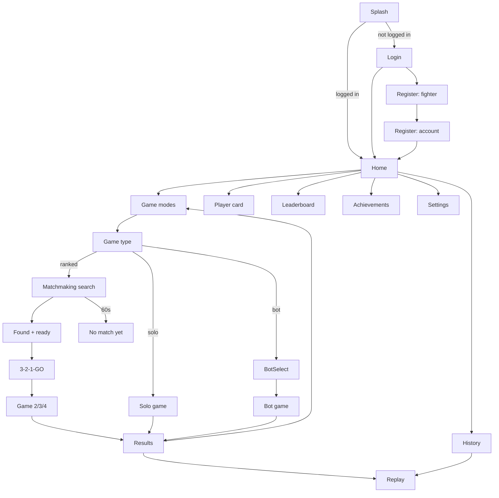

<div dir="rtl">

# סודוקו פייט — אפיון מפורט לגרסה הראשונה (V1)

> **מה המסמך הזה:** אפיון מלא לבנייה, שמבוסס על האפיון המקורי של משה ([00-original-spec-v1.md](00-original-spec-v1.md)).
>
> - **כל דרישה מהאפיון המקורי נשארה**, חוץ מהצעות שמסומנות **"ממתינה לאישור"**. כל עוד הצעה כזו לא אושרה, בונים לפי המקור.
> - במקומות שהאפיון המקורי השאיר פתוחים נקבעה **ברירת מחדל**, כדי שאפשר יהיה להתחיל לבנות. היא מסומנת כך: **[D3]**.
>   כל ההחלטות מרוכזות בטבלה בסעיף 24, ושם גם מאשרים אותן.
>
> **איך לקרוא הפניות:** הסימן §11 מפנה לסעיף 11 ב[אפיון המקורי](00-original-spec-v1.md). "סעיף 6.2", או רק 6.2, מפנה לסעיף במסמך הזה.
>
> - **עיצוב:** https://claude.ai/artifact/Gi5UdFahu2WP7ECR5Z5pon (פרטים ב־[03-DESIGN.md](03-DESIGN.md))
> - **תוכנית עבודה:** [02-WORK-PLAN.md](02-WORK-PLAN.md)
>
> גרסת המסמך: 1.2. בהמשך המסמך, **V1.1** פירושו העדכון של המשחק שיגיע אחרי ההשקה.

---

## תוכן עניינים

1. חזון ועקרונות
2. מילון מונחים
3. משתמשים, הרשמה וחשבון
4. מסכים וניווט
5. מצבי משחק וסוגי משחק
6. חוקי המשחק (הליבה)
7. הפרעות
8. תגובות (אימוג'י)
9. בוטים
10. Matchmaking
11. דירוג וליגות
12. סיום משחק ומסך תוצאות
13. צפייה חוזרת (Replay) והסברים לוגיים
14. היסטוריה, טבלת מובילים וכרטיס שחקן
15. Gamification (התקדמות)
16. אופליין, ניתוק וחיבור מחדש
17. ארכיטקטורה טכנית
18. פרוטוקול תקשורת בזמן אמת
19. מודל נתונים
20. מאגר הלוחות
21. אבטחה ומניעת רמאות
22. דרישות לא־פונקציונליות (ביצועים, נגישות, שפות, אנליטיקס)
23. דרישות חנויות (App Store / Google Play)
24. החלטות פתוחות: כאן מאשרים
25. מחוץ להיקף V1
26. רעיונות (§39), לאישור
27. נתוני שימוש ואתר ניהול

---

## 1. חזון ועקרונות

**סודוקו פייט** הוא משחק סודוקו תחרותי. 1–4 שחקנים פותרים **את אותו לוח בדיוק, בזמן אמת**. כל מהלך נכון מזכה בנקודות לפי
הקושי שלו, כל טעות עולה בנקודות, ואפשר להפריע ליריבים. יש דירוג כמו בשחמט, Matchmaking, וצפייה חוזרת שמסבירה כל מהלך.

עקרונות שלא משתנים (מהאפיון המקורי: §2, §36, §40):

- **משחק, לא אפליקציה.** אין Dashboard, אין טבלאות עסקיות, אין מראה של אפליקציית סודוקו בסיסית.
- **Competitive + Fun + Premium + Clear.** החוויה מהירה, תחרותית, ברורה, מצחיקה וממכרת.
- **הלוח תמיד קריא.** אנימציות ואפקטים לא פוגעים בריכוז. החריג: הפרעות, שזה התפקיד שלהן (§15).
- **עיצוב (§2):** שפה גרפית ייחודית, עומק ויזואלי, ומעברים מונפשים בין מסכים. כל שינוי משמעותי במצב המשחק מורגש:
  החלפת מוביל, הפרעה או ניתוק. ניקוד מונפש. מהלך נכון נותן משוב חיובי, וטעות מורגשת. ניצחון מרגיש כמו ניצחון.
  הפרעות מצחיקות, מפתיעות ובולטות. יש תחושת מתח, התקדמות ותגמול.
- **UX (§36):** המשחקיות קודמת למידע משני. פעולות חשובות בולטות. אין עומס. אנימציות קצרות ומדויקות.
  יש Feedback לכל פעולה. מצב המשחק ברור בכל רגע, והמשתמש מבין תוך שניות מה הוא יכול לעשות עכשיו.
- **השרת הוא מקור האמת** בכל משחק מדורג (§26).
- **פתרון סודוקו איכותי והוגן** הוא הליבה.

## 2. מילון מונחים

| מונח | הגדרה |
|---|---|
| לוח | 9×9 משבצות. שורות A–I מלמעלה למטה, עמודות 1–9 משמאל לימין. שם משבצת: אות שורה ואחריה מספר עמודה, למשל **D5**. הלוח מוצג תמיד משמאל לימין, גם בעברית. |
| ריבוע | אחד מתשעת ריבועי ה־3×3, ממוספרים 1–9 משמאל לימין ומלמעלה למטה. |
| רמז (Given) | ספרה שמופיעה בלוח מההתחלה. |
| נעילה (Lock) | בחירת משבצת ריקה. המשבצת שייכת לשחקן שבחר אותה לזמן החשיבה, ואף אחד אחר לא יכול לגעת בה. |
| זמן חשיבה | משך הנעילה לפני שחרור אוטומטי (סעיף 6.2). |
| מהלך | הזנת ספרה במשבצת נעולה. המהלך **נכון** או **שגוי**. |
| בעלות | משבצת שנפתרה נשארת צבועה בצבע של מי שפתר אותה עד סוף המשחק. |
| הפרעה | אפקט של 5 שניות שנשלח על יריב ועולה נקודות (סעיף 7). |
| תגובה | אימוג'י קצר שנשלח במהלך המשחק (סעיף 8). |
| מצב משחק | אחד מחמשת המצבים: לבד, מול בוט, מדורג 2, מדורג 3, מדורג 4. |
| סוג משחק | מהיר, רגיל או קשה. |
| מפתח דירוג | המזהה של דירוג מסוים, למשל `normal` (אפשרות B) או `normal-2p` (אפשרות A). |
| מושב (Seat) | מקום השחקן במשחק, 0–3. לכל מושב יש צבע וצורה. |
| "אני" | בכל מכשיר השחקן המקומי מוצג בצבע P1 ובצורת ●. היריבים מקבלים את P2–P4 לפי סדר המושבים. |

## 3. משתמשים, הרשמה וחשבון

### 3.1 פרטי משתמש (§3)
| שדה | חובה | כללים |
|---|---|---|
| שם לתצוגה | כן | 3–16 תווים: אותיות עברית ואנגלית, ספרות, קו תחתון ונקודה. ייחודי, בלי תלות ברישיות. בדיקת זמינות בזמן ההקלדה. סינון מילים פוגעניות. אפשר לשנות פעם ב־30 יום **[D20]**. |
| מדינה | כן | ברירת המחדל מזוהה לפי הגדרות המכשיר, ואפשר לשנות אותה בכל עת **[D21]**. מוצגת כדגל. |
| אווטאר | כן | מתוך הקטלוג (סעיף 3.4). |
| מייל | כן | ייחודי. נשלח מייל אימות **[D22]**. |
| סיסמה | כן | לפחות 8 תווים, ולפחות אות אחת וספרה אחת. מד חוזק עם 4 דרגות. |

### 3.2 זרימת הרשמה: "צור את הלוחם שלך"
לפי הרעיון באפיון המקורי, בחירת האווטאר והמדינה היא חוויה ולא טופס.
1. **שלב 1, הלוחם:** אווטאר גדול על במה, רצועה לבחירת אווטאר, שם לתצוגה עם בדיקת זמינות, ומדינה.
   תצוגה חיה של הכרטיס כפי שיופיע במשחק.
2. **שלב 2, החשבון:** מייל, סיסמה, אימות סיסמה, ואישור תנאי השימוש ומדיניות הפרטיות.
3. בסיום עוברים למסך הבית. הדירוג ההתחלתי הוא 1200 בכל מפתח דירוג **[D23]**.

### 3.3 כניסה וחשבון
- כניסה עם מייל וסיסמה (§3). "שכחתי סיסמה" שולח מייל לאיפוס **[D22]**.
- **מחיקת חשבון מתוך האפליקציה** (חובה ב־App Store, סעיף 23). גם הכניסה ליציאה מהחשבון ולמחיקה נמצאת במסך ההגדרות.
- **הצעה (ממתינה לאישור) [D24]: משחק כאורח.** האפיון המקורי (§3): "שחקן חדש יוצר משתמש".
  ההצעה: אפשר להתאמן לבד ומול בוט בלי חשבון, גם אופליין. משחק מדורג דורש חשבון.
  למה: השחקן מתחיל לשחק מיד, ויותר אנשים יגיעו למשחק הראשון.
  כאורח: בכרטיס הבית כתוב "אורח" ואין דירוג, כרטיסי המשחקים המדורגים עמומים עם הכיתוב "דורש חשבון", וההיסטוריה וה־XP נשמרים במכשיר ועוברים לחשבון בהרשמה.
  **עד שתאושר: הרשמה היא חובה**, ואחריה האימון זמין גם אופליין.

### 3.4 אווטרים (§33)
- **החלטה של משה (12.10.2026):** האווטרים הם שלנו, ולא חבילה חיצונית. זה מחליף את מה שכתוב במקור (§33: "אני אספק תמונות של אווטרים"). משה שינה את זה בעצמו.
- קטלוג V1: ‏101 דמויות מוכנות ומונפשות, שלנו (`packages/avatars`, מדריך הסגנון `docs/avatars/STYLE.md`, דף תצוגה `docs/avatars/preview.html`). אין "בונה אווטאר": בוחרים דמות מוכנה.
  - **ערבוב של אנשים, חיות וחפצים עם פנים:** אנשים, חיות, חפצים מהבית ומהמשרד, אוכל, טבע, יצורים, וכל הספרות וסימני הסודוקו.
  - **לכל דמות:** ‏10 הבעות (רגילה, חיוך, צחוק, קריצה, הפתעה, עצב, בלבול, סחרחורת, כעס, ישנוניות), ‏9 תנועות (מצמוץ, קפיצה, הנהון, הטיה, ניעור, סיבוב, היפוך, מעיכה, נדנוד), ולרובן גם חלק זז משלהן (הטוסט קופץ מהטוסטר, הענן מוריד גשם).
  - **כל התנועות מכבדות הפחתת תנועה.** במצב הזה הפנים משתנות, והדמות לא זזה.
  - הסדר בבורר: לפי סוג, ובתוך הסוג לפי הקטלוג. המזהים הם מילים באנגלית (`noam`, `coffee-cup`), נשמרים עם המשתמש, ולכן לא משנים אותם לעולם. הרשימה בחוזה: `AVATAR_IDS` ב־`packages/protocol`.
- av00 נשאר המזהה של "אין אווטאר" (חשבון שנמחק או חסר): לא נבחר ולא נשמר, והאפליקציה מציירת במקומו צללית אפורה בלי פנים (המראה: ברירת מחדל, ממתינה לאישור של משה, [החלטות פתוחות](DECISIONS-PENDING.md) 3.20).
- **המזהים הישנים** (av01 עד av51, בלי av36) לא נבחרים יותר. לכל אחד יש מחליף קבוע ושונה (`LEGACY_AVATAR_MAP`): מיגרציה 0004 בשרת ממירה את `users.avatar_id`, וכל קריאה של מזהה ממסד הנתונים עוברת דרך `normalizeAvatarId`. הקבצים הישנים (`assets/avatars`) נמחקו מהמאגר ב־13.10.2026, לבקשת משה, ולכן **שאלת הרישיון שלהם ירדה**.
- האווטאר מופיע, כמו קודם, במסך הראשי, בכרטיס השחקן, במשחק (וגם קטן, ‏22 פיקסלים, במשבצת נעולה), ב־Replay, בהיסטוריה, ב־Leaderboard ובמסך הסיום.
- **האווטרים מגיבים למשחק** (ברירת מחדל, ממתינה לאישור של משה: [החלטות פתוחות](DECISIONS-PENDING.md) 3.18). הטבלה היא הגדרה: `AVATAR_REACTIONS` ב־`apps/mobile/src/avatars/reactions.ts`, ושינוי בה לא דורש שינוי בקוד.
  - **תגובה** מתנגנת פעם אחת, על האווטר של מי שזה קרה לו:

    | מה קרה | על מי | הבעה | תנועה | כמה זמן ההבעה נשארת |
    |---|---|---|---|---|
    | מהלך נכון | מי ששיבץ | חיוך | הנהון | ‏1.2 שניות |
    | מהלך נכון שממלא שורה, עמודה או ריבוע, או מניח את התשיעי של ספרה, וכל מהלך נכון חמישי ברצף בלי טעות | מי ששיבץ | צחוק | קפיצה | התנועה |
    | מהלך שגוי | מי שטעה | עצב | ניעור | ‏1.6 שניות |
    | הפרעה | היעד | סחרחורת | נדנוד, שוב ושוב עד שההפרעה נגמרת | התנועה |
    | הפרעה | השולח | קריצה | בלי | ‏1.5 שניות |
    | תגובה 😂 · 😱 · 😎 · 🤦 · 🔥 · 👀 | השולח | צחוק · הפתעה · קריצה · בלבול · צחוק · הפתעה | קפיצה · מעיכה · הטיה · הנהון · סיבוב · הטיה | התנועה |
    | כניעה, נטישה | מי שיצא | עצב | בלי | ‏1.5 שניות |
    | ניתוק | | אין תגובה: הכרטיס כבר אפור | | |
    | חזרה מניתוק | מי שחזר | חיוך | בלי | ‏1.5 שניות |
    | סוף המשחק: מקום 1 לבד | המנצח | צחוק | סיבוב | התנועה |
    | סוף המשחק: מקום 1 עם עוד שחקן | כל מי שבמקום 1 | חיוך | בלי | ‏1.5 שניות |
    | סוף המשחק: מאחור, או יצא | כל השאר | עצב | בלי | ‏1.5 שניות |
    | לפני משחק (VS, טעינת החדר): שחקן נהיה "מוכן" | השחקן | חיוך | הנהון | התנועה |

  - **מצב רוח:** ההבעה שנשארת בין התגובות, כל עוד הסיבה קיימת. תחת הפרעה: סחרחורת. נכנע או נטש: עצב. בסוף המשחק: מנצח ותיקו חיוך, מפסיד עצב. לפני משחק (VS, ‏3-2-1, החדר): חיוך. **‏20 שניות בלי פעולה שלי במשחק שרץ: ישנוניות**, רק אצלי, עד הפעולה הבאה שלי (גם פעולה שנדחתה, כמו לחיצה על משבצת תפוסה). בכל זמן אחר: הבעה רגילה. באנר ההפרעה מראה את השולח קורץ, ובארסנל היעד מופתע.
  - **כשתגובות נפגשות על אותו אווטר:** סוף המשחק, ואחריו כניעה ונטישה, הפרעה (יעד), שליחת הפרעה, טעות, מהלך נכון, חזרה מניתוק ותגובת אימוג'י. תגובה חזקה יותר קוטעת מיד. חלשה יותר לא קוטעת תגובה חזקה שעוד מתנגנת. ותגובה באותה עוצמה מתחילה רק ‏0.6 שניות אחרי הקודמת. מה שלא נכנס נזרק, ואין תור.
  - **Replay:** כל שלב מנגן את התגובה של מי שפעל בו (החזקה מביניהן), כשהצפייה עומדת על השלב ‏0.2 שניות. גרירה על ציר הזמן מנגנת רק את השלב שבו היא נעצרת, ולא את מה שעברה בדרך. מעבר לשלב אחר עוצר מיד את התגובה של השלב הקודם, וחזרה לשלב מנגנת אותו שוב.
  - **מסך התוצאות:** כשהשורה של השחקנים נוחתת, המנצח צוחק ומסתובב, וממשיך לזוז במקום. מי שמאחור עצוב, ותיקו מחייך.
  - **"חי" כשלא קורה כלום** (מצמוץ, ובגודל 48 ומעלה גם החלק הזז של הדמות, בלולאה): רק במנצח במסך התוצאות ובבמה של בחירת האווטאר, ורק כשהמסך מוצג. בשאר המקומות האווטר עומד בין התגובות (ברירת מחדל, ממתינה לאישור של משה: [החלטות פתוחות](DECISIONS-PENDING.md) 3.19; ההגדרה: `AVATAR_STAGES`).
  - **הפחתת תנועה:** רק ההבעה משתנה, לאותו זמן. שום אווטר לא זז.
- פתיחת אווטרים נוספים לפי רמה: התשתית נבנית ב־V1 (שדה `unlockLevel`, בלי שינוי), והתוכן מגיע ב־V1.1.

## 4. מסכים וניווט

### 4.1 רשימת המסכים (§37) ושמם בקנבס העיצוב
**שם הקובץ** הוא השם שמשתמשים בו במסמכים ומול Claude. **הכותרת בקנבס** היא הכותרת באנגלית שמופיעה מעל כל מסך.

| # | מסך | שם הקובץ | הכותרת בקנבס |
|---|---|---|---|
| — | מערכת עיצוב | DS-Foundations, DS-Components, DS-Motion | Design System · Foundations / Components / Motion & Feedback |
| 1 | פתיחה | Splash | Splash |
| 2 | התחברות | Login | Login |
| 3 | הרשמה: לוחם | Register-Fighter | Register · Create your fighter |
| 4 | הרשמה: חשבון | Register-Account | Register · Account |
| 5 | בית | Home, Home-EN | Home, Home · English (LTR) |
| 6 | כרטיס שחקן | Profile | Player card |
| 7 | מצבי משחק (5 אפשרויות) | Modes | Game modes |
| 8 | סוג משחק | GameType | Game type |
| 9 | בחירת בוט | BotSelect | Bot selection |
| 10 | Matchmaking | Match-Search, Match-Found, Match-Countdown, Match-Timeout | Matchmaking · Searching / Found & Ready / 3-2-1-GO / No match yet |
| 11 | משחק 2 שחקנים | Game-2P, Game-2P-EN, Game-2P-Correct, Game-2P-Wrong | Game · 2 players (playable) / English / Correct move / Wrong move |
| 12 | משחק 3 שחקנים | Game-3P | Game · 3 players |
| 13 | משחק 4 שחקנים | Game-4P | Game · 4 players |
| 14 | אימון לבד | Game-Solo | Solo practice |
| 15 | אימון מול בוט | Game-Bot | Practice vs bot |
| 16 | הפרעות | Arsenal, Interference-Drag, Interference-Target, Hit-Fireworks, Hit-Cats, Hit-Warp, Interferences | Interference · … / Hit · … / Interferences collection |
| 17 | תגובות | Reactions | Reactions |
| 18 | אישור כניעה | Surrender | Surrender confirmation |
| 19 | תוצאות | Results-Victory, Results-Defeat, Results-4P | Results · Victory / Defeat / 4-player ranking |
| 20 | צפייה חוזרת | Replay | Replay with explanations |
| 21 | היסטוריה | History, History-Empty | Game history / Game history · Empty |
| 22 | טבלת מובילים | Leaderboard | Leaderboard |
| 23 | הישגים והתקדמות | Progress | Achievements & progress |
| 24 | אין אינטרנט | Offline | Offline · before a game |
| 25 | ניתוק | Opponent-Reconnecting, Self-Reconnecting, Opponent-Left | Opponent reconnecting · 15 / My connection lost / Opponent abandoned |
| 26 | שגיאת חיבור | Connection-Error | Connection error |
| 27 | טעינה | Loading | Loading states |
| — | חלופה לבחינה: משחק בתורות | Game-2P-Turns | Game · Turn-based variant |

**מסכים שחסרים בעיצוב ויתווספו ב־V1:**
- **הגדרות:** צליל, רטט, שפה, הפחתת תנועה, יציאה, מחיקת חשבון.
- **שכחתי סיסמה, עריכת פרופיל, וניצחון בנטישה** (וריאנט של מסך התוצאות).
- **מצבים ריקים (§38):** טבלת מובילים בלשונית חברים, הישגים לפני שהושג משהו.
- **מצבי שגיאה (§38):** התחברות (סיסמה שגויה, מייל לא מאומת), הרשמה, ו־Matchmaking.

### 4.2 מפת ניווט

> כדי לראות את התרשים ב־VS Code צריך את התוסף **Markdown Preview Mermaid Support** (‏`bierner.markdown-mermaid`). ב־GitHub הוא מוצג אוטומטית.

<div dir="ltr">



</div>

- בניווט התחתון של מסכי הבית יש ארבעה פריטים: **בית · טבלת מובילים · היסטוריה · הישגים**. לכרטיס השחקן נכנסים בלחיצה על הכרטיס במסך הבית.
- אם D24 תאושר, יתווסף מסלול נוסף: מ־Login, "המשך כאורח", למסך הבית במצב אורח.

### 4.3 מסך הבית (§4)
- הוא מרגיש כמו מסך הבית של משחק, לא כמו Dashboard.
- **בראש המסך: כרטיס השחקן.** אווטאר, שם, דגל ומדינה, ליגה, דירוג, ונתונים מרכזיים (משחקים, אחוז ניצחונות, רצף).
  בדירוג מוצגים כל הדירוגים של השחקן: 3 באפשרות B, או בקיצור באפשרות A.
- **מתחת לכרטיס: אפשרויות המשחק.** כפתור "שחק" גדול, שמוביל למסך משחק חדש, ושורת "עוד סיבוב" עם ההגדרה האחרונה.
- משחקים אחרונים בקצרה, וניווט תחתון.

## 5. מצבי משחק וסוגי משחק

### 5.1 חמשת מצבי המשחק (§5): במסך "משחק חדש" מוצגות חמש אפשרויות בלבד
| מצב | שחקנים | דירוג | אינטרנט | שמירה ו־Replay |
|---|---|---|---|---|
| אימון לבד | 1 | לא | לא נדרש | נשמר במכשיר **[D25]** |
| אימון מול בוט | 1 + בוט | לא | לא נדרש | נשמר במכשיר **[D25]** |
| מדורג · 2 שחקנים | 2 | כן | נדרש | בשרת |
| מדורג · 3 שחקנים | 3, כולם נגד כולם | כן | נדרש | בשרת |
| מדורג · 4 שחקנים | 4, כולם נגד כולם | כן | נדרש | בשרת |

### 5.2 סוגי משחק (§6)
| | מהיר | רגיל | קשה |
|---|---|---|---|
| קושי הלוח | קל: נפתר רק עם "בודד גלוי" | בינוני: דורש "בודד נסתר" | קשה: דורש זוגות או צמצומים |
| זמן חשיבה לנעילה | 8 שניות | 12 שניות | 18 שניות |
| משך משוער (2 שחקנים) | 4–6 דקות | 6–9 דקות | 9–14 דקות |

- ברירת המחדל היא ש"סוג משחק" משלב **גם** את קושי הלוח **וגם** את קצב הזמן **[D5]**.
- סוגי המשחק חלים גם על אימון לבד ועל אימון מול בוט.

## 6. חוקי המשחק (הליבה)

- כל החוקים רצים במנוע המשחק (`packages/engine`), שהוא קוד TypeScript טהור.
- אותו קוד רץ בשרת (משחק מדורג) ובמכשיר (אימון ובוטים).
- **השעון מוזרק למנוע:** במשחק מדורג זה השעון של השרת, ובאימון זה השעון של המכשיר (`LocalGameHost`). גם **האקראיות מוזרקת** (RNG עם seed), כדי שאפשר יהיה לשחזר כל משחק.

### 6.1 מודל המשחק [D1]
- **הצעה (ממתינה לאישור): כולם משחקים במקביל.** האפיון המקורי אומר "בזמן אמת" (§1), אבל גם מזכיר "תור" ב־§9, ‏§10, ‏§25, ‏§26 ו־§29.
  ההצעה: כל השחקנים פועלים בו־זמנית על אותו לוח, ו"תור" מתפרש כ"מי פעיל עכשיו". כרטיס של שחקן שמחזיק נעילה מציג "בוחר · D5" עם טיימר.
  - יתרונות: קצב מהיר, מתח, והמשחק מרגיש באמת כמו "Fight".
  - חסרונות: ב־4 שחקנים יש עומס על הלוח, ושחקנים עם תגובה מהירה מקבלים יתרון.
- **החלופה: משחק בתורות.** בכל רגע רק שחקן אחד יכול לנעול (מסך Game-2P-Turns).
- המנוע תומך בשני המצבים, דרך ההגדרה `rules.turnModel`, שהערכים שלה `simultaneous` או `turns`.

### 6.2 נעילת משבצת (§11)
1. שחקן בוחר משבצת **ריקה** שלא נעולה. השרת נועל אותה לשחקן הזה ושולח `cellLocked` עם `expiresAt`.
2. לכל שחקן יש **נעילה אחת לכל היותר**. בחירה במשבצת אחרת משחררת את הקודמת.
3. אי אפשר לבחור משבצת שנעולה על ידי שחקן אחר. בלחיצה עליה מוצג משוב "תפוסה": רטט קצר, בלי קנס.
4. **בסיום זמן החשיבה** (סעיף 5.2) המשבצת משתחררת אוטומטית. **אין קנס על שחרור בגלל זמן [D2]**.
5. כפתור "ביטול בחירה" משחרר את הנעילה. זה ה"ביטול" שמופיע באפיון (§12).
6. **אחרי שחרור מכל סיבה** (זמן, ביטול, בחירה במשבצת אחרת או טעות), אותו שחקן יכול לנעול שוב את אותה משבצת רק אחרי שנייה אחת **[D2]**. כך אי אפשר להחזיק משבצת ללא הגבלה.
7. **עצירת טיימרים [D11]:**
   - בזמן שהשחקן תחת הפרעה, טיימר הנעילה שלו נעצר. נעילה שהוא יוצר בזמן ההפרעה מתחילה עצורה עד שההפרעה נגמרת.
   - בהקפאת משחק (סעיף 16.2) נעצרים כל טיימרי הנעילה וגם טיימר ההפרעה.
   - פתיחת חלון הכניעה לא עוצרת את טיימר הנעילה ולא משחררת אותה.
8. **הצגה בלוח:** לנעילה שלי יש טבעת בצבע שלי, ספירה לאחור ופס שמתרוקן. לנעילה של יריב יש טבעת בצבע שלו ואווטאר קטן.
   כך ברור מאוד למי שייכת כל משבצת, גם כשמשחקים 3–4 שחקנים.

### 6.3 הזנת ספרה (§12)
- המקלדת ייעודית: הספרות 1–9 וכפתור "ביטול בחירה". לא משתמשים במקלדת של המכשיר.
- **"מחיקה" (§12)** לא נדרשת ב־V1. ספרה נבדקת מיד, ולא מוחקים ספרה נכונה או סימון טעות. אם יתווספו בעתיד סימוני עיפרון (Notes), "מחיקה" תמחק אותם.
- הזנה אפשרית רק כשיש לשחקן נעילה פעילה.
- ספרה שכבר הוזנה בטעות **במשבצת הזו** מושבתת במקלדת לכל השחקנים, כדי שאף אחד לא יקבל קנס כפול על מידע שכבר גלוי **[D12]**.
- ספרה שכל 9 המופעים שלה כבר בלוח מוצגת עמומה ולא ניתנת ללחיצה. מתחת לכל ספרה מופיע כמה מופעים שלה נשארו.
- השרת בודק את הספרה מול הפתרון ומחזיר תוצאה. **במשחק מדורג הלקוח לא מקבל את הפתרון** (סעיף 21).

### 6.4 מהלך נכון: ניקוד (§14)
עבור משבצת c וספרה d מחשבים ארבעה פרמטרים, **על הלוח שלפני ההזנה**:

| פרמטר | הגדרה | טווח |
|---|---|---|
| `row` | מספר המשבצות המלאות בשורה של c, לא כולל c | 0–8 |
| `col` | מספר המשבצות המלאות בעמודה של c, לא כולל c | 0–8 |
| `box` | מספר המשבצות המלאות בריבוע של c, לא כולל c | 0–8 |
| `num` | כמה פעמים הספרה d כבר מופיעה בלוח | 0–8 |

"מלאה" פירושה רמז או משבצת שנפתרה. סימוני טעות לא נספרים.

- X הוא הערך הגבוה מבין ארבעת הפרמטרים. Y הוא הערך השני בגובהו אחרי מיון בסדר יורד. בתיקו בערך הגבוה, Y שווה ל־X.
- **הניקוד:** `points = 9 − X + (9 − Y) / 2`.
- **טווח:** תאורטית 1.5 עד 13.5, בקפיצות של חצי נקודה. **בפועל**, במאגר הנוכחי של 690 לוחות המקסימום הוא 10.5, וברוב הלוחות 8 עד 9.5. המשבצת האחרונה בלוח תמיד שווה 1.5.
- **דוגמה** (באפיון המקורי מופיעה רק התוצאה, 3.5): `X = 7, Y = 6 → 2 + 1.5 = 3.5`.
- **פרשנות [D13]:** באפיון המקורי מופיעים חמישה סעיפים: שורה, עמודה, ריבוע, מספר, "כמה מספרים נוספים קיימים".
  הם פורשו כארבעה פרמטרים: "מספר" ו"כמה מספרים נוספים קיימים" הם פרמטר אחד (`num`). אם הכוונה הייתה לחמישה פרמטרים, צריך להגדיר את החמישי.
  החלופה ל־Y: הערך השני **השונה** מ־X.
- **Feedback:** הניקוד עולה מהמשבצת, עף אל הכרטיס של השחקן, ושם המספר סופר כלפי מעלה (650ms). המשבצת נצבעת בצבע השחקן.

### 6.5 מהלך שגוי (§13)
- **הקנס** תלוי במספר הטעות של **אותו שחקן באותו משחק**: 1, 2, 4, 8, 16 נקודות וכן הלאה (`penalty = 2^(k−1)`, כאשר k הוא מספר הטעות). הסולם לא מתאפס במהלך המשחק.
- **הצעה שמשנה את האפיון (ממתינה לאישור) [D14]:** קנס מקסימלי של 8 נקודות לטעות, מהטעות הרביעית והלאה.
  למה: במשחק ארוך טעות אחת עלולה למחוק יתרון שלם. **עד שתאושר, נשאר החוק המקורי.**
- הספרה השגויה נשארת במשבצת, **קטנה ואדומה**, וגלויה לכל השחקנים. היא נשארת גם אחרי שהמשבצת נפתרת.
- **Feedback:** הבהוב אדום, רעד של 300ms, הקנס באדום ותגית על הכרטיס, בלי לחסום את הלוח.
- **אחרי טעות המשבצת משתחררת**, וכל אחד יכול לנעול אותה **[D3]**.
- הניקוד **יכול לרדת מתחת לאפס** **[D15]**.

### 6.6 כניעה (§19)
- הכפתור נמצא בכרטיס שלי. לחיצה פותחת אישור: **"אתה בטוח שאתה רוצה להיכנע?"** עם הכפתורים **"כן, להיכנע"** ו**"ביטול"**.
  "ביטול" הוא הכפתור הבולט והנוח יותר.
- **2 שחקנים:** כניעה היא הפסד מיידי.
- **3–4 שחקנים [D36]:** מי שנכנע יוצא מהמשחק. המיקום שלו נקבע לפי סעיף 6.7. המשבצות שפתר נשארות בצבע שלו, והנעילה שלו משתחררת.
- **באימון:** הכפתור נקרא "סיום אימון". לחיצה פותחת אישור ("לסיים את האימון?", עם הכפתורים "כן, לסיים" ו"ביטול"). אין השפעה על דירוג.

### 6.7 סיום משחק ומיקום במשחק
- המשחק מסתיים כש**כל המשבצות מלאות**, או כשנשאר רק שחקן פעיל אחד (כל השאר נכנעו או נטשו).
- **מיקום:** לפי הניקוד, מהגבוה לנמוך. **[D16]** בתיקו בניקוד, מי שעשה פחות טעויות מדורג גבוה יותר. אם גם זה שווה, זה תיקו אמיתי (מקום משותף).
- **מי שיצא מהמשחק** (נכנע או נטש) מדורג אחרי כל השחקנים הפעילים, לפי סדר היציאה: מי שיצא ראשון מדורג אחרון. בנטישה, רגע היציאה הוא סוף זמן ההמתנה (Grace).

### 6.8 כרטיסי השחקנים במסך המשחק (§9, §10)
- **2 שחקנים:** שני כרטיסים זה לצד זה, **אני | היריב**. "אני" בצד ההתחלה של השורה: מימין בעברית, משמאל באנגלית.
- **כל כרטיס כולל:** שם, דגל ומדינה, אווטאר, ניקוד במשחק הנוכחי (מונפש), דירוג (לפי מפתח הדירוג של המשחק),
  **מצב Online** (מחובר, מתנתק או נטש), ו**אינדיקטור פעילות**: "בוחר · D5" עם טיימר. אם D1 ייקבע "בתורות", זה יהיה "התור שלו".
- **בכרטיס שלי:** כפתור כניעה וכפתור תגובות. **בכרטיס של יריב:** כפתור הפרעה ⚡ עם העלות הבאה.
- **מי מוביל (§9):** סימון ברור של המוביל, וכשהמוביל מתחלף זה קורה באנימציה. ב־3–4 שחקנים מוצג גם המקום הנוכחי (1–4) על כל כרטיס.
- **3–4 שחקנים:** כרטיסים קומפקטיים בשורה אחת, שלא פוגעים באזור הלוח. הסדר שלהם קבוע לפי המושבים, כדי שיעדי ההפרעה לא יזוזו.

## 7. הפרעות (§15–§17)

### 7.1 קטלוג
| הפרעה | V1 | תיאור |
|---|---|---|
| זיקוקים | ✓ | זיקוקים מתפוצצים על המסך. |
| חתולים | ✓ | חתולים מצוירים רצים על המסך. |
| עיוות | ✓ | המסך מתעוות: פרספקטיבה, גלים, היסט צבעים. |
| דיו | בעתיד | כתמי דיו שנמחקים בהדרגה. |
| רעידת אדמה | בעתיד | המסך רועד. |
| ערפל | בעתיד | ערפל שמתפזר. |
| בועות | בעתיד | בועות שצריך לפוצץ. |

ההפרעות נפתחות בהדרגה לפי רמה. טבלת הרמות תיקבע ב־V1.1 **[D17]**. ב־V1 שלוש ההפרעות הראשונות פתוחות מההתחלה.

### 7.2 חוקים
- **משך:** 5 שניות בדיוק.
- **עלות [D10]:** ההפרעה ה־n של שחקן במשחק עולה `cost = 2^n` נקודות: הראשונה 2, השנייה 4, השלישית 8, וכן הלאה.
  - העלות **יורדת מהניקוד במשחק** ברגע השיגור.
  - הסולם מתאפס בכל משחק חדש.
  - אפשר לשגר רק אם הניקוד גדול מהעלות או שווה לה. אחרת כפתור ⚡ עמום, וליד העלות מופיע, למשל, "חסרות 3 נק׳".
- **אין הפרעה כפולה [D11]:** אי אפשר לשלוח הפרעה לשחקן שכבר תחת הפרעה, וגם לא בשנייה שאחרי שהיא נגמרת. אי אפשר לשלוח הפרעה לשחקן מנותק.
- **היקף ההפרעה [D35]:** **לפי האפיון המקורי, ההפרעה פועלת על המסך** (§15: "חתולים שרצים על המסך", "עיוות של המסך").
  **הצעה (ממתינה לאישור):** ההפרעה תפעל רק על אזור הלוח, והמקלדת והכרטיסים יישארו זמינים. למה: ההפרעה מפריעה לראות, אבל לא חוסמת לגמרי את היכולת לשחק.
  **עד שתאושר, ההפרעה פועלת על כל המסך.**
- המשחק ממשיך כרגיל בזמן ההפרעה. טיימר הנעילה של מי שנפגע נעצר (סעיף 6.2, סעיף קטן 7).
- הפרעות זמינות במשחק מדורג ובמשחק מול בוט, ולא באימון לבד.

### 7.3 שיגור בגרירה בלבד (§16, §17)
1. לחיצה על ⚡ בכרטיס של יריב פותחת את **ארסנל ההפרעות**: מגירה עם האסימונים הזמינים, העלות הבאה, וההוראה "גרור אל הכרטיס של NinaVolt".
2. גוררים אסימון. בזמן הגרירה מוצגים **השם, תצוגה מקדימה קטנה והעלות**. למשל: זיקוקים · 8 נק׳.
3. **אזור השחרור היחיד** הוא הכרטיס של היריב שממנו נפתח הארסנל, והוא מודגש. כל שאר הכרטיסים עמומים.
4. רק שחרור בתוך אזור השחרור משגר. שחרור במקום אחר מבטל.
5. **במשחק של 3–4 שחקנים** מוצג תג מסלול עם שני האווטרים: "אני ← NinaVolt". היעד נקבע לפי הכרטיס שממנו התחלת, ולכן אי אפשר להפריע ליריב הלא נכון.
6. **הצעה (ממתינה לאישור) [D18]: חלופה לנגישות.** האפיון המקורי (§16): "הפרעה לא תופעל בלחיצה רגילה". ההצעה, רק למשתמשי קורא מסך: לחיצה ארוכה על אסימון ואז אישור.
   **עד שתאושר: גרירה בלבד.**

### 7.4 מה רואים
- **מי ששלח:** "זיקוקים ← NinaVolt", והניקוד שלו יורד בעלות ההפרעה.
- **מי שנפגע:** באנר "NinaVolt שלחה לך זיקוקים!" עם טבעת שסופרת 5 שניות לאחור, והאפקט עצמו.
- **שאר השחקנים:** תג קטן על הכרטיס של מי שנפגע.

## 8. תגובות (§18)
- שש תגובות בסיס: 😂 😱 😎 🤦 🔥 👀. כפתור התגובות נמצא בכרטיס שלי.
- תגובה עולה מהכרטיס של מי ששלח אותה. היא מונפשת, מצחיקה וקצרה (כ־1.6 שניות), ולא מכסה את הלוח.
- **הגבלת קצב [D19]:** תגובה אחת כל 2 שניות לכל שחקן. מוצגות לכל היותר 3 תגובות בו־זמנית. אפשר להשתיק יריב דרך התפריט של הכרטיס שלו.
- תגובות נוספות ייפתחו בעתיד, מתוך ספריית האימוג'י של האפליקציה הקודמת (`assets-src/ImojiDataSource.java`).

## 9. בוטים (§5.2, §20)

הבוט מתנהג כמו שחקן אנושי ולא כמו "מחשב שפותר סודוקו". הוא רץ על המכשיר באותו מנוע, ולכן עובד גם אופליין.

| רמה | שם | אווטאר | זמן חשיבה בסיסי (רגיל) | שיעור טעויות | הפרעות [D40] | תגובות |
|---|---|---|---|---|---|---|
| 1 · טירון | Pip | אפרוח בביצה (`hatchling`; היה עכבר) | 8–11 ש׳ | 15% | נדיר: לכל היותר פעם במשחק | נדיר |
| 2 · חובב | Biscuit | שועל (`fox`; היה כלב) | 6–9 ש׳ | 9% | לפעמים, כשמפגר ב־15 נק׳ או יותר | 😂 לפעמים |
| 3 · מתקדם | Mr. Hoot | ינשוף (`owl`) | 4–7 ש׳ | 5% | כשמפגר ב־10 נק׳ או יותר | כן |
| 4 · מאסטר | Maestro | פרופסור גדליה (`professor`; היה ג'נטלמן) | 3–5 ש׳ | 2% | כשמפגר | 😎 |
| 5 · גרנדמאסטר | Overlord | מפלצת פרוותית (`furry-monster`; היה קוף) | 2–4 ש׳ | 1% | אגרסיבי | כן |

**זמן חשיבה:**
- הזמנים בטבלה הם לסוג "רגיל". במשחק מהיר מכפילים ב־0.67, ובקשה ב־1.5.
- הבוט "מתלבט" לפני שהוא נועל. אחרי שנעל, הוא מזין ספרה בתוך פרק זמן שלא עולה על 80% מזמן החשיבה של סוג המשחק.
- לכן הנעילה של בוט כמעט אף פעם לא פוקעת, חוץ מהתלבטות מכוונת (כ־2% מהמקרים).
- הזמן בפועל הוא זמן הבסיס, כפול הקושי של המשבצת (מספר האפשרויות או הטכניקה הנדרשת), עם פיזור אקראי.

**התנהגות אנושית:**
- **בחירת משבצת:** מעדיף משבצות קלות, כלומר עם מעט אפשרויות, עם רעש אקראי.
- **טעויות:** בוחר ספרה סבירה, כלומר אחת האפשרויות שנשארו למשבצת, ולא ספרה אקראית.
- **הפרעות ותגובות:** לפי הטבלה. מגיב ב־😂 על טעות של היריב, וב־😱 כשהוא מקבל הפרעה.
- **הסתגלות:** כשהשחקן מפגר ביותר מ־25 נקודות, הבוט מאט קצת. רק ברמות 1–3.

## 10. Matchmaking (§7, §8)
- **תור** נפרד לכל צירוף של סוג משחק ומספר שחקנים. למשל `fast-2p`.
- **טווח דירוג [D6]:** מתחיל ב־±50, ומתרחב ב־25 כל 5 שניות, עד ±300. התקרה מגיעה אחרי 50 שניות.
- **שחקן זמין עכשיו:** רק מי שנמצא בתור ומחובר.
- **הימנעות מיריבים חוזרים (§7):**
  - המערכת מעדיפה יריבים שהשחקן עוד לא שיחק נגדם בסוג המשחק הזה, לפי `opponent_history`.
  - יריב שכבר שיחקו נגדו נבחר רק כשאין יריב אחר זמין בטווח. במקרה כזה עדיף היריב שהמשחק האחרון נגדו הכי ישן.
  - כשהשחקן שיחק נגד יותר מ־80% מהיריבים הרלוונטיים, ההיסטוריה מתאפסת.
  - **הצעה (ממתינה לאישור) [D34]:** אחרי 20 שניות של חיפוש, לאפשר גם יריב חוזר, כדי לקצר את ההמתנה.
- **נמצאו:** מסך VS עם אווטרים, שמות, דגלים ודירוגים. לכל שחקן מוצג מצב **"מוכן"** (§8).
  - **[D37]:** השחקן מסומן כמוכן אוטומטית כשהוא מתחבר לחדר. החלופה: כפתור "מוכן" שצריך ללחוץ עליו תוך 10 שניות.
  - המשחק מתחיל רק כשכולם מחוברים ומוכנים. אם שחקן לא התחבר תוך 10 שניות, השאר חוזרים לראש התור.
- **ספירה לאחור:** 3… 2… 1… GO!
- **לא נמצא יריב אחרי 60 שניות:** מסך עם שלוש אפשרויות: "המשך לחפש (בלי הגבלת טווח)", "שחק מול בוט בינתיים", "חזרה לבית". מי שבוחר להמשיך לחפש, התקרה של הטווח מוסרת.
- **3–4 שחקנים:** המשחק מתחיל רק כשהמספר מלא. מי שכבר נמצא ממתין עד 60 שניות.
- **ביטול:** אפשר לבטל בזמן החיפוש. אחרי "נמצאו" אין ביטול, ויציאה נחשבת נטישה **[D32]**.

## 11. דירוג וליגות (§6, §24)

### 11.1 אילו דירוגים (§6): המערכת תומכת בשתי האפשרויות
- **אפשרות B (ברירת המחדל, ההעדפה באפיון) [D7]:** שלושה דירוגים: מהיר, רגיל וקשה. מספר המשתתפים משפיע על החישוב, אבל לא יוצר דירוג נפרד.
- **אפשרות A:** דירוג נפרד לכל צירוף של סוג משחק ומספר שחקנים, כלומר 9 דירוגים.
- **איך זה עובד:**
  - המערכת שומרת דירוג לפי **מפתח דירוג** (`normal` או `normal-2p`). הפונקציה `ratingKey(type, players, option)` קובעת איזה מפתח מתעדכן.
  - ההגדרה בשרת היא `RATING_OPTION=B|A`.
  - **באפשרות A:** הליגה והדירוג ה"כללי" הם הגבוה מבין כל מפתחות הדירוג של השחקן. בטבלת המובילים, לשונית של סוג משחק מציגה בורר 2 / 3 / 4 שחקנים. בכרטיס השחקן מוצגים כל 9 הדירוגים.

### 11.2 נוסחה: Elo זוגי. ברירת מחדל ל־V1, לא סופית (§24) [D31]
- **משחקון:** כל זוג שחקנים במשחק נחשב משחקון. מי שסיים **במקום גבוה יותר במשחק הזה** ניצח (S=1). בתיקו, כלומר מקום משותף, ‏S=0.5. מי שסיים במקום נמוך יותר הפסיד (S=0).
- **הסיכוי הצפוי שלי לנצח יריב:** `E = 1 / (1 + 10^((R_opp − R_me) / 400))`. כאן `R_me` הוא הדירוג שלי ו־`R_opp` הוא הדירוג של היריב.
- **שינוי הדירוג:** `ΔR = Σ K_pair × (S − E)`, על כל היריבים במשחק.
  - `K_pair = 32 / (N − 1)`, כאשר N הוא מספר השחקנים במשחק. במשחק של 2 שחקנים: ‏K=32.
  - **דירוג זמני:** ב־10 המשחקים הראשונים בכל מפתח דירוג, K מוכפל ב־2.
- **דוגמה** (שחקן לא זמני, K=32): 1287 מול 1305, ‏E=0.474. בניצחון הדירוג עולה ב־17, ובהפסד יורד ב־15. בדירוג זמני (K=64): עולה ב־34 או יורד ב־30.
- **כניעה ונטישה [D32]:** המקום נקבע לפי סעיף 6.7, וה־S בכל זוג נקבע לפי המקומות. ב־2 שחקנים, כניעה ונטישה הן הפסד רגיל, והמנצח מקבל ניצחון מלא **[D8]**.
- **החלופות לנוסחה:**
  - **Elo** (המוצע): פשוט ושקוף, אבל לא מודל אי־ודאות.
  - **Glicko-2:** מודל אי־ודאות, אבל מורכב יותר.
  - **OpenSkill / TrueSkill:** מותאמים ל־3–4 שחקנים, אבל פחות מוכרים לשחקנים.
  - הנוסחה מבודדת ב־`packages/engine/rating`, ולכן אפשר להחליף אותה בלי לשנות שום דבר אחר.

### 11.3 ליגות [D38]
- **ארד** עד 1099 · **כסף** 1100–1249 · **זהב** 1250–1399 · **יהלום** 1400–1599 · **אגדה** 1600 ומעלה.
- הליגה נקבעת לפי **הגבוה מבין כל הדירוגים של השחקן** **[D9]**.
- הליגה מוצגת רק אחרי שהשחקן סיים את 10 המשחקים הזמניים במפתח דירוג כלשהו. הדירוג ההתחלתי (1200) נמצא בכסף, כך שכל ליגה מאוכלסת.
- עונות ופרסים לפי ליגה מגיעים ב־V1.1.

## 12. סיום משחק ומסך תוצאות (§23)
- מסך **ניצחון / הפסד** חווייתי, לא רק "You Win".
- **מה מוצג:**
  - מקום סופי, ניקוד, ושינוי דירוג מונפש.
  - מספר טעויות.
  - **"מהלך המשחק":** המהלך עם הכי הרבה נקודות, כולל שורת החישוב.
  - זמן משחק, ונתונים: מהלכים נכונים וזמן חשיבה ממוצע.
  - **יריבים:** הניקוד, הטעויות ושינוי הדירוג של כל אחד.
  - כפתורים: **צפייה חוזרת**, **משחק חדש**, **לבית**.
- **3–4 שחקנים:** מוצג דירוג מלא, עם פודיום ומקום רביעי.
- **פרסי משחק**, רגעיים ולכל משחק:

| פרס | הגדרה |
|---|---|
| המהלך הטוב ביותר | הניקוד הגבוה ביותר במהלך בודד |
| הכי מעט טעויות | הכי מעט טעויות. בתיקו, הניקוד הגבוה יותר |
| הכי מהיר | זמן החשיבה הממוצע הנמוך ביותר למהלך נכון (לפחות 5 מהלכים) |
| Comeback | **ניצחון** (מקום 1) אחרי פיגור של 15 נקודות או יותר בשלב כלשהו |
| הכי הרבה נקודות | סכום הנקודות הגבוה ביותר מכל המהלכים הנכונים, לפני קנסות |

- **ניצחון בנטישה:** וריאנט של מסך הניצחון, עם תגית "ניצחת בנטישה".

## 13. צפייה חוזרת (Replay) והסברים לוגיים (§21, §22)

### 13.1 שלבים
- כל משחק נשמר כ**רצף אירועים** עם חותמת זמן (סעיף 19). משחק מדורג נשמר בשרת, ואימון נשמר במכשיר.
- **בכל שלב מוצגים:** הלוח, כרטיסי השחקנים עם האווטרים והניקוד באותו רגע, ומצב המשחק: נעילות, הפרעה פעילה, ניתוק (§21).
- **שלב אחד הוא פעולה אחת:** בחירת משבצת, בחירת מספר (תשובה נכונה או שגויה), הפרעה, או שינוי מצב (ניתוק, חזרה, כניעה, הקפאה).
- **בתחתית המסך:**
  - הכפתורים **◀ שלב קודם | שלב הבא ▶**.
  - ציר זמן עם נקודות בצבעי השחקנים: נכון, שגוי, הפרעה.
  - מונה ("שלב 7 מתוך 94") ושעון משחק.
- במשחק ארוך אפשר לקפוץ ל"רגעי מפתח": המהלך הטוב ביותר, טעויות, הפרעות, ונקודת המהפך.

### 13.2 הסברים
- **בכל שלב** מוצג הסבר **לכל שחקן** (§22): המשבצת שבחר, הספרה שהייתה צריכה להיות שם, למה, וההסבר הלוגי.
  - במשחק של 2 שחקנים מוצגים שני הסברים.
  - במשחק של 3–4 שחקנים מוצג הסבר מלא לכל שחקן.
  - **הצעה שמשנה את האפיון (ממתינה לאישור) [D26]:** ב־3–4 שחקנים, השחקן שפעל בשלב מוצג בהרחבה, והשאר בשורה מקוצרת. למה: ארבעה הסברים מלאים לא נכנסים מתחת ללוח.
    **עד שתאושר, נשאר החוק המקורי.**
- ההסבר מחושב **על הלוח שלפני המהלך**: מה הלוגיקה קובעת, גם אם השחקן ניחש.
- **הטכניקות שמנוע ההסברים מזהה:**

| טכניקה | שם בעברית | דוגמת הסבר |
|---|---|---|
| Naked Single | בודד גלוי | D5 → 7. בשורה D חסרים 3, 7 ו־9. בעמודה 5 כבר יש 3 ו־9. לכן רק 7. |
| Hidden Single (שורה, עמודה, ריבוע) | בודד נסתר | הספרה 7 חייבת להופיע בריבוע 5. כל שאר המשבצות הריקות בו חסומות: ב־D4 יש 7 בעמודה 4, וב־E6 יש 7 בשורה E. לכן D5 = 7. |
| Pointing / Box-Line | צמצום ריבוע־שורה | בריבוע 4, הספרה 2 יכולה להיות רק בשורה E, ולכן היא נמחקת משאר השורה. |
| Naked / Hidden Pair | זוג גלוי / זוג נסתר | E2 ו־E7 יכולות להכיל רק 4 ו־9. |
| שרשרת | טכניקה מתקדמת | המשבצת הזו עוד לא נקבעת בצעד אחד. מוצגים הצעדים, לפי הסדר, עד שהיא נקבעת. |

- במהלך נכון מוצגת גם שורת הניקוד: `points = 9 − 7 + (9 − 6) / 2 = 3.5`.
- **מצב "לימוד"** (ברירת המחדל) מגלה את התשובה. **מצב "חידון"** ("מה היית שם?") מגיע ב־V1.1.

## 14. היסטוריה, טבלת מובילים וכרטיס שחקן

### 14.1 היסטוריה
- כרטיס לכל משחק: פס תוצאה (ניצחון או הפסד), מצב וסוג, אווטרים של היריבים, ניקוד סופי, שינוי דירוג ותאריך. לחיצה פותחת Replay.
- ההיסטוריה ממזגת משחקים מדורגים מהשרת ואימונים מהמכשיר.
- **סינון:** הכל, מדורג, אימון. טעינה הדרגתית, 20 משחקים בכל פעם.
- **מצב ריק:** "עוד אין משחקים כאן", עם הכפתור "שחק את המשחק הראשון".

### 14.2 טבלת מובילים (§34)
- **לשוניות:** כללי · מהיר · רגיל · קשה · חברים **[D27]**.
- **הדירוג ה"כללי"** הוא הגבוה מבין כל הדירוגים של השחקן, כמו בליגה (סעיף 11.3).
- פודיום לשלושת הראשונים, ושורות לשאר.
- **השורה שלי מוצמדת** לתחתית המסך. למשל בלשונית "רגיל": ‏#214 · MosheG · 1287. בלשונית "כללי" יוצג 1342.
- **חברים [D27]:** דורש מנגנון חברים, כלומר הזמנה בקישור והוספה מתוך משחקים קודמים.
  ב־V1 הלשונית מציגה יריבים אחרונים וכפתור "הזמן חברים". מנגנון החברים המלא מגיע ב־V1.1.
  יש מצב ריק כשאין עדיין יריבים.
- העיצוב הוא של Leaderboard במשחק, לא של טבלה עסקית.

### 14.3 כרטיס שחקן (§4, §10)
- אווטאר, שם, דגל ומדינה, ליגה ורמה.
- **כל הדירוגים:** 3 באפשרות B, או 9 באפשרות A. לכל דירוג מוצגים המגמה והשיא.
- **נתונים:** משחקים, ניצחונות, הפסדים, אחוז ניצחונות, רצף נוכחי ושיא, המהלך הטוב ביותר, וממוצע טעויות למשחק.
- 10 התוצאות האחרונות, והישגים מובילים.

## 15. Gamification (§35) [D38]
המערכת בנויה כך שאפשר להוסיף את כל אלה. ב־V1 נכנס רק מה שמסומן ✓.

| רכיב | ב־V1 | הערה |
|---|---|---|
| XP ורמות | ✓ | **XP:** מקום 1 במשחק מדורג או ניצחון מול בוט: 50. כל תוצאה אחרת במשחק מדורג או מול בוט: 20. אימון לבד: 10. בנוסף, נקודה לכל מהלך נכון, רק במשחק מדורג ומול בוט. **רמות:** כדי לעלות מרמה n לרמה n+1 צריך `200 × n` XP (מרמה 1 לרמה 2: 200; מרמה 2 לרמה 3: 400). |
| הישגים | ✓ (12 בסיסיים) | הרשימה המלאה תאושר לפני המימוש (שלב 12). דוגמאות: ניצחון ראשון; 10, 50 ו־100 ניצחונות; מהלך של 9.5 נקודות ומעלה; ניצחון בלי טעויות; Comeback; מקום 1 ב־4 שחקנים. |
| ליגות | ✓ (לפי דירוג) | עונות בהמשך |
| רצף ניצחונות | ✓ | מוצג בכרטיס **[D28]** |
| רצף יומי | V1.1 | מדד נפרד מרצף הניצחונות |
| משימות יומיות | V1.1 | |
| פתיחת אווטרים, הפרעות ותגובות | תשתית ב־V1, תוכן ב־V1.1 | |
| פרסים | V1.1 | |

**XP של אימון [D41]:** כשאין חיבור, ה־XP נשמר בתור במכשיר ונשלח לשרת כשהשחקן מחובר. אצל אורח (אם D24 יאושר) הוא נשמר במכשיר ועובר לחשבון בהרשמה.

## 16. אופליין, ניתוק וחיבור מחדש (§25)

### 16.1 אין אינטרנט לפני משחק
- משחקים מדורגים לא זמינים: הכרטיסים שלהם עמומים, עם התגית "דורש חיבור".
- מוצג באנר **"אין חיבור לאינטרנט"** עם הכפתור **"עבור לאימון"**, וכפתור משני "בדוק שוב". האפליקציה גם בודקת מחדש ברקע.
- אפשר **להתאמן לבד** ו**לשחק מול בוט**. הלוחות לאימון שמורים בתוך האפליקציה: לפחות 200 לכל סוג משחק, ממאגר ה"אופליין" (סעיף 20).

### 16.2 ניתוק במשחק מדורג
- המשחק **לא מסתיים מיד**, והמצב שלו נשמר בשרת.
- **Grace Period [D4]:** ‏15 שניות לכל ניתוק, לכל שחקן מנותק בנפרד. הספירה לאחור רצה בשרת, וכל השחקנים רואים את אותו זמן (`graceEndsAt`).
- **2 שחקנים: המשחק מוקפא** לשני הצדדים. הנעילות נשמרות והטיימרים עוצרים, כדי שהיריב לא ירוויח מהניתוק.
  היריב רואה **"היריב מתנתק…"** וטבעת **"Reconnecting... 15"**.
- **3–4 שחקנים: המשחק ממשיך.** הנעילה של המנותק משתחררת, והכרטיס שלו מוצג באפור עם ספירה לאחור.
- **מי שהתנתק:** רואה באנר "החיבור שלך אבד · מתחבר מחדש… ניסיון 2", והלוח שלו נעול. האפליקציה מנסה להתחבר מחדש אוטומטית.
  במכשיר, מעבר לרקע באמצע משחק מדורג נחשב ניתוק.
- **חזרה:** סנכרון מלא (Snapshot) של **הלוח, הניקוד, התור או הנעילות, והטיימרים**, ואז המשחק ממשיך.
- **לא חזר בזמן:** נטישה. המיקום נקבע לפי סעיף 6.7, וההשפעה על הדירוג לפי סעיף 11.2 **[D32]**. במשחק של 2 שחקנים היריב מנצח, ורואה את המסך "יריב נטש" עם כפתור "לתוצאות".

### 16.3 שגיאת חיבור
- **אין אינטרנט:** למכשיר אין רשת.
- **שגיאת חיבור:** יש רשת, אבל שרת המשחק לא ענה.
- במסך שגיאת החיבור: הסבר פשוט, "נסה שוב", "עבור לאימון", וקוד שגיאה קטן לצורך תמיכה.

## 17. ארכיטקטורה טכנית (§26–§30)

### 17.1 טכנולוגיות מומלצות [D29] (ממתין לאישור)
הבחירה נשענת על מה שכבר עובד אצלך ב־PureTrack 4.0: ‏Expo 57, ‏expo-router, ‏Reanimated 4, ‏Zustand, ‏TypeScript, ‏Jest ו־Firebase.

| שכבה | בחירה | למה |
|---|---|---|
| אפליקציה (iOS + Android) | **Expo (React Native) + TypeScript**, ‏expo-router, ‏Zustand, ‏**Development Build** (לא Expo Go) | קוד אחד לשתי החנויות, ואתה כבר מכיר את זה. Firebase דורש קוד נייטיב, ולכן צריך Development Build |
| אנימציות | **Reanimated 4**, ‏**react-native-skia** (חלקיקים לזיקוקים ולקונפטי), ‏expo-haptics, ‏expo-audio | 60fps, האנימציות רצות על ה־UI thread |
| מנוע משחק | **חבילת TypeScript טהורה** (`packages/engine`), עם בדיקות Jest | אותו קוד בשרת ובמכשיר: אימון אופליין, בוטים והסברים |
| שרת זמן אמת | **Node.js + TypeScript + Colyseus** | חדרים, Matchmaking, חיבור מחדש מובנה, ומצב סמכותי (§26) |
| נתונים | **PostgreSQL** (‏Neon או Supabase) עם Drizzle ORM | דירוגים, היסטוריה וטבלת מובילים: נתונים טבלאיים עם מיונים |
| זהות | **Firebase Auth** (מייל וסיסמה) דרך ‎@react-native-firebase. השרת מאמת את ה־ID token | מוכר לך. אותה ספרייה משמשת גם ל־Crashlytics ול־Analytics |
| אחסון שרת | **Fly.io**, מכונה אחת באזור אחד ב־V1 | WebSockets, פריסה קרובה לשחקנים |
| ניטור | Firebase Crashlytics ו־Analytics, ו־Sentry לשרת | |

**חלופות שנשקלו:**
- **Kotlin נייטיב:** שתי אפליקציות נפרדות, אחת לכל מערכת.
- **Flutter:** שפה חדשה.
- **Unity:** כבד מדי למשחק דו־ממדי עם הרבה ממשק.
- **Firebase Realtime במקום שרת ייעודי:** לא סמכותי, והטיימרים לא אמינים.

### 17.2 הפרדה (§29)
| תיקייה | תפקיד |
|---|---|
| `packages/engine` | חוקי המשחק, ניקוד, נעילות, טיימרים (שעון ו־RNG מוזרקים), בוט, דירוג, הסברים ומאגר הלוחות. בלי ממשק ובלי רשת. |
| `packages/protocol` | הממשק `GameHost` וטיפוסי ההודעות בין הלקוח לשרת. |
| `apps/server` | ‏Colyseus: חדרים, Matchmaking, אימות, שמירה, Replay, חיבור מחדש, ו־HTTP API. מריץ את ה־engine. |
| `apps/mobile` | ‏Expo: מסכים, אנימציות ו־Feedback. מחזיק רק תצוגה של המצב, ואין בו לוגיקת משחק. |

**ה־UI לא מכיל לוגיקת משחק.** המסכים מדברים עם `GameHost`:
- באימון זה `LocalGameHost`, שמריץ את המנוע במכשיר.
- במשחק מדורג זה `RemoteGameHost`, שמדבר עם השרת.

לשניהם אותו ממשק, ולכן המסכים לא יודעים אם הם אופליין או אונליין.

### 17.3 תקשורת ישירה בין מכשירים (§28): ניתוח והמלצה [D33]

| | WebSocket דרך שרת | WebRTC P2P (עם שרת כשופט) | P2P טהור | Wi-Fi Direct | רשת מקומית (LAN) | Bluetooth |
|---|---|---|---|---|---|---|
| **יתרונות** | פשוט, אמין, השרת מחזיק את האמת, חיבור מחדש קל | מהיר יותר בין מכשירים קרובים | אין עלות שרת | עובד בלי אינטרנט | מהיר מאוד, בלי אינטרנט | בלי אינטרנט ובלי רשת |
| **חסרונות** | יש עלות שרת. קצת יותר Latency | Signaling ו־TURN. עדיין צריך שופט | אין מקור אמת. רמאות קלה | רק מרחק קצר. שונה בין iOS ל־Android | רק באותה רשת | איטי. מוגבל ל־2–4 מכשירים. מורכב |
| **Latency** | ‏40–120ms באותו אזור. מספיק, כי יש מעט פעולות בשנייה | ‏20–80ms, אבל כל מהלך עדיין צריך אישור מהשרת | נמוך | נמוך | נמוך מאוד | בינוני |
| **אבטחה ורמאות** | גבוהה: הפתרון רק בשרת | בינונית | נמוכה מאוד | נמוכה | נמוכה | נמוכה |
| **מורכבות** | נמוכה–בינונית | גבוהה | גבוהה | גבוהה | בינונית | גבוהה |
| **חיבור מחדש** | פשוט, דרך Snapshot | מסובך | מסובך מאוד | מסובך | בינוני | מסובך |
| **NAT / Firewall** | אין בעיה (פורט 443) | צריך TURN בכ־10–20% מהחיבורים | בעייתי | לא רלוונטי | לא רלוונטי | לא רלוונטי |
| **עלות שרת** | נמוכה: ההודעות קטנות | שרת ועוד TURN | אפס | אפס | אפס | אפס |

**המלצה (ממתינה לאישור):** WebSocket דרך שרת סמכותי.
- P2P לא חוסך זמן משמעותי במשחק שבו יש מעט פעולות בשנייה.
- הוא מוסיף מורכבות.
- השרת עדיין חייב להיות מקור האמת (§26, §28).

"מצב מסיבה" מקומי (רשת מקומית או Bluetooth) אפשרי בעתיד, רק לאימון.

## 18. פרוטוקול תקשורת בזמן אמת (§27, §30)

**עקרונות:**
- השרת סמכותי. נשלחים רק **אירועים** (Deltas), לא כל המצב (§30). מצב מלא (Snapshot) נשלח רק בכניסה ובחיבור מחדש.
- לכל אירוע יש `seq` עולה וחותמת זמן של השרת. לכל פעולה של הלקוח יש `clientSeq`, כדי למנוע כפילויות.
- **מצב המשחק לא עובר ב־Colyseus Schema.** החדר שולח את אירועי ה־engine כהודעות.
- **סנכרון שעון:** הלקוח מחשב את ההפרש בין השעון שלו לשעון השרת, דרך `ping` ו־`pong`, ומציג טיימרים לפי `expiresAt` בשעון השרת.

**מהלקוח לשרת**
| הודעה | שדות | הערה |
|---|---|---|
| `select` | `cell` | נעילה |
| `release` | — | ביטול בחירה |
| `place` | `cell, digit, clientSeq` | הזנת ספרה |
| `interfere` | `targetId, kind, clientSeq` | רק אחרי שחרור בתוך אזור השחרור |
| `react` | `emoji` | |
| `surrender` | — | אחרי אישור |
| `ping` | `t` | מדידת Latency (§30) |

**מהשרת ללקוח**
| אירוע | שדות עיקריים |
|---|---|
| `snapshot` | המצב המלא, בלי הפתרון |
| `cellLocked` / `cellReleased` | `playerId, cell, expiresAt` / `reason` |
| `placedCorrect` | `playerId, cell, digit, points, breakdown{row,col,box,num,X,Y}, score` |
| `placedWrong` | `playerId, cell, digit, penalty, mistakes, score` |
| `interference` / `interferenceEnded` | `fromId, targetId, kind, cost, endsAt` / `locks[]` |
| `reaction` | `playerId, emoji` |
| `playerDisconnected` / `playerReconnected` / `playerAbandoned` / `playerSurrendered` | `playerId, graceEndsAt` |
| `gamePaused` / `gameResumed` | `reason` / `locks[{playerId, cell, expiresAt}]` |
| `gameOver` | `ranking[], ratingChanges[], awards[]` |
| `pong` | `t, serverTime` |

- **תצוגה אופטימית:** בחירת משבצת מוצגת מיד כ"ממתינה". התוצאה של ספרה (נכון או שגוי) מוצגת רק אחרי שהשרת עונה. היעד: פחות מ־150ms.
- **יעדי ביצועים (§30):**
  - p95 של זמן תגובה לפעולה: עד 150ms ב־4G באותו אזור.
  - סנכרון מחדש: עד 2 שניות.
  - אירוע: עד 200 בתים. Snapshot: עד 4KB.
- **המדדים שנמדדים:** לקוח→שרת, שרת→לקוח, זמן עדכון פעולה, זמן חיבור מחדש, וזמן סנכרון. הם נשלחים ל־Analytics (סעיף 22).
- **HTTP API** (חלק מהשרת): שמות פנויים, יצירת משתמש, פרופיל, עריכה, מחיקה, היסטוריה וטבלת מובילים. כל קריאה עם Firebase ID token.

## 19. מודל נתונים (PostgreSQL)

<div dir="ltr">

```
users            (id, firebase_uid, display_name, display_name_changed_at, country, avatar_id, email, created_at, deleted_at)
                 -- unique index on lower(display_name)
ratings          (user_id, rating_key, rating, games, provisional, peak, updated_at)   -- PK(user_id, rating_key)
puzzles          (id, givens CHAR(81), solution CHAR(81), game_type, techniques[], givens_count, source, pool)
                 -- id = stable hash of givens; pool = 'offline' | 'ranked'
puzzle_history   (user_id, puzzle_id, played_at)                                       -- no repeat puzzles (orig. §32)
opponent_history (user_id, opponent_id, game_type, played_at)                          -- no repeat opponents (orig. §7)
games            (id, mode, game_type, player_count, puzzle_id, rules JSONB, started_at, ended_at, end_reason)
game_players     (game_id, user_id, seat, final_score, mistakes, place, status, rating_key, rating_before, rating_after)
game_events      (game_id, seq, t_ms, type, payload JSONB)                             -- replay (orig. §21)
achievements     (id, key, name_he, name_en, rule JSONB)
user_achievements(user_id, achievement_id, earned_at)
xp               (user_id, level, xp)
cheat_flags      (user_id, game_id, reason, value, created_at)                         -- anomaly flags (section 21)
```

</div>

## 20. מאגר הלוחות (§31, §32)

- **מה יש היום:** ‏**690 לוחות** מהאפליקציה הקודמת (`assets/puzzles/sudoku-bank-690.csv`, בפורמט `puzzle,solution`). בכל לוח 30–36 רמזים. המקור אומת: "1 million Sudoku games" של Kyubyong Park ב־Kaggle, ברישיון CC0 (‏[ASSET-LICENSES](store/ASSET-LICENSES.md) סעיף 4).
  **נבדק: כל 690 הלוחות נפתרים בבודד גלוי בלבד, ולכן כולם מסוג "מהיר".** כרגע אין לוחות לרגיל ולקשה.
- **צינור ייבוא:** סקריפט שקורא CSV או Excel ובודק כל לוח: שיש בו 81 תווים, שיש לו פתרון יחיד, ושהפתרון תואם.
  אחר כך הוא **מדרג** את הלוח לפי הטכניקות הנדרשות, משייך אותו לסוג משחק, מסיר כפילויות ושומר.
  המזהה של לוח הוא hash יציב של הרמזים, ולכן הוא זהה במכשיר ובשרת.
- **מחולל לוחות** (בשלב 1 בתוכנית): יוצר לוח עם פתרון יחיד, מדרג אותו ושומר אותו רק אם הוא מתאים לסוג המבוקש.
- **שני מאגרים נפרדים:**
  - **אופליין:** בתוך האפליקציה. לפחות 200 לוחות לכל סוג, לאימון.
  - **מדורג:** רק בשרת. אף לוח מהמאגר המדורג לא נכלל באפליקציה, כי הפתרון לא אמור להגיע למכשיר (סעיף 21).
- **מקורות נוספים:** קובצי ה־Excel שהוזכרו באפיון המקורי, המחולל, או מאגר ציבורי אחרי בדיקת רישיון. **היעד: לפחות 2,000 לוחות לכל סוג לפני ההשקה.**
- **מניעת חזרה (§32): בכל המצבים.**
  - **במשחק מדורג:** נבחר לוח שאף אחד מהמשתתפים לא שיחק. אם אין כזה, נבחר הלוח שהמשתתפים שיחקו בו לפני הכי הרבה זמן.
  - **באימון:** לפי היסטוריה מקומית במכשיר.
  - כששחקן שיחק ביותר מ־80% מהלוחות שזמינים לו בסוג משחק מסוים, ההיסטוריה שלו בסוג הזה מתאפסת.

## 21. אבטחה ומניעת רמאות
- **השרת סמכותי בכל דבר:** חוקיות מהלך, בעלות על משבצת, ניקוד, נעילות, תוצאה וסיום (§26).
- **הפתרון לא נשלח ללקוח** במשחק מדורג. הוא נשלח רק אחרי הסיום, לצורך ה־Replay. הלוחות המדורגים לא נמצאים בתוך האפליקציה.
- **הגבלת קצב** לכל סוג הודעה, ודחיית פעולות כפולות לפי `clientSeq`.
- **זיהוי חריגות:** ממוצע זמן חשיבה של פחות מ־1.2 שניות על 20 מהלכים רצופים נרשם ב־`cheat_flags` לבדיקה. ב־V1 אין חסימה אוטומטית.
- **אימות זהות:** Firebase ID token בכל חיבור. השרת ממפה כל חדר ל־`user_id`.

## 22. דרישות לא־פונקציונליות
- **ביצועים:**
  - אנימציות של לפחות 55fps ב־Release build, בטלפון Android בינוני.
  - פתיחת האפליקציה תוך פחות מ־2 שניות.
  - יעדי התקשורת מסעיף 18.
- **נגישות:**
  - לכל שחקן יש צורה (● ▲ ■ ◆), כך שהבעלות לא תלויה רק בצבע.
  - אזורי לחיצה של 44px לפחות. ניגודיות של 4.5:1 לפחות. תוויות לקורא מסך.
  - **הפחתת תנועה (Reduced Motion):** האנימציות מתקצרות. הפרעה מוצגת כ**כיסוי סטטי באותו שטח ולאותן 5 שניות**, כדי שלאף אחד לא יהיה יתרון.
- **שפות:** עברית (מימין לשמאל, שפה ראשית) ואנגלית (משמאל לימין).
  - הלוח והמקלדת תמיד משמאל לימין. מספרים תמיד בספרות לטיניות.
  - כל טקסט בממשק עובר דרך קובצי תרגום, בלי מחרוזות קשיחות בקוד.
- **צליל ורטט:** משוב לכל פעולה (מפורט במסך DS-Motion בקנבס). אפשר לכבות אותם בהגדרות.
- **אירועי אנליטיקס (V1):**

<div dir="ltr">

`app_open`, `register_step{step}`, `register_complete`, `game_start{mode,type,players}`, `game_end{mode,result,score,mistakes,durationSec}`,
`interference_sent{kind,cost}`, `reaction_sent{emoji}`, `matchmaking_wait{sec,result}`, `reconnect{durationMs,success}`,
`latency_sample{c2sP95,s2cP95,actionP95}`, `replay_open`, `account_delete`

</div>

## 23. דרישות חנויות
- **Apple:**
  - מחיקת חשבון מתוך האפליקציה, ומדיניות פרטיות.
  - Sign in with Apple נדרש רק אם תוסיף התחברות עם Google או עם רשת חברתית אחרת.
  - App Privacy labels ודירוג גיל.
  - חשבון דמו לבודקי Apple, עם הערה שאפשר לשחק מול בוט כשאין יריבים.
  - לבדוק אם הנחיה 1.2 של Apple מחייבת אפשרות "דווח על שחקן", כי שמות לתצוגה הם תוכן שמשתמשים יוצרים.
- **Google Play:**
  - טופס Data safety, ‏API level עדכני, ומדיניות פרטיות.
  - **בחשבון אישי חדש:** חובה Closed testing עם לפחות 12 בודקים במשך 14 יום רצופים לפני Production.
- **חשבונות מפתחים:** ‏Apple Developer Program. רישום על שם חברה דורש מספר D-U-N-S, וזה יכול לקחת שבועות. וגם Google Play Console.
- **בטא:** TestFlight, ו־Closed testing ב־Google Play.
- **רישיונות:** גופנים (Google Fonts, רישיון OFL), צלילים ומאגר הלוחות. יש לבדוק את כולם לפני ההגשה. האווטרים שלנו (סעיף 3.4), ולכן אין רישיון לבדוק.

## 24. החלטות פתוחות: כאן מאשרים

**איך מאשרים:**
- בעמודה "סטטוס" משנים ☐ ל־✓ כדי לאשר את מה שכתוב.
- כדי לבחור משהו אחר, כותבים בעמודה את הבחירה. למשל: "בתורות".
- Claude בונה לפי מה שכתוב בעמודה הזו. החלטה שעדיין מסומנת ☐: בונים לפי ברירת המחדל, כהגדרה שקל לשנות.
  **אם היא מסומנת "ממתינה לאישור", בונים לפי האפיון המקורי.**

| # | שאלה (המקור באפיון) | ברירת מחדל (מה שנבנה עכשיו) | חלופות · יתרונות וחסרונות | סטטוס |
|---|---|---|---|---|
| D1 | במקביל או בתורות (§1, §9) | **ממתינה לאישור:** במקביל, עם נעילת משבצת | בתורות: רגוע וברור, אבל איטי | ☐ |
| D2 | זמן חשיבה ושחרור | 8 / 12 / 18 ש׳. אין קנס על פקיעת זמן. שנייה לפני שאפשר לנעול שוב, אחרי כל שחרור | זמנים אחרים; קנס על פקיעת זמן | ☐ |
| D3 | המשבצת אחרי טעות | משתחררת לכולם | נשארת נעולה למי שטעה: פחות מידע ליריבים | ☐ |
| D4 | Grace Period (§25) | ‏15 ש׳ לכל ניתוק. ב־2 שחקנים המשחק מוקפא, ב־3–4 הוא ממשיך | המשחק ממשיך תמיד: פשוט יותר, אבל לא הוגן | ☐ |
| D5 | מה זה "סוג משחק" (§6) | קושי הלוח וגם קצב הזמן | רק קושי; רק קצב | ☐ |
| D6 | טווח Matchmaking | ‏±50, ועוד 25 כל 5 ש׳, עד ±300 | טווח רחב יותר: חיפוש מהיר, אבל פחות הוגן | ☐ |
| D7 | אפשרות דירוג (§6) | B: שלושה דירוגים | A: תשעה דירוגים. מדויק יותר, אבל מפוצל | ☐ |
| D8 | ניצחון בנטישה (2 שחקנים) | ניצחון מלא | ניצחון חלקי | ☐ |
| D9 | איזה דירוג קובע ליגה | הגבוה מבין כל הדירוגים | "רגיל" בלבד | ☐ |
| D10 | עלות הפרעה (§15) | יורדת מהניקוד, מתאפסת בכל משחק, רק אם יש מספיק נקודות | מטבע נפרד | ☐ |
| D11 | הפרעה כפולה וטיימרים | אין הפרעה כפולה, ויש שנייה של חסינות. טיימר הנעילה של מי שנפגע נעצר | | ☐ |
| D12 | ספרה שגויה גלויה | מושבתת לכולם, במשבצת הזו | מושבתת רק למי שטעה | ☐ |
| D13 | פרמטרי הניקוד (§14) | ארבעה פרמטרים. בתיקו בערך הגבוה, Y שווה ל־X | חמישה פרמטרים; Y הוא הערך השני השונה | ☐ |
| D14 | תקרת קנס (§13) | **לפי האפיון: בלי תקרה.** הצעה: תקרה של 8 | | ☐ |
| D15 | ניקוד שלילי | מותר | עצירה באפס | ☐ |
| D16 | תיקו | פחות טעויות. אם עדיין שווה, תיקו אמיתי | מי שסיים את המהלך האחרון ראשון | ☐ |
| D17 | פתיחת הפרעות לפי רמה | ב־V1 שלוש פתוחות, השאר ב־V1.1 | | ☐ |
| D18 | חלופה נגישה לגרירה (§16) | **לפי האפיון: גרירה בלבד.** הצעה: לחיצה ארוכה ואישור, רק בקורא מסך | | ☐ |
| D19 | הגבלת תגובות | אחת כל 2 ש׳, עד 3 על המסך, ואפשר להשתיק | | ☐ |
| D20 | שינוי שם לתצוגה | פעם ב־30 יום | | ☐ |
| D21 | מדינה | זיהוי אוטומטי, ניתן לשינוי | נקבעת פעם אחת | ☐ |
| D22 | אימות מייל ושחזור סיסמה | כן | | ☐ |
| D23 | דירוג התחלתי | ‏1200, ו־10 משחקים זמניים | | ☐ |
| D24 | משחק כאורח (§3) | **לפי האפיון: חובה להירשם.** הצעה: אימון בלי חשבון | | ☐ |
| D25 | שמירת אימונים | במכשיר, כולל יומן אירועים ל־Replay | גם בשרת | ☐ |
| D26 | הסברים ב־3–4 שחקנים (§22) | **לפי האפיון: הסבר מלא לכל שחקן.** הצעה: השחקן שפעל בהרחבה, השאר בקצרה | | ☐ |
| D27 | חברים (§34) | ב־V1: יריבים אחרונים והזמנה. ב־V1.1: מנגנון מלא | | ☐ |
| D28 | משמעות "רצף" | רצף ניצחונות | רצף ימים | ☐ |
| D29 | טכנולוגיות | Expo, ‏Node עם Colyseus, ‏Postgres, ‏Firebase Auth | Kotlin; ‏Flutter | ☐ |
| D30 | כיוון עיצובי | בבחירה: A, ‏B או C | | **C · לילה רגוע** ✓ (2026-10-09) |
| D31 | נוסחת דירוג (§24) | Elo זוגי, ‏K_pair = 32/(N−1), ו־K כפול ב־10 המשחקים הראשונים | Glicko-2; ‏OpenSkill | ☐ |
| D32 | נטישה ודירוג (§25) | מקום לפי סעיף 6.7, והפסד רגיל. יציאה אחרי "נמצאו" היא נטישה | קנס דירוג נוסף; יציאה לפני GO בלי השפעה על הדירוג, אבל עם חסימה זמנית | ☐ |
| D33 | תקשורת בזמן אמת (§28) | WebSocket דרך שרת סמכותי | WebRTC P2P עם שופט; רשת מקומית או Bluetooth במצב מקומי | ☐ |
| D34 | יריב חוזר (§7) | **לפי האפיון: הימנעות ככל האפשר.** הצעה: מותר אחרי 20 ש׳ של חיפוש | | ☐ |
| D35 | היקף הפרעה (§15) | **לפי האפיון: כל המסך.** הצעה: אזור הלוח בלבד | | ☐ |
| D36 | כניעה ב־3–4 שחקנים | יוצא מהמשחק, ומדורג לפי סדר היציאה | נשאר בטבלה עם הניקוד שהיה לו | ☐ |
| D37 | מצב "מוכן" (§8) | אוטומטי כשמתחברים | כפתור "מוכן" עם 10 ש׳ ללחוץ | ☐ |
| D38 | מספרי Gamification | ספי הליגות, ה־XP ועקומת הרמות שבסעיפים 11.3 ו־15 | | ☐ |
| D39 | היקף V1 (סעיף 25) | כמו בסעיף 25 | להכניס משחק פרטי עם קוד כבר ל־V1 (§40: "להתחרות בחברים") | ☐ |
| D40 | הפרעות של בוטים ברמות 1–2 (§20) | נדיר / לפעמים | אף פעם | ☐ |
| D41 | XP של אימון אופליין | נשמר בתור ומסונכרן כשיש חיבור | XP רק במשחק מדורג | ☐ |

## 25. מחוץ להיקף V1 [D39]
- טורנירים, מנגנון חברים מלא, צ'אט טקסט (לא יהיה), רכישות בתוך האפליקציה.
- משימות יומיות, עונות, צפייה במשחקים של אחרים (Spectator), התראות Push (ב־V1.1), ו"מצב מסיבה" מקומי.
- **משחק נגד חבר (§40: "להתחרות בחברים"):** ב־V1 אין דרך להזמין חבר ספציפי.
  **הצעה לאישור:** להכניס משחק פרטי עם קוד כבר ל־V1. התשתית שלו נבנית בכל מקרה בשלב 7, לבדיקות.

## 26. רעיונות (§39), לאישור
אף רעיון כאן לא סותר דרישה קיימת. אלה רק הצעות.

| נושא | הצעה | יתרון | חיסרון |
|---|---|---|---|
| Multiplayer / Private Games | משחק פרטי עם קוד או קישור | משחק עם חברים, וויראליות | עוד מסכים |
| Tournament | טורניר שבועי עם טבלה נפרדת | חזרה קבועה למשחק | צריך תזמון ותגמולים |
| Retention | אתגר יומי: אותו לוח לכל השחקנים, וטבלה יומית | סיבה לחזור כל יום | צריך מאגר לוחות גדול |
| Replay | שיתוף Replay בקישור, ו"המהלך הכי טוב שלי" כתמונה | שיווק חינמי | צריך דף צפייה ציבורי |
| Bot behavior | בוט "רוח" שמשחק לפי המשחק הקודם שלך | אתגר אישי | מורכבות בינונית |
| Animations / הפרעות | הפרעות עונתיות, למשל לחגים | רעננות | עבודת עיצוב |
| Anti-cheat | השוואת זמני חשיבה מול קושי המשבצת | זיהוי טוב יותר | צריך נתונים |
| Rating | הצגת "צפי דירוג" לפני חיפוש | שקיפות | עלול להרתיע |
| Social | "קבוצות" או מועדונים עם טבלה משותפת | קהילה | מורכב |
| Rewards | תיבת פרס אחרי 3 ניצחונות: אווטאר או הפרעה | תגמול | צריך כלכלה מאוזנת |

## 27. נתוני שימוש ואתר ניהול (דרישה של משה, 2026-10-09)

**המטרה:** להבין מי משתמש במשחק ובמה, בלי לשחק בו: משתמשים, ניקוד, היסטוריה, התקנות ומסכים.

### 27.1 דיווח מהאפליקציה
- **מזהה התקנה:** בהפעלה הראשונה נוצר מזהה אקראי (`installId`) ונשמר במכשיר. כך כל התקנה נספרת, גם בלי חשבון.
- **אירועים:** כל אירוע בסעיף 22 נשלח גם לשרת שלנו, ובנוסף `screen_view{screen}` בכל כניסה למסך.
- **אופליין:** אירועים נשמרים בתור במכשיר ונשלחים בקבוצות כשיש חיבור.
- **הסרת התקנה לא נמדדת.** אתר הניהול מציג "נראה לאחרונה" לכל התקנה, וממנו מבינים מי עזב.
- **פרטיות:** בלי מידע אישי מעבר למה שבחשבון. מדיניות הפרטיות (סעיף 23) מפרטת את האירועים.

### 27.2 השרת
- נקודת קבלה `POST /v1/events` (קבוצת אירועים לכל קריאה), עם הגבלת קצב ובדיקת מבנה.
- **טבלאות נוספות** (בנוסף לסעיף 19): `installs (id, platform, app_version, first_seen, last_seen, user_id)`,
  `app_events (id, install_id, user_id, name, props JSONB, t_client, t_server)`.

### 27.3 אתר הניהול (`apps/admin`)
- **לצפייה בלבד.**
- **כניסה (החלטה של משה, 2026-10-13):** בשרתים האמיתיים נכנסים עם חשבון Google, דרך פרויקט ה־Firebase של המשחק.
  - נכנסים רק החשבונות שברשימה בשרת (`ADMIN_EMAILS`), ורק עם כתובת ש־Google אימת. הרשימה לא נשלחת לדפדפן ולא נכתבת בריפו.
  - רק כניסה טרייה ל־Google פותחת חיבור: לכל היותר 5 דקות לפני כן (`auth_time` של ה־token). token ישן שחודש לא מספיק.
  - סיסמת מנהל (`ADMIN_PASSWORD`) לא חובה. אם מגדירים אותה, היא עובדת לצד Google: לפחות 8 תווים, ובייצור לא סיסמת הפיתוח.
  - בפיתוח, במחשב, סיסמת הפיתוח ממשיכה לעבוד.
  - הכתובת של המנהל נשמרת בחיבור (session), ונרשמת בלוג של השרת בכל כניסה. כך אפשר יהיה לתעד בעתיד מי עשה כל פעולה.
- **סקירה:** התקנות ליום, משתמשים פעילים ביום ובשבוע, ומשחקים ליום.
- **משתמשים והתקנות:** רשימה עם חיפוש, ו"נראה לאחרונה". לכל משתמש: פרופיל, דירוגים, היסטוריית משחקים וסטטיסטיקה.
- **משחקים:** רשימה, ולכל משחק: משתתפים, ניקוד, מיקום ויומן האירועים.
- **מסכים:** כמה כניסות יש לכל מסך, ובאילו מסכים אנשים מפסיקים.

### 27.4 מסד הנתונים
- בייצור: PostgreSQL (סעיף 17.1).
- בפיתוח ובבדיקות: PGlite, ‏Postgres שרץ בתוך השרת בלי התקנה. אותו קוד ואותן מיגרציות.

</div>
